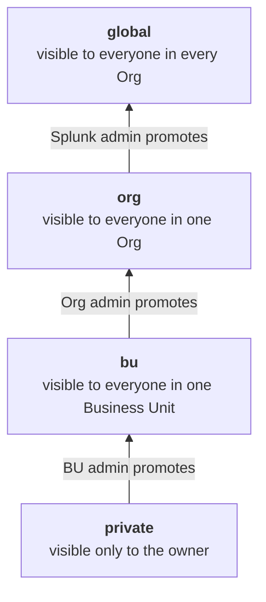

# Admin manual — Adjutant AI (formerly AI Workbench)

**App version:** 2.7.1
**Last updated:** 2026-10-12
**Audience:** Splunk users holding `admin`, `splunk_admin` **or** `sc_admin`
on the search head where this app is installed. Those three are the whole
list — `bin/itmip_llm_common.py` `ADMIN_ROLES` is the single source of truth,
and the browser UI mirrors it.

> **⚠️ If you administer Splunk Cloud, read this first.**
>
> `sc_admin` is the administrator role on Splunk Cloud — customers are not
> granted `admin` at all — and this manual has always said `sc_admin` belongs
> here. **Until 2.5.9 the UI did not agree.** The server accepted `sc_admin`
> everywhere (every handler gate, and all 100 `write :` ACLs in
> `metadata/default.meta`), but the browser checked only `admin` and
> `splunk_admin`, so a Cloud administrator passed every server-side check and
> was still shown the **end-user** app: no Playbooks, Skills, Knowledge, Input
> Sources, Unattended, Tokens & Costs, Orgs & BUs, Tools, Models, Audit,
> License or Backups tab. Two screens even said *"You need admin or sc_admin
> role"* to someone holding `sc_admin`.
>
> It also affected tenancy: the browser could class a Cloud admin as
> **unassigned** and grey the whole app out while splunkd considered them
> assigned — which reads as a broken install rather than a role problem.
>
> **Fixed in 2.5.9**, and pinned by an automated test so the two halves
> cannot drift apart again. **On any earlier build**, the
> workaround is to grant `admin` alongside `sc_admin`.

> **A note on this manual's currency.** The role model and the tab inventory
> below are correct for **2.7.0**. The rest of the document was last given a
> full pass at **1.8.0**, so individual sections may lag — where a subject has
> its own document (Tools, Models, Unattended, stateless operation,
> licensing), that document is newer and wins.

> **About this app — read first.** Adjutant AI is a *host shell*: a
> single-page React app that has **no use-cases of its own**. Every
> piece of functionality it offers (which governed agents appear, which
> LLMs are reachable, which tools the LLM may call, where saved
> searches / dashboards / alerts land) is fully derived from
> **(a) the Splunk app the user opened it from** and **(b) the Splunk
> roles that user holds**. End users should reach the assistant from
> within Search / ITSI / Enterprise Security / your custom or MSP
> customer apps via a nav-menu entry — they should **not** be pointed
> at the `itmip_ai_splunk_assistent_app` tile directly. The whole
> point of the Workbench is to deliver governed agents *inside other
> apps, for other users*, with all generated knowledge objects landing
> in those apps' namespaces. See
> [the installation guide, Deployment model](./installation.md)
> and the **Multi-Org namespace model** section below for the full
> rationale.

This document covers **only** the parts of the app that an admin sees
that an end user doesn't. For everything an end user sees (the Console
tab, History, Settings, attaching references, picking agents, the
guardrail behaviour), read [the user manual](../user/user-manual.md) first.

## Multi-Org namespace model: design assumption

Adjutant AI is designed to be **embedded in the navigation menu of
every Splunk app it serves**, not consumed as a standalone tile. The
expected install pattern:

1. Drop the app on the Search Head (and KVStore replication peers).
2. For each app that should expose the assistant — Search, ITSI,
   Enterprise Security, custom SOC apps, MSP customer apps —
   edit that app's `data/ui/nav/default.xml` to add a nav entry that
   opens the Adjutant AI dashboard.
3. **The calling app becomes the namespace.** When a user opens
   Adjutant AI from app *X*, every saved search / dashboard / alert /
   MLTK model the LLM creates is written into app *X*'s namespace,
   owned by the calling user. Switching to app *Y* and re-opening
   the same Workbench writes future artefacts into app *Y* instead.
4. **Adjutant AI resolves Org + BU automatically** from `(callingApp,
   userRoles)` against the Organisations + Business Units you
   configure on the Orgs & BUs tab. The user never picks Org/BU
   themselves — it's a property of "where they opened the assistant
   from + which roles they hold".
5. **Users who don't resolve into any Org see a greyed-out app + an
   admin-configured "ask your Splunk team" message** — they cannot
   accidentally fall into DFLT/DFLT and start running tools without
   tenancy. The message text comes from
   `[ui] unassigned_message` in `local/itmip_ai_workbench.conf`
   (default is generic; you should customise it with your actual
   contact instructions). The server enforces this too: every endpoint
   that reads or writes an Organisation's data answers such a user with
   HTTP 403 and the same message, so a direct REST call cannot reach
   DFLT/DFLT's data either.

Design rationale: the Workbench is one app, but the customer
experience is "governed agents *in* my SOC app", "governed agents *in* my
ITSI app", "governed agents *for* my MSP customer's Org", all
served by the same engine without operators having to remember which
namespace they're in. Splunk's namespace model handles the
artefact-routing for free; the Org/BU model handles per-Org
agent and tool visibility on top of it.

## Quick reference — what's admin-only

Listed in the order they appear in the tab bar, so you can read along with the
screen. **16 tabs in total**; the 13 below are admin-only, and Console, Settings and
Help are shared with end users.

| Tab | Purpose |
|-----|---------|
| Agents | CRUD on agents; promote `draft` → `operational`; clone across Org/BU; visibility scoping; **edit each agent's `includes_skills` list (0.9.6+)**; **see users' own private agents from 0.9.7+** (filter not yet in UI; they appear mixed with the agent templates). 90 agent templates ship as seeds: 65 ready and 25 in preview. |
| Skills (0.9.6+) | CRUD on the **Skills layer**: reusable "do-it-correctly" prose blocks that agents reference. Sits between agents and tools. 52 ship as seeds. See [the tools and agent templates overview, §3.5](./tools/tools-and-playbooks.md). |
| Knowledge | Manage knowledge entries + connectors. Live-platform connectors read the running instance's `searchbnf.conf` (command syntax) and installed visualizations to ground SPL/viz generation (1.4.0). Four sub-tabs: Connectors, Static rules, Curated entries, Learned Knowledge. (Integration State, Integration Runs and Mappings moved to Unattended in 2.7.0.) See the knowledge-layer guide. |
| Unattended *(2.x)* | The home for everything that runs unattended (page heading **Unattended runs**). Five sections: **Integrations**, **Agent jobs**, **Mappings**, **Input sources** (the sources an agent or integration may read from) and **All runs**. **Integrations** lists every integration with its sources, destinations, schedule and last run; opening one shows its flow (source → mapping → destination, drawn from the integration agent's contract and the mapping its run uses), its runs, its watermarks and its schedule, with **Run now** and **Edit schedule**. Two kinds of schedule: a **Scheduled Job** runs an agent and delivers a result (needs the `scheduled_job` capability, Professional+); a **Scheduled Integration** reads a source and writes a target (needs the **`data_integration`** capability, Enterprise and MSP, from 2.7.0). The integration branch is chosen by the type **or** by the bound agent's `integration` tag, so it cannot be booked as a cheaper agent job by relabelling. See the unattended runs and memory guide and the AI Driven Integration guide. |
| Tokens & Costs | Cost / token analytics, multi-group comparison, over-time charts. Greyed unless licence ≥ Professional. |
| Orgs & BUs | Org and BU CRUD. Cap-enforced by licence. |
| Tools | Four sub-tabs since 2.5.9: **Built-in tools** (enable/disable, per-tool metadata overrides, for all **196** of them), **Custom tools** ([the custom-tools guide](./tools/custom-tools-authoring.md)), **MCP servers** (registration, tool import, and per-tool expand + run for debugging), **ServiceNow** ([the ServiceNow guide](./integrations/servicenow.md)). Credentials for MCP and ServiceNow are settable **from the UI** — no backend trip to rotate one. **Full details in [the tool catalogue](./tools/tool-catalogue.md).** |
| Audit (1.3.0+) | Per-Org audit search / timeline / consent + governance log / CSV export. **Greyed unless licence ≥ Enterprise (moved from Professional in 1.4.1).** |
| License | Activate / validate / remove the Cryptolens licence; manage expiry-warning recipients. |
| Backups | Browse daily KVStore snapshots, inspect manifest + verification + referenced-credentials inventory per backup, trigger an out-of-schedule backup, and run a 3-step dry-run + acknowledge + commit **restore** (0.9.0+). Greyed unless licence ≥ Professional. |
| Models *(2.5.9)* | The model + price catalogue, where each price came from, discovery run history, **Refresh from providers**, per-row **Set price** and manual model registration. **This moved out of Settings in 2.5.9** — older screenshots show it there. Authoring needs `model_catalog_overrides` (Enterprise); the catalogue and run history are visible to any admin. See [the LLM model catalogue](./llms/llm-model-catalog.md). |
| Settings *(shared, with extras)* | Same surface as the user manual, plus central-scope LLMs, the connection **wizard** (**+ Add LLM**, **Edit** and **Open in wizard** are admin-only and are **not rendered at all** for anyone else), and the Customer authorisation hook toggle. |

**Help** is the one tab everybody has, admin or not, and it renders outside the
main panel — so it still works when the app is greyed out, which is when a user
most needs to report a problem.

End-user controls that admins also have:

- Asking questions, History (always enabled for admins since the
  licence-gating is on `effective_tier == "personal"` which doesn't
  apply to admin-served features), Settings for personal LLMs.

## Per-feature licensing

Up to 1.4.0 the licence tier gated a coarse handful of things (Orgs/BUs
caps, Tokens & Costs, audit). **1.4.1 replaces that with a per-feature
capability matrix.** Each feature declares the **minimum tier** it needs;
the server resolves the active tier to a full `{capability: bool}` map and
both refuses gated calls server-side **and** tells the frontend which
tabs / sections / agents to grey out. The split is deliberate:

- **Professional = operations** (the things a working ops team does).
- **Enterprise = security + integrations + governance + reliability**
  (the things a SOC / platform team and a procurement / compliance team
  scrutinise).

The matrix is server-authoritative and **fail-closed**: if the licence
state is in any doubt (expired, node-lock mismatch, vendor unreachable)
the effective tier collapses toward Personal and the gated features
disappear. Source of truth: `CAPABILITY_MIN_TIER` in
`bin/itmip_llm_license_tier.py`, emitted on
`GET /services/itmip_llm/license` as `capabilities`.

Licence checks read the licence from Splunk's credential store and reuse that read for up to 30
seconds in each Splunk process. A licence you add, change or remove applies immediately in the
request that made the change, and everywhere else within 30 seconds. A licence that cannot be read
is never reused: the check fails closed to the Personal tier until it can be read again.

### Which feature needs which tier

| Capability | Min tier | What it covers |
|---|---|---|
| `spl_generation`, `dashboard_generation` (Simple XML + Studio), `alert_generation` | **Personal** | Core authoring — every tier, including the free single-user trial. |
| `byok`, `multi_llm` | **Personal** | Bring-your-own-key and the multi-provider LLM picker — all tiers. |
| `knowledge_layer`, `skills_layer`, `template_authoring` | **Personal** | Knowledge, Skills and agent authoring, all tiers. |
| `ml_generation` | **Professional+** | MLTK `fit` workflows + CDTSM training/model promotion. |
| `history` | **Professional+** | Persisted history of Console runs. |
| `tokens_costs` | **Professional+** | Tokens & Costs analytics tab. |
| ~~`in_splunk_awareness`~~ *(deprecated 1.7.1)* | **All tiers** *(was Professional+)* | TrackMe feed-health + the `_internal` / Cribl ingestion-health **checks** — moved to all tiers in 1.7.1 (bounded only by Splunk role + index ACL). ES / ITSI **read**-context tools are gated by `security_workflows` (Enterprise), not this key. |
| `backups` | **Professional+** | Backups tab (daily snapshot browse + restore wizard). |
| `data_onboarding` | **Professional+** | Data Foundation **authoring**: config-package builder, props/transforms validators, Data Quality Score (**Live — shipped 1.5.0**). *(The ingestion-health **check** tools moved to all tiers in 1.7.1 — see `in_splunk_awareness` above.)* |
| `platform_ops` | **Professional+** | *Reserved: platform-operations agents and tools.* |
| `security_workflows` | **Enterprise+** | ES / ITSI / ATT&CK-hunt agents + ES / ITSI / SSE tools. |
| `mcp_servers` | **Enterprise+** | MCP server registration + tool import + invoke. |
| `custom_http_tools` | **Enterprise+** | Admin-authored custom HTTP tools. |
| `iam_gateway_hook` | **Enterprise+** | Customer authorisation hook (server-side dynamic headers). |
| `audit_logging` | **Enterprise+** | Audit tab + per-Org audit index config **(moved from Professional in 1.4.1)**. |
| `data_integration` | **Enterprise+** | The integration programme *(2.7.0)*: reconciliation, integration flows, Scheduled Integrations, the approval and stage views for blocked integration writes, and writes to a ServiceNow or stage destination. A pending write can still be **cancelled** without it. |
| `governance_logging` | **Enterprise+** | Governance change log (agent/tool/MCP/LLM-config changes). |
| `reliability_llm_ops`, `ai_activity_dashboard`, `llm_health_dashboard`, `multi_model_orchestration` | **Enterprise+** | `ai_activity_dashboard` gates the *Adjutant AI Behaviour Analysis* agent. The other three keys are reserved and gate nothing in 2.7.0. The LLM Health and AI Activity dashboards ship at every tier (admin roles only) and are not gated by these keys (see [the LLM reliability guide](./llms/llm-reliability.md)). |
| `multi_deployment` | **MSP** | Multiple Orgs across deployments. |

### Named licensable features — the second gating dimension

Alongside the tier capabilities above, a **second** gate exists: *named
features* carried in the Cryptolens `cryptolens_features` data object. A
named feature is granted only when **both** conditions hold:

- **access = edition-min AND feature-present** — the effective edition
  reaches the feature's minimum (`FEATURE_MIN_EDITION` in
  `bin/itmip_llm_license_tier.py`) **and** the feature is actually present
  on the license.

Presence is checked with dotted **`HasFeature(license, "a.b")`** notation
(replicated in pure Python), so a parent feature and its children are
addressable independently.

| Named feature | Min edition | Gates |
|---|---|---|
| `socplaybooks` | **Enterprise** | Security agent content for unattended runs (called the Backend Ask Service in earlier documents); composes with `security_workflows`. The feature keeps its original name. |
| `opsrunbooks` | **Professional** | Operations agent content. |
| `servicenow` (+ children `incidents` / `problems` / `events` / `changes` / `csdm`) | **Professional** | The **ServiceNow integration**: all REST tools, knowledge and agents, including the ITSM agents. The integration uses the flat parent today; the children are reserved for finer granularity. See [the ServiceNow guide](./integrations/servicenow.md). |
| `servicenow-mcp` | **Professional** | The ServiceNow **MCP transport** — a deliberate carve-out reachable at Professional **without** the Enterprise `mcp_servers` capability (a *generic* non-ServiceNow MCP server still requires Enterprise). Enforced by `servicenow_mcp_allowed()`. |

ServiceNow **tools** carry a `min_feature` tag (hidden unless the Org both
holds the feature **and** has an active connection —
"visible-only-when-configured"); ServiceNow **agents** carry a parallel
`required_feature` gate (server-enforced, fail-closed). As with tier
capabilities, downgrade **hides, never deletes**. Full reference:
the licensing reference, §7.1.

### What an admin / user actually sees when a feature is gated

The frontend greys the relevant tab / section / agent tile and shows an
upsell hint. **A greyed tab or agent is a licence gate, not a bug.** If a
gated call is reached anyway (direct REST, a stale UI), the server returns a
**403** with a plain message, e.g.:

- `MCP server integrations require an Enterprise license.`
- `Custom HTTP tools require an Enterprise license.`
- `The customer IAM gateway hook requires an Enterprise license.`
- `Machine-learning workflows require a Professional or higher license.`
- `Audit logging requires an Enterprise license.` *(`_apply_audit_fields`
  refuses to set an audit index without the `audit_logging` capability)*

Security / ES / ITSI / hunt **agents** below Enterprise, and ML
**agents** below Professional, simply do not render in the agent
picker in the Console (the same `dependent_apps` / capability filter that hides
agents whose app is missing).

### Downgrade behaviour — nothing is deleted

A downgrade (Enterprise → Professional, Pro → Personal, or an expiry that
flips the *effective* tier) **hides or refuses** the now-out-of-tier
features — it never deletes data. Saved MCP servers, custom tools, audit
config, history, and KVStore rows all survive; they reappear intact the
moment the licence is restored or upgraded. The only visible change is that
the gated tabs grey out and gated calls 403. See
the licensing reference for the full tier / capability reference and
the rights and roles reference for how this layers on top of
the admin / non-admin role model.

## Tab: Agents

An agent is a pre-tuned LLM prompt the app prepends to the user's
question. The app ships **67 agent templates** ready to use, plus 23 agent templates in preview
that only administrators see (see step 2 of [the installation guide](./installation.md)).

### Editing an agent

Click a tile, then **Edit**. The editor is a dialog with five tabs:
General, Prompt, Visibility, Routing & tools and Agent modes. Under the
title, one sentence says whether it is an agent template or an agent, and
what can start it. Only
**Cancel** or **Save changes** leave it; a click beside it, or Escape,
does nothing, so edits are never lost by accident.

- **General**: name, status (draft / operational), short description,
  its concise version, and response style. The two reserved roles
  (router, base guardrails) are here too.
- **Prompt**: the skills added before the prompt (in order), the prompt
  itself, and the question form put into the question box.
- **Visibility**: who can see and use it (see below).
- **Agent modes**: the ways the agent may be put to work. Each mode is a
  switch: **Triggered** (an alert, notable or episode calls it),
  **Scheduled**, **Integration** (its mapping and integration settings
  open inside this card) and **Published to MCP**. Each card says what the
  mode needs (for example unattended runs on, or a licence) and which
  alerts or schedules use the agent. With a mode off, a run that names the
  agent through that path is refused and recorded. With no mode on it stays
  an agent template, which people can still pick in the Console. The base
  guardrails are not an agent and have no modes.
- **Routing & tools**: how the agent is found, its skills, the tools
  the model may use, and the agents it may hand over to.
  - Every list shows what is **selected** first, with a count.
  - **+ Add** opens a searchable list of what is available, with each
    value's description and how often it is used.
  - Only tags and categories accept a new value you type.
  - Skills are numbered and can be reordered; the order is the order in
    the prompt.
  - The tools section starts with one line saying what the model gets.
    For example "Allowed: 12 of 196 tools", or "All tools (no
    restriction)" when nothing is chosen. Under it the tools are
    grouped by product. A tool is allowed when you tick it, or when it
    has a tag or category you listed. A tool under **Never offer these
    tools** is never offered, whatever allows it.
- Save. The system fields (creator, updated by, version) update
  automatically; the version bump keeps the seed refresh from reverting
  your edit.
- Agent templates with `version === 1` and creator `system` (unedited
  agent templates) refresh from the bundled seeds. Once you edit one, it sticks.

### Visibility: who can see and use an agent

The tab starts with one sentence, for example *"Shared with Org ACME,
all Business Units. Users need the role soc_analyst."*

| Setting | Effect |
|-------|--------|
| **Who can see it** | **Everyone**; **One Organisation** (that Org, every Business Unit); **One Business Unit** (that Org and BU); or **Only its owner**. An agent without a setting is visible to everyone. |
| **Organisation / Business Unit** | Shown for the two middle choices: the one Org (and BU) the agent is shared with. |
| **Required roles** | At least one of them must match the user. Administrators always qualify. None selected: every role. |
| **Required apps** | Every app listed must be installed and visible to the user, e.g. `SplunkEnterpriseSecuritySuite@>=8.0` for a minimum version. |

Who can see it is checked in the browser and again on the server (the
agent list and `splunk_get_use_case_template_prompt`), so a user
cannot fetch an agent's prompt just by knowing its name.

### Base guardrails and the router

- **Base guardrails**: the agent named `General` (`is_general = true`). Silently prepended to every
  question, and never pickable. Defines the safety boundary (no sexual / religious /
  political / racial / illegal / medical / financial-advice content;
  no key/prompt extraction; Splunk + AI-Toolkit topics only).
- **Router**: the agent named `Default` (`is_default = true`). Used when the
  user doesn't pick an agent. Calls
  `splunk_list_use_case_templates` then
  `splunk_get_use_case_template_prompt` to pick the right one.

A BU-scoped router overrides the Org-scoped router (the latter
overrides the global DFLT router).

### Clone across Org/BU

Open an agent, click **Clone to another Org/BU**, pick target
shorts. Creates a copy with status `draft` in the target scope. Edit + promote when
ready. The original stays untouched.

### Promoting draft → operational

Every agent template that is ready for use arrives **operational**; agent templates in preview
arrive as `draft`. An agent you create as `draft` is promoted by editing it and switching its status to `operational`.

### `includes_skills`

Every agent now carries an ordered list of skill names in
`includes_skills`. At LLM prompt-fetch time the runtime concatenates
each skill's body in front of the agent's own prompt body. That's
how a rule like "no emojis in dashboards" or "MLTK models must follow
the `aiworkbench` naming pattern" is enforced across the agents that
need it without copy-pasting prose. Skill names autocomplete from the
seeded skills + any custom skills you've created. The `general-output-style`
skill is silently injected by the runtime for every operational
agent that is not the base guardrails or the router. Do **not** list it
explicitly; that would inject it twice.

See [Tab: Skills](#tab-skills) below for skill CRUD details and
[the tools and agent templates overview, §3.5](./tools/tools-and-playbooks.md)
for the full 53-skill default catalogue plus the architecture diagram.

## Tab: Skills

Skills are reusable "do-it-correctly" prose blocks that agents
inject into the LLM prompt at fetch time. They factor cross-cutting
rules out of individual agents so each rule lives in exactly one
place.

**What admins do here:**

- **List** every skill: its title and name, status (ready, in preview or deleted), tags,
  categories, **Depending apps**, and **Used by** (how many agent templates include it; hover for
  their names). Search by name, title, tag or category.
- **View** a skill: its text and details as plain text. Close it with the **×** or **Close**.
- **Edit** or **+ New skill**: a dialog that closes only through **Cancel** or **Save**, and
  **Save** says what still needs fixing. Tags and categories are lists you add to from the
  values the skills already use (or a new one); **Depending apps** and **Depending tools** are
  picked the same way; **Organisation** limits the skill to one Organisation or Business Unit,
  or leave it empty for everyone. The skill's **name cannot change** once it exists: agents name
  the skill by it. The text is limited to 4000 characters. Saving keeps everything the dialog
  does not show, such as who owns the skill.
- **Delete** keeps the skill, marked deleted: agents that include it say in their instructions
  that it is missing, so the model does not pretend the rule ran. **Show deleted** lists it again
  with **Restore** and **Delete permanently**. Both deletes ask in the page first.

**Lifecycle**: identical to agents. The default skills are
seeded on first load with `creator=system`, `updated_by=system`,
`version=1`. Once you edit one, `version > 1` and the auto-refresh
on the next app upgrade leaves your edit alone. To revert to the
shipped default, **Delete** it, then **Delete permanently**, and the
seeder recreates it.

**Org/BU scope**: same as agents. `DFLT / DFLT` skills are
visible to every caller. Narrower scopes are visible to matching
callers + admins. See
the rights and roles reference, §7.4b.

**Skill dependencies**:

- `dependent_apps` — skill is silently dropped when an app is missing.
  E.g. `feed-health-verdict` carries `dependent_apps=[{name: "trackme"}]`
  and disappears from prompts in environments where TrackMe is not
  installed. The dropped-note tells the LLM why.
- `dependent_tools` — skill is silently dropped when a named tool is
  disabled for the resolved Org/BU. Used for skills that materially
  depend on a specific tool being callable.

> **Anti-pattern**: do not write rules into skill bodies that should
> live in agent prompts. Skills are for *cross-cutting* rules:
> things three or more agents would otherwise repeat. A rule only
> one agent uses belongs in that agent's `prompt_text`, not in
> a skill.

## Authoring & promotion model

End users can now author their own private agents via a
conversational Console flow (no YAML / JSON editing). The
companion sharing-and-promotion model adds a four-step ladder
on every agent and skill (`private | bu | org | global`),
with admin-gated promotion.

### The sharing ladder



Promote = move up. Demote = move down. Each step requires authority
on the **target** scope. End users author into `private` only; the
server forces `sharing=private` + `owner_user=<caller>` on every
write through `splunk_create_user_template`. Admins promote
privately-authored agents up the ladder via the Agents tab.

The server applies the ladder when it lists agents and skills: a
user receives only the rows their own Org, BU and user name allow,
worked out on the server from their roles. Administrators (`admin`,
`sc_admin`, `splunk_admin`) receive every row; the Console still shows
them only their own Org's. The agent and skill collections
themselves can be read directly (over the KV Store REST API or in a
search) by administrators only.

### End-user authoring flow (Console)

Two system agent templates ship out-of-the-box, both with
`sharing=global`, `creator=system`. They keep their original names:

- **Create your own agent**: the end user describes a use case in
  plain English; the LLM composes an agent and calls
  `splunk_create_user_template`.
- **Update your own agent**: the end user names one of their own
  private agents and a paragraph of what should change; the LLM
  composes a patch and calls `splunk_update_user_template`.

Both go through a Python REST handler that enforces:

1. **No policy switch.** There is no setting that turns end-user
   authoring off per Org or BU in 2.7.0.
2. **Quota**: 25 private agents per user. The number is fixed and
   cannot be changed per Org.
3. **Name uniqueness** — within `(owner_user)`, the handler appends
   `_v2` / `_v3` on collision rather than failing.
4. **Field shapes** — `name` matches `[a-z][a-z0-9_]*`,
   `short_description` ≤ 200 chars, `prompt_text` ≤ 8000 chars,
   `question_text` ≤ 2000 chars, user-facing fields ASCII-only (no
   emojis).
5. **Skill-reference visibility** — every skill in
   `includes_skills` must exist AND be visible to the caller AND
   `status=operational`. Unknown / invisible skills fail the call
   with a structured `errors[]` envelope the LLM can read + retry.
6. **Forbidden-content scan** — the prose-bearing fields cannot
   contain literals like `sharing=global`, `owner_user=...`,
   `is_default=true`, `is_general=true`, `creator: system`, or
   admin-role-elevation patterns. Hard reject (the LLM rephrases
   and retries within its 3-attempt loop).
7. **Server-forced fields** — `sharing=private`, `owner_user`,
   `owner_org_short`, `owner_bu_short`, `creator`, `updated_by`,
   `updated_at`, `version=1`, `is_default=false`,
   `is_general=false`, `status=operational`, `required_roles=[]`,
   `dependent_apps=[]` are all overridden regardless of LLM
   input. Override attempts surface in the response as
   `attempted_override_fields[]` AND in the audit row.

### Audit log — `itmip_authoring_changes`

Every create / update — success **or** failure — emits one row to
this admin-only KVStore collection. Query from SPL:

```spl
| inputlookup itmip_authoring_changes
| sort - timestamp
| table _time, action, by_user, object_name, attempted_override_fields, errors
```

Fields:

| Field | Meaning |
|---|---|
| `action` | `create` / `update` (the only two actions recorded) |
| `object_name` | the agent's name |
| `object_key` | the KVStore `_key` (empty on validation-rejected rows that never persisted) |
| `owner_user` | always the caller for create + update on private rows |
| `by_user` | the actor (same as owner_user for end-user flows) |
| `tenant_org` / `tenant_bu` | resolved at action time |
| `authoring_mode` | `llm_mediated`, the only value written in 2.7.0 |
| `attempted_override_fields` | JSON-encoded list of server-forced field names the LLM tried to set, plus `forbidden_content_in_<field>:...` markers for prose-level injection attempts |
| `errors` | JSON-encoded list of validation-failure messages, when applicable |

A user whose audit rows are frequently flagged with
`attempted_override_fields` is either pasting prompt-injection
content into the question_text inputs OR being targeted by the
content they're querying. Either way it's worth a follow-up
conversation.

### Widening a user-authored agent's scope

There is no promote or demote action, scope filter or authoring
policy page for user-authored agents. An admin who wants to make a
user-authored private agent available more widely edits the row
directly in the Agents tab's Edit modal:

1. Open the user-authored agent in the Edit modal.
2. Change `org_short` / `bu_short` to the desired scope (the
   `sharing` field will follow at read time via the dual-read
   mapper; see [the tools and agent templates overview, §2](./tools/tools-and-playbooks.md#2-tenancy-model--org--bu-scoping)).
3. Save. The row's `sharing` field is now derived to match the new
   Org/BU scope.

## Tab: Tokens & Costs

Available only when the licence ≥ Professional **and** the bootstrap
Anthropic key is stored centrally (so per-question telemetry is
written to the index).

### What's shown

- One card per selected group-by axis. The chip selector at the top
  lets you pick one or more of: App, User, Model, Provider, Org, BU,
  LLM configuration name.
- Each card has:
  - A stacked-area chart of cost over time (timechart spans auto-
    sized to the time range).
  - A table of token in / out / cache-read / cost-USD totals grouped
    by the axis.

### Where the data comes from

- Macro `ai_assistant_metrics_index` resolves by default to
  `index=main (sourcetype=ai_assistant_usage OR
  sourcetype=claude_assistant_usage)`. Customers in production
  typically override the macro in `local/macros.conf` to point at a
  dedicated index — see step 3 of
  [the installation guide](./installation.md).
- Events are written by the `/services/itmip_llm/usage_log`
  persistent handler (called by the React app at the end of every
  Console turn). Rate-limited to **120 writes/min/user** to prevent
  charts being skewed by spam.
- Cost is computed at write time from the per-model pricing in
  effect at that moment. A later pricing change won't retro-update
  historical events; you'll see a step in
  the cost chart at the deploy point.

### Known gaps

- **Personal-scope LLM configs produce no telemetry** by design
  (privacy / no-key-attribution trade-off). The panel header notes
  this. To get full attribution, route everyone through
  central-scope LLMs.
- The legacy v0.1 sourcetype `claude_assistant_usage` is still
  included in the macro so old events remain queryable; it'll be
  retired in v0.4.

## Tab: Orgs & BUs

Org / BU CRUD with **licence-aware caps**. The banner
at the top of the page shows your current limits:

| Tier | Orgs | BUs / Org |
|------|-----:|----------:|
| Personal | 1 | 1 |
| Professional | 1 | 3 |
| Enterprise | 1 | ∞ |
| MSP | ∞ | ∞ |

### Creating an Org

**+ Add Org** → pick a 1-4 char short (e.g. `ACME`), a name, a
description, **App patterns** (chip multi-select; supports wildcards
like `acme_*`), and **Role patterns** (chip multi-select; supports
wildcards like `acme_*_user`).

The dropdowns are seeded from your live Splunk inventory
(`/services/apps/local`, `/services/authorization/roles`,
`/services/authentication/users`).

A user's active **Org** is resolved per page load: the first Org
whose `app_patterns` matches the URL's current Splunk app AND whose
`role_patterns` intersects the user's roles wins.

### Creating a BU

Inside an Org, click **+ BU** → pick a 1-4 char short, a name,
optional **Extra roles** (added to the Org's role match), optional
**Extra users** (explicit user-name allow-list).

### Cap enforcement

Both UI and server enforce caps:

- Browser disables **+ Add Org** / **+ BU** when at cap.
- `POST /services/itmip_llm/tenancy` (the wrapper handler all writes
  go through) refuses with **403** when at cap. The browser surfaces
  the message verbatim ("License 'professional' allows up to 3 BU(s)
  per Org; 'ACME' already has 3.").
- An admin who bypasses the UI and POSTs directly to the KVStore
  collection CAN exceed the cap. Splunk's KVStore ACL is `admin /
  power write` so removing the escape hatch entirely isn't possible.
  The wrapper is the boundary for everyone using the app.

### Deletion behaviour

- `delete_org` cascades — every BU in that Org is also deleted, so
  no orphan rows.
- `delete_bu` removes only that one BU.
- Both operations are admin-only and idempotent (404 is treated as
  "already gone").

## Audit logging

> Full operator reference: [the auditing guide](./security/auditing.md).

Real audit logging records, per Org, **who sent what to which external LLM,
when, after what consent, and how often** — to a secured per-Org index — so
a disclosure of sensitive data to a public LLM is provably a *user action
after an explicit warning*, not an app fault.

> **Licence gate (updated 1.4.1):** audit logging — the per-Org **Audit
> logging** config section *and* the **Audit** tab — is now an
> **Enterprise+** feature (it sat at Professional through 1.4.0; the
> `audit_logging` capability moved to Enterprise in 1.4.1 alongside the
> other governance capabilities). Below Enterprise the config section is
> hidden and the Audit tab does not appear; server-enforced in
> `itmip_llm_tenancy._apply_audit_fields`, which refuses to set an audit
> index without the `audit_logging` capability and returns
> `Audit logging requires an Enterprise license.` on a direct call. See
> [Per-feature licensing (v1.4.1)](#per-feature-licensing) above.

**What you, the admin, must do (because the app never creates indexes):**

1. **Provision an audit index per Org.** On-prem, define an internal index
   in your own `indexes.conf` (e.g. `[_itmip_audit_DFLT]`) with **retention
   > 24 months** (`frozenTimePeriodInSecs`). On Splunk Cloud, create a normal
   index via ACS (lowercase, no `kvstore` substring), set retention there.
   See [the auditing guide, §4](./security/auditing.md) for copy-paste stanzas.
2. **Enter the index name** in **Orgs & BUs → edit Org → Audit index**.
   *Mandatory for every new Org.* **DFLT is NOT auto-configured** — until you
   set it, DFLT does no real audit logging (a banner reminds you).
3. **Pick the content mode** (mandatory, no default): `metadata_only` /
   `prompt_hash` / `truncated_prompt` / `full_prompt`. This decides how much
   of the user's input is stored. **Choose per your DPIA** — `full_prompt` is
   the strongest evidence but the heaviest data-protection exposure
   (verbatim, possibly special-category, >24 months). Attachment *names* are
   always logged regardless. **Saving `full_prompt` requires ticking a DPIA
   acknowledgement** ("we have assessed lawful basis + retention"), which is
   itself recorded in the audit.
4. **(Optional) Define an auditor.** Create a Splunk role and grant it
   `srchIndexesAllowed` on that Org's audit index, then add its name to the
   Org's **Audit role patterns**. That user then sees the **Audit** tab for
   their Org only. Admins see all Orgs. Reads run as the user, so Splunk's
   index ACL is the real boundary.
5. **Choose enforcement.** `enforce` = fail-closed (no audit write ⇒ no LLM
   call) and **requires `splunk_proxy`** (browser_direct is disabled for the
   Org — this makes enforce genuinely bypass-proof). `best_effort` allows
   browser_direct but those turns are lower-assurance.

**Reading the audit:** the **Audit** tab — search by user / time / LLM /
agent / wildcard over prompt+answer, with timeline, frequency, consent
log, governance log, and CSV export for legal hand-off.

**Honest limits to remember:** an internal `_` index is hidden from ordinary
users but **not** from a full admin; the integrity hash detects accidental
gaps, not a privileged-admin rewrite; only an off-box WORM/SIEM copy hardens
against that (optional, not built in). You are the data controller — set
retention, lawful basis and privacy notice per your DPIA.

## Unattended runs: enabling the agent runner

> Full operator reference: the unattended runs guide.

**Unattended runs** let you attach an operator-authored *agent*
to a native Splunk alert, an ES correlation search (notable), or an ITSI
episode policy, or fire it via REST, so the trigger launches an
**unattended AI investigation** with no human in the loop. Each run executes
server-side in the agent runner, a bounded Python process that gathers evidence, reaches a
validated structured verdict (the Investigation Result Contract), writes
back safely to the source object, and records the run in history + audit +
telemetry.

> **Ships DISABLED.** The engine is built and live-verified but the master
> switch is **`[agent_runner] enabled = 0`** out of the box. Nothing runs
> unattended until you deliberately enable it. The security agent content
> additionally rides the **`socplaybooks` named feature (Enterprise)** and
> operations content the **`opsrunbooks` feature (Professional)** — see
> [Named licensable features](#named-licensable-features--the-second-gating-dimension)
> above.

### Enabling the engine

The dispatcher modular input ticks on a poll interval but stays **inert**
until you turn it on. Enable it deliberately:

1. **Provision the telemetry index** (`itmip_ai_telemetry`) — the app ships
   no `indexes.conf`, so create it yourself (dev: `local/indexes.conf`;
   production: per your indexing policy). It holds the content-free
   pipeline-telemetry log.
2. **Set `email_admins`** (the (sc)admin escalation list for both-LLM-fail
   and backpressure events) and, if you use failover, **`llm_fallback_config_id`**.
3. **Set `[agent_runner] enabled = 1`** in `local/itmip_ai_workbench.conf`
   and **restart** splunkd.
4. The dispatcher then ticks every `poll_interval_seconds`, claims pending
   queue rows, and spawns at most `max_parallel` runner subprocesses
   cluster-wide.

To disable again, set `enabled = 0` (or remove the `local/` override) and
restart.

### Key `[agent_runner]` configuration knobs

All knobs live in `default/itmip_ai_workbench.conf [agent_runner]`; override
in `local/`. The selection below is the most operationally significant —
**see `README/itmip_ai_workbench.conf.spec` for the full schema** (~20 keys
including the runaway watchdog, LLM-failover, dedup, storm-detection and
per-Org history knobs).

| Knob | Default | What it controls |
|---|---|---|
| `enabled` | **0** | Master switch. Flip to 1 to run unattended (requires restart). |
| `max_parallel` | 2 | Max concurrent runners cluster-wide — the core platform-protection knob. A storm cannot spawn unbounded LLM processes. |
| `max_queue_depth` | 500 | Pending-row cap; beyond it the producer applies backpressure (logs + emails admins, never silent drop). |
| `poll_interval_seconds` | 5 | Dispatcher tick cadence. |
| `run_timeout_seconds` | 300 | Per-run wall-clock cap → `timed_out`, then retried/dead-lettered. Keep it above `llm_request_timeout_seconds`. |
| `max_turns` | 16 | Per-run tool-use turn ceiling. |
| `token_budget` | 200000 | Per-run token ceiling. |
| `runner_max_attempts` | 2 | Attempts before a failing run is **dead-lettered**. The knob that makes failure terminate — without it a crashing run would be retried forever. |
| `runner_max_memory_mb` | 2048 | Runner memory cap (RLIMIT_AS). Keeps the OOM killer away from splunkd: a runaway run fails instead of the platform. 0 disables. |
| `runner_max_cpu_seconds` | 120 | Runner **CPU**-time cap (RLIMIT_CPU) — not wall-clock; a run waiting on an LLM burns almost none. 0 disables. |
| `runner_nice` | 5 | Runner niceness, so unattended runs yield to interactive searches. |
| `llm_fallback_config_id` | (blank) | Ordered fallback LLM config(s) for primary→fallback failover. |
| `result_index` | main | Index for the safe structured-report write-back. |
| `email_admins` | (blank) | (sc)admin escalation list (both-LLM-fail, backpressure). |
| `telemetry_index` | itmip_ai_telemetry | Content-free pipeline-telemetry log. |

Runaway hard ceilings (`runner_max_llm_calls` / `runner_max_tool_calls`,
`runner_max_llm_calls_per_minute`, `runner_repeat_loop_limit`,
`runner_heartbeat_seconds` / `runner_stale_seconds`), SHC leadership
(`dispatcher_lease_ttl_seconds`), resilience (`dedup_mode`, `storm_detection` /
`storm_threshold`), and tenancy (`per_org_history`, `queue_mode`) are all
documented in the spec file and in
the unattended runs guide, §8.

> **Why these knobs and not `limits.conf`:** Splunk's `limits.conf` governs *searches*.
> An Adjutant AI run is a separate `splunk cmd python3` subprocess that no `limits.conf`
> stanza constrains, so the app governs it directly — `max_parallel` caps how many exist,
> and the runner caps its own memory/CPU/priority at startup. See
> the unattended runs guide, §5.1.

**When a cap cannot be applied.** Some operating systems refuse a runner's memory or CPU cap: macOS
refuses the memory cap, and Windows supports neither. The run still goes ahead, and the refusal is
recorded on the run's queue row as `resource_limits_not_applied` and in the runner log, so a run
that was not bounded as configured is visible rather than silent.

### Where unattended runs log

Scheduled and unattended runs log to `$SPLUNK_HOME/var/log/splunk/itmip_llm_agent_runner.log`, one
line per message, each with its run id. Splunk indexes the file into `_internal`, so a run's lines
are found with `index=_internal source=*itmip_llm_agent_runner.log* run_id=<run id>`. A runner that
fails before it starts logging writes to `itmip_llm_agent_runner_boot.log`. Both files are rotated by
size. The run's Splunk session key is never written to either file.

### Monitoring — two dashboards

Two app-nav dashboards are the daily drivers (they run in the app context
where the agent history lookup resolves):

- **Adjutant AI — Automation Outcomes** (`adjutant_ai_outcomes`) — *are the
  verdicts good?* Verdict distribution, **Runs by agent (last 30d)**, terminal-state mix,
  write-back outcomes, latency p50/p95, token cost, and the deferred/failed
  "needs attention" table. The analyst-agreement headline (with coverage
  beside it) activates with feedback capture.
- **Adjutant AI — Pipeline Knobs** (`adjutant_ai_knobs`) — *is the plumbing
  healthy and which knob to tune?* Every limit knob paired with its measured
  actual (latency↔timeout, depth↔`max_queue_depth`, runners↔`max_parallel`,
  tokens↔budget, deferrals / dead-letters / runaways, dedup suppressions,
  storm activity, tuning history). Enable `proactive_diagnosis_enabled` to be
  emailed a concrete recommendation when a knob nears its limit.

Pipeline telemetry is also queryable directly:
`index=itmip_ai_telemetry sourcetype=itmip:agent:telemetry`. Unattended runs write one
`event=agent_run` per run. Interactive questions write one `event=tool_step` per step of the
Tool calls panel when the question is saved to History, built from the same step record the
panel shows: ids, tool, kind, status, timings and parts, counts, sampling, attention ids,
effect, authorization outcome, retries and, for a model round, tokens and an estimated cost.
It never carries the tool's arguments, the SPL, the step's text or any output. See
the unattended runs guide, §9 and §10 for the symptom →
knob-to-tune table.

### Triggering agents: event, scheduled, REST, and MCP

An agent with status `operational` can be run unattended four ways. All go
through the **same** bounded, default-deny queue, so none gets more privilege than
an alert-triggered run. The engine must be **enabled** (`[agent_runner] enabled = 1`).

- **Event-triggered (entity-scoped).** Attach the **Adjutant AI: Run investigation
  agent** alert action to any saved search / ES correlation search (Adaptive
  Response) / ITSI episode action. The triggering search's first result row (e.g.
  `host`, `user`) is captured as the run's *source_context*, so an **MLTK-outlier
  alert investigates that host**. Set the agent's name in the **Agent** field (an agent whose Triggered agent mode is on) and (optionally) the bound
  fields and the permitted actions (`allowed_actions`) in the action's parameter form.
- **Scheduled (the morning health check).** A `cron_schedule` saved search whose
  result fires the alert action. Two **disabled** OOTB examples ship in
  `default/savedsearches.conf` (`Adjutant AI - EXAMPLE - Daily 08:00 health-check playbook` and
  `Adjutant AI - EXAMPLE - MLTK outlier triggers an Investigation playbook`; the searches and the
  `.param.playbook` parameter keep their original names): set `.param.playbook` to a real agent, adjust the search, then
  `disabled = 0` + `enableSched = 1`.
- **REST.** `POST /services/itmip_llm/agent/run` (admin) — for an external scheduler.
- **MCP (interoperability hub, 1.7.x).** Other AI agents can run your agents over MCP
  through four async fire-and-poll tools (renamed in 2.7.0 from `adjutantai_*_playbook*`; reconfigure
  any MCP client that used the old names): `adjutantai_list_agents(org_bu)`,
  `adjutantai_start_agent(org_bu, playbook_name)`, `adjutantai_get_agent_status(org_bu, run_id)`
  and `adjutantai_get_agent_results(org_bu, run_id)`. **OFF by default (1.7.1)** — set
  `[mcp_server] enabled = 1` in `itmip_ai_workbench.conf` and restart to turn it on. Two
  ways to reach the tools once enabled:
  - **Standalone Adjutant MCP server** — `POST /services/itmip_llm/mcp_server` (JSON-RPC
    2.0). Works on any Splunk. Authenticate with a standard Splunk **bearer/session token**.
  - **Inside Splunk's own MCP Server** (`/services/mcp`) — with `register_in_splunk_mcp = 1`
    the app auto-registers the four tools into `Splunk_MCP_Server` so they appear next to
    `splunk_get_info`. **Requires Splunk_MCP_Server 1.2+** (argument substitution); on 1.1.x
    the app holds back (logs to `sourcetype=itmip_llm_mcp_register`) and you use the
    standalone endpoint instead.
  **To publish an agent to MCP, switch on its Published to MCP agent mode** (**Agents** tab → **Edit** →
  **Agent modes**). Only agents with that mode on and visible to the Org/BU are listable and runnable. Every call names the
  **Org/BU** (e.g. `ACME/OPS`) as a safeguard (non-admin → own Org only). Running is
  **admin-only (v1)** and requires unattended runs to be enabled. Full setup + auth:
  **[the MCP server guide](./tools/mcp-server.md)**.

### Agent modes decide which agents may run unattended

From 2.7.0 each way of running an agent unattended needs the matching **agent mode** switched on
(**Agents** tab → **Edit** → **Agent modes**). An agent template with no mode on runs only when
someone picks it in the Console.

| How the run starts | Agent mode it needs |
|---|---|
| An alert, an ES notable or an ITSI episode action (including **Root-cause this episode**) | **Triggered** |
| A Scheduled Job | **Scheduled** |
| A Scheduled Integration | **Integration** |
| An MCP client | **Published to MCP** |
| An administrator's REST call, or a mapping verification run | none |

**A run whose mode is off is refused**, before the language model is called, so it costs no tokens.
It is never silent: the run is recorded as failed with the state `mode_refused` and the reason
*"the <mode> agent mode is off for this agent template"*, in the run history, in the audit trail
and in the platform audit log (`agent_run_refused`). A run that names an agent that does not exist
is refused the same way, with the reason *"agent template <name> not found"*.

**While unattended runs are off** (`[agent_runner] enabled = 0`), an alert or schedule that fires is
recorded as a refused run with the state `engine_disabled`: one record per alert or schedule per
hour, and a platform audit line every time it fires. An Adjutant AI alert or scheduled action that
names no agent is recorded the same way, with the state `no_template_configured`.

#### Upgrading to 2.7.0: agents already in use keep running

Before 2.7.0 the modes were not checked. So that nothing that worked stops, a one-time step switches
on the matching mode for every agent that is already in use. It runs on the first dispatcher tick
after unattended runs are enabled, before any run is started. An agent counts as in use when one
of these names it:
- an Adjutant AI alert or scheduled action on a saved search, enabled or not;
- the default agent of an Adjutant AI alert action;
- a storm fallback;
- a run in the last 30 days.

The step only switches modes on, never off, and runs once. If you switch a mode off later, it stays
off. Each change is in the platform audit log:

```
index=_internal source=*itmip_llm_audit.log* agent_mode_upgrade*
```

| Line | Meaning |
|---|---|
| `agent_mode_upgrade` | Modes switched on for one agent, with how many places name it. |
| `agent_mode_upgrade_conflict` | Nothing was changed for this agent: it is used both by a Scheduled Job and by a Scheduled Integration. Switching on one mode would change what the other runs as. Decide which it is and switch that mode on. |
| `agent_mode_upgrade_unresolved` | Something names an agent that does not exist. Its runs are refused as *not found*. |
| `agent_mode_upgrade_done` | The step finished; the counts are in the line. |
| `agent_mode_upgrade_deferred` | The step could not read what it needs, or could not save a change. No run is started until it succeeds; it tries again on the next tick. Queued runs wait. |

## Data Foundation

The 1.5.0 **Data Foundation** surface gives data-onboarding teams three
admin-relevant capabilities, gated by the **`data_onboarding`** capability
(**Professional+**, now Live — see the licensing matrix above):

- **Config-package builder** — assembles the inputs / props / transforms /
  index definitions for a new data source as a deployable config package.
- **Ingest-health check** — verifies a source is actually landing as expected
  (volume, lag, parsing).
- **Data Quality Score** — a scored read of how well a source conforms
  (CIM / field extraction / timestamping), so onboarding gaps are visible.

These appear as agents / tools in the Console when the `data_onboarding`
capability is unlocked; below Professional they do not render.

## Tab: Tools

The Tools tab is the catalogue of everything the LLM can call — built-
in Splunk tools (search, dashboards, ES / ITSI / TrackMe, MLTK), admin-
authored HTTP custom tools (since 0.4.0), and MCP server integrations
(since 0.7.0). It also lets you enable/disable tools per Org/BU,
override per-tool metadata (tags / category / short description), and
configure Org/BU-scoped credentials.

This is enough surface to warrant its own document — see
**[the tool catalogue](./tools/tool-catalogue.md)** for the full reference. Quick highlights:

- **The edit dialogs** (**Manage** on a built-in tool, a custom tool's editor and **Import JSON**, and an MCP
  server's editor) work like the LLM configuration Edit dialog. They are left only through **Cancel** or the
  save button: a click beside the dialog or Escape does nothing, so an edit is never lost by accident. Fields are
  grouped on tabs. A tab you changed says **changed**, a tab with a problem says **has errors**, and the save
  button stays disabled until something changed and every tab is valid, naming the tabs to fix. **Manage** has a
  **Metadata** and an **Availability** tab; **Reset to built-in defaults** puts the built-in metadata back in the
  dialog and **Save changes** applies it.

- **Built-in tools** are scoped per Org/BU via `Manage` rules
  (`Org+BU` > `Org+*` > `*+BU` > `*+*` > implicit-enabled).
- **Per-tool metadata overrides** (0.7.0+) live in
  `itmip_tool_overrides`; the runtime merges overrides on top of
  the hard-coded defaults at app-load time.
- **Custom HTTP tools** (0.4.0+) — pure JSON definitions, secrets in
  `storage/passwords` realm `itmip_llm_assistent_app`, allowed-hosts
  allowlist enforced AFTER template substitution, three-tier
  credential model (`global` / `per_tenant` / `per_user`) since
  0.7.0, optional proxy + TLS-CA fields.
- **MCP servers** (0.7.0+) — register an upstream MCP server, test
  the connection, import a subset of tools, refresh to detect drift.
  Streamable HTTP transport with SSE fallback. `stdio` rejected.
  **OAuth 2.1 (1.5.0+)** — for OAuth-protected MCP servers (e.g.
  ServiceNow Action Fabric / MCP Server Console) choose
  **Authentication type = OAuth 2.1**, register the shown redirect URI
  in your IdP, save, then click **Connect** on the server card. The
  Splunk backend is the OAuth client/token holder (auth-code + PKCE
  interactive; client-credentials / stored service-token unattended);
  tokens are encrypted in `storage/passwords` and never reach the
  browser. Rides the same Enterprise `mcp_servers` gate. Full guide:
  [the MCP OAuth guide](./tools/mcp-oauth.md).
- **ServiceNow connections** (1.7.0) — the dedicated ServiceNow integration
  (a built-in `servicenow` tool category: incidents, changes, problems,
  CMDB/CSDM with bounded relationship traversal, SIR security incidents,
  events). Add a per-Org connection under **Tools → ServiceNow connections**:
  pick the **transport** (direct REST or a ServiceNow MCP server), the
  instance URL / MCP server, the credential (`storage/passwords`, with the
  customer-auth hook for WebEAM-gated instances), the CSDM version, the CMDB
  **write allowlist** (default deny-all), the closed-incident policy, and,
  for a SecOps Org, `sir_enabled` plus (explicitly) the security agents.
  **Test connection** validates auth + detects the release. All connectivity
  is server-side; credentials never reach the browser; ServiceNow can never
  block the assistant. Gated **Professional + `servicenow`** (MCP rides the
  `servicenow-mcp` carve-out). Full guide: **[the ServiceNow guide](./integrations/servicenow.md)**.
  *(Needs a splunkd restart to register the route + collection.)*
- **SSE security-content tools** (1.2.0) — a `security-content` tool
  category (`sse_check_prerequisites`, `sse_list_content`,
  `sse_get_detection`, plus two enrichment stubs) reaches Splunk
  Security Essentials' detection catalogue — including real detection
  SPL — via SSE's public `sseanalytics` / `sseidenrichment` / `sselookup`
  commands. They only return content when SSE (and, for some content,
  the ESCU app `DA-ESS-ContentUpdate`) is installed and visible to the
  calling user, and are scoped per Org/BU like any other built-in. The
  former `sse-bridge` knowledge connector was retired in their favour.
- **Simple XML dashboard builder tools** (1.4.0) — a `dashboards-simplexml`
  tool category of seven route-unlocked tools (`splunk_xml_create`,
  `splunk_xml_add_input`, `splunk_xml_add_panel`, `splunk_xml_update_panel`,
  `splunk_xml_remove_panel`, `splunk_xml_preview`, `splunk_xml_publish`).
  This is now the default path for
  multi-panel dashboards: the LLM composes the dashboard via small typed
  calls rather than emitting one large XML blob, so big dashboards no longer
  truncate or mis-escape, and each panel can set its own `full_width` / `row`
  layout.
- **Customer-auth hook for IAM-gated targets** — `target_kind` is
  `"llm"` / `"tool"` / `"mcp"`. See
  [the customer authorisation hook guide](./security/customer-authorisation-hook.md).
- **Unified audit trail** in `itmip_llm_custom_tool_calls` covers
  custom HTTP tools AND MCP calls (`tool_kind` distinguishes them).

## Tab: License

Three cards.

### Current license

Shows the environment GUID, the active key (if any), tier,
effective_tier (downgraded if expired or node-lock mismatched),
badge, expiry date + days remaining, node-lock status, customer
name/email, and (when present) an **Activations** row listing every
machine the same key has been activated against.

Two buttons:

- **Re-validate** — re-calls Cryptolens (from the browser; falls
  back to a server-side call if the browser can't reach the vendor).
  Useful after the vendor extends an expiry.
- **Remove** — drops the stored response. The tier downgrades to
  Personal immediately. Asks for confirmation.

### Activate a new license

Paste the 25-character Cryptolens key, click **Activate**.

- The browser hits `api.cryptolens.io` directly so this works on
  air-gapped Search Heads.
- The browser POSTs the signed response back to splunkd which
  encrypts it in `storage/passwords`.
- The badge in the header updates immediately.
- For MSPs: repeat with the same key on each customer environment.
  Cryptolens tracks the activations centrally up to
  `maxNoOfMachines`.

### Expiry warning recipients

Add the email addresses that should be notified when the licence is
within 30 days of expiring. **Saving the list** creates (or updates)
a Splunk Enterprise saved alert named
`itmip_llm_license_expiry_warning`. Removing every recipient deletes
the alert.

How the alert fires:

1. `bin/itmip_llm_license_monitor.py` is a scripted input that runs
   every 6 hours (`default/inputs.conf`). Silent unless
   `expires_in_days ≤ 30`. When it fires, it emits one JSON event
   into the index pointed at by the `ai_assistant_license_index`
   macro.
2. The saved alert runs daily at 09:00 (cron `0 9 * * *`) and emails
   the recipient list if at least one expiry event landed in the
   last 7 days.

If you want to verify the pipeline before the threshold is crossed,
the saved-alert UI has a **Run now** button that dispatches an
immediate email if an event is in the index.

## Tab: Settings (admin-only extras)

Everything the user manual describes plus:

### Central-scope LLM configurations

You can create LLMs with `scope = central`. These appear in the LLM
picker for every user whose Org / BU / role intersects the config's
visibility, not just for the creator. Most enterprise installs run
this way so customers don't have to mint per-user API keys.

### TLS CA certificate (PEM)

For customers whose LLM endpoint presents a private corporate CA,
paste the PEM here. The Splunk proxy builds an `ssl.SSLContext` with
your `cadata=ca_pem` and passes it to `HTTPSHandler`. Browser-direct
mode ignores this — browsers use the OS trust store.

### Extra HTTP headers

Static key/value pairs added to every request. Use for header tokens
that don't expire (a static `X-Tenant-Id`, a customer-managed
gateway shared secret, etc.).

### Security confirmation prompt

Each LLM configuration carries a **"Show security confirmation before
sending"** checkbox. When on (the default for every new config),
users see a full-screen modal warning them that data is about to
leave the organisation:

- on the **first run** with that LLM in a browser session, AND
- every time the user **switches to** that LLM (so an admin's
  internal-LLM-then-external-LLM pivot can't slip past unnoticed).

Acknowledgement is per-LLM, per-session — a full page reload
re-prompts; the Console's Clear button does **not** reset it.

The default warning is a Splunk-Enterprise-specific message that
lists every data class that may leave (question text, SPL, search
results, dashboard XML, alert config, Splunk metadata).

You can override the message per LLM in the **Custom warning message
(optional)** field shown when the checkbox is on. Three placeholders
are substituted at render time:

- `{provider}` — provider kind label (e.g. "Anthropic", "OpenAI")
- `{endpoint_host}` — host portion of the LLM endpoint URL
- `{call_mode}` — `browser_direct` or `splunk_proxy`

Turn the checkbox off for trusted-network LLMs (on-prem Ollama,
private gateway, etc.) where the warning would just be noise. Leave
it on for everything cloud-hosted.

The bootstrap Anthropic config ships with the checkbox on.

### Customer authorisation hook (server-side dynamic headers)

Toggle on per LLM config — and only when `call_mode = splunk_proxy`,
since browsers can't run server-side Python. When the hook is enabled,
every outbound request runs through
`bin/customer_authorisation.py` (or your override at
`local/bin/customer_authorisation.py`) and merges the returned
headers in. Use this for endpoints behind WebEAM, Ping, Okta,
AzureAD, internal SAML — anywhere static headers aren't enough
because tokens expire and have to be re-minted.

See [the customer authorisation hook guide](./security/customer-authorisation-hook.md)
for the full function contract, the WebEAM-style worked example,
storing credentials in `storage/passwords`, caching pattern, and
security model.

## Tab: Settings (the LLM picker — admin power user notes)

When you add a new LLM config:

| Field | Notes |
|-------|-------|
| Name | Auto-suggested as `<Org>_<BU>_<provider>_<scope>`. Override only if you have a strong reason. |
| Provider | Determines which adapter wraps the call. Picking the wrong one is the #1 cause of "401 / wrong-format response" errors. |
| Model | Dropdown auto-populates from `available_models` for the provider. Pricing + speed hint visible inline. Falls back to a custom-text input if your model isn't in the canonical list yet. |
| Endpoint | Auto-fills from `PROVIDER_DEFAULTS`. Edit for Azure (per-deployment) or for internal gateways. |
| Call mode | `browser_direct` (no CORS for OpenAI / Azure / Groq / Gemini / Bedrock) or `splunk_proxy` (works for all, hides keys on the SH). Bedrock must be `splunk_proxy`. |
| Scope | `central` (visible to everyone matching the Org/BU visibility filters) or `personal` (only the creator). |
| Server-side proxy | When call mode = `splunk_proxy`, optional `http://host:port` for an outbound HTTP proxy on the SH. |
| Extra role patterns | Comma-separated list. Roles outside the Org's role_patterns that should also see this LLM. |
| Extra user names | Comma-separated. Specific Splunk users to allow. |
| Default model | Per-config default the Console uses unless the user picks another. |

After save, the modal asks for the **secret value** (API key, access
token, Bedrock access key id). It's stored in `storage/passwords`
under the realm `itmip_llm_assistent_app` and the name
`<llm_config_id>` — encrypted at rest by Splunk.

See the supported-LLM matrix for the per-provider
field mapping (endpoint shape, auth header name, CORS reality,
streaming support, recommended models).

## Tab: Models (prices and registered models)

The Models tab lists every model Adjutant knows, with its price and where the price came from. The
prices drive the estimates on Tokens & Costs. Any administrator sees the catalogue and the discovery
history; setting prices and registering models needs Enterprise (`model_catalog_overrides`).

All prices are **US dollars per 1 million tokens**. The **input price** is what is sent to the model:
the request, the instructions and the tool results. The **output price** is the text the model
writes. Both dialogs show a worked example as you type, for example "A round with 70,000 input and
300 output tokens costs about $0.215."

### Set price

**Set price** on a catalogue row opens the dialog with that model filled in; **+ Set price** under
*Price overrides* opens it empty. The dialog closes only through **Cancel** or **Add override**
(**Save override** when you edit one). Its fields:

| Field | What to give |
|---|---|
| Provider | The provider the price applies to. |
| Model id | Exactly as the provider reports it. Prices this one model or deployment. |
| Underlying model | The provider's model name behind deployments (for example on Azure). Prices every deployment of it. Give this, the model id, or both. |
| Input price / Output price | Both are required, 0 or more. |
| Reason | Kept in the audit trail, for example where the price comes from. |

An override outranks every other price source, and discovery never replaces it. **Edit** and
**Delete** are on each row of *Price overrides*; Delete asks first.

An override saved before 2.7.0 without prices is stored as 0 / 0 and makes every run on that model
count as free. The list shows it as **0 / 0 (free)** with a note; edit it and give both prices.

### Register model

**+ Register model** under *Registered models* adds a model that discovery cannot see, such as a
private gateway or a self-hosted deployment. Discovery and shipped packs never overwrite it. The
dialog closes only through **Cancel** or **Register**. Give the provider and the model id, a display
name if you want one, and either both prices or neither (the model is then listed with its price
unknown).

**Classes** are checkboxes. Two of them change which model is picked when nothing is chosen:
**Safe default** (the model an unattended run uses for the provider; give it to one model per
provider) and **Balanced** (the cheapest balanced model is picked). The others (Cheap, Premium,
Reasoning, Large context, Local, Private, Vision) describe the model. A class the list does not know,
kept from an older row, is shown as "other: <name>" and saved back unchanged.

### What the server refuses

The dialog disables its button and says why; the server applies the same rules and returns the same
words:
- a price that is not a number, or is negative;
- a price override without both prices;
- a registered model with only one of the two prices;
- a price override with neither a model id nor an underlying model.

The server also accepts a class it does not know, for older rows, and writes one warning to
`splunkd.log` per save naming it.

## CDTSM (Cisco Deep Time Series Model) — admin setup

CDTSM is Splunk AI Toolkit's pre-trained, generative time-series model
(feature preview, MLTK 5.7.3+). Adjutant AI ships three agent templates that
drive it — **Smart Forecasting**, **Anomaly Detection**, **Predictive
Alerting**. It is an **integration, not a reimplementation**: the model
and the `apply CDTSM` command live in AI Toolkit; this app only
orchestrates them (3 agent templates + 1 skill + 1 read-only tool, all
frontend — **no new REST handler, KVStore collection, or egress**).
Architecture: [the CDTSM forecasting guide](./integrations/cdtsm-forecasting.md) §8.

**Unlike the other AI-Toolkit agents, CDTSM creates no models**. There
is nothing to share and nothing to clean up in the section below. Saved
searches follow `cdtsm_<purpose>_<thing>_aiworkbench_v<N>`.

### What you must provide

| Requirement | Splunk Cloud | On-premise (Enterprise) |
|---|---|---|
| AI Toolkit | `Splunk_ML_Toolkit >= 5.7.3` installed | same |
| Model host | Splunk-hosted GPUs (no setup) | a customer-run open-source **CTS server** |
| Caller capability | `list_tokens_scs` | n/a |
| Rate limit | ~50 req/min (beta, AI-Toolkit-managed) | your CTS server's capacity |

If MLTK is absent or < 5.7.3 the three agents simply do not appear in
the picker (they declare `dependent_apps = [{Splunk_ML_Toolkit, 5.7.3}]`).
**Predictive Alerting** additionally requires the caller to hold `power`
or `admin` (it creates a scheduled alert).

### On-premise setup (one time)

On-prem `apply CDTSM` silently falls back to the Cloud provider — and
fails — until MLTK is pointed at a local model server. Two halves, both
required:

1. **Run the open-source CTS server**
   (https://github.com/splunk/cisco-time-series-model) — a FastAPI service
   exposing `GET /health` and `POST /cdtsm/v1/ai/infer`.
2. **Point MLTK at it** in
   `$SPLUNK_HOME/etc/apps/Splunk_ML_Toolkit/local/mlspl.conf`:
   ```ini
   [CTSM]
   self_hosted_cdtsm_endpoint = http://<host>:8080/cdtsm/v1/ai/infer
   ```
3. **Store the server's bearer token** (it returns HTTP 401 otherwise) in
   `storage/passwords`, realm `aitk_fm_tokens`, name `CDTSM_AUTH_TOKEN`:
   ```bash
   curl -k -u admin https://localhost:8089/servicesNS/nobody/Splunk_ML_Toolkit/storage/passwords \
     -d realm=aitk_fm_tokens -d name=CDTSM_AUTH_TOKEN --data-urlencode password=<TOKEN>
   ```
   `--data-urlencode` matters — plain `-d` turns `+` into a space and
   corrupts the token. **No splunkd restart needed**; MLTK reads it at
   search time. Full runbook: [the CDTSM forecasting guide](./integrations/cdtsm-forecasting.md) §3–4.

### Verifying it

- Run the read-only **`splunk_check_cdtsm_availability`** tool (from the
  Console): it reports MLTK version, deployment kind, `list_tokens_scs`,
  and the on-prem endpoint config in one structured answer.
- Or prove the model directly in Search:
  `| inputlookup internet_traffic.csv | apply CDTSM bits_transferred forecast_k=384 show_input=f`
  → expect `predicted(bits_transferred)` + band columns. A Cloud-fallback
  error on-prem ⇒ the `[CTSM]` endpoint is unset; HTTP 401 ⇒ the token is
  missing/wrong.

### Operational notes

- Each forecast proof dashboard runs an extra short **backtest** search (a
  second `apply CDTSM` call with a holdback) to prove accuracy — factor it
  into the ~50 req/min beta budget; keep CDTSM scheduled searches off
  minute cadence.
- The agents pin a TrackMe feed-health header when TrackMe is installed
  and omit it cleanly when it is not.

## Auditing AI-Assistent-created MLTK models

The AI-Toolkit agents train models in the calling user's current
app and then call a privileged server-side handler
(`/services/itmip_llm/mltk_share`) to promote each model's lookup-
table-file to `owner=nobody, sharing=global`. This means:

- A normal `user` or `power` role can use the AI-Toolkit agents
  end-to-end without holding `admin_all_objects` — the privileged
  handler does the share on their behalf.
- The handler refuses any model name that doesn't match
  `^mltk_[a-z]+_[a-z0-9_]+_aiworkbench_v\d+$` (the literal `_aiworkbench_v<N>`
  suffix), so it cannot be used as a generic "promote-anything-globally"
  backdoor.
- Every successful share writes one row to the **`itmip_llm_mltk_models`**
  KVStore collection (read by `*`, write by `admin/sc_admin`).

### Find every AI-Assistent-created model on this SH

```spl
| inputlookup itmip_llm_mltk_models
| table model_name, host_app, created_by, created_at_epoch, template,
        description, last_shared_at
| eval first_created = strftime(created_at_epoch, "%Y-%m-%d %H:%M:%S")
| eval last_shared    = strftime(last_shared_at,   "%Y-%m-%d %H:%M:%S")
| sort -last_shared_at
```

### Tail the audit log

Promotions surface as structured lines in `$SPLUNK_HOME/var/log/splunk/splunkd.log`:

```
itmip_llm_audit action=mltk_share user=alice model=mltk_outlier_disk_temp_aiworkbench_v1 app=search promoted=1 failed=0
```

Grep / wire a saved alert:

```spl
index=_internal sourcetype=splunkd "itmip_llm_audit action=mltk_share"
| rex "user=(?<user>\S+) model=(?<model>\S+) app=(?<app>\S+) promoted=(?<promoted>\d+) failed=(?<failed>\d+)"
| stats count by user, app
```

### Cleanup: remove old AI-Assistent models

```spl
| inputlookup itmip_llm_mltk_models
| where created_at_epoch < relative_time(now(), "-90d@d")
| table model_name, host_app
```

Then for each row: delete the lookup-table-file via
`| rest /servicesNS/nobody/<host_app>/data/lookup-table-files/__mlspl_<model_name>.csv method=DELETE`
(repeat for `.mlmodel` / `.onnx`), and drop the registry row via
`| outputlookup` or the KVStore REST DELETE.

### Capability prerequisites

End users still need MLTK's own `apply_ml_command` /
`apply_ai_commander_command` capabilities to run `fit` / `apply` /
`ai`. The AI-Assistent share handler **does not** elevate those — it
only elevates ACL writes for files matching the `aiworkbench` pattern.
Grant the MLTK capabilities to the roles that should be able to
train models via the agents.

## The Tool calls panel: what administrators should know

Every Ask question shows a **TOOL CALLS** panel with each step, its live progress, and
**Stop** and **Cancel search**. The user manual describes it ("The Tool calls panel").
For administrators:

- **No setting.** Every user sees the panel; it cannot be switched off. Two tabs of a
  step's details, **Splunk job** and **IDs**, and the **Trace view** are shown only to
  administrators and to roles with the `adjutant_trace_view` capability.
- **Trace view.** Every step of the question on one time axis, with a search's queued,
  running and fetch parts; steps that ran at the same time are marked with a bracket.
  Columns give the start, the duration, the status, a model round's tokens in and out,
  a search's events read and rows, and what reached the model. *Attention only*, *Splunk
  only*, sorting by start or by duration, and **Export** (the step records as JSON: ids,
  timings, statuses, counters and SPL, never the tools' input or output).
- **Job Inspector.** The **Splunk job** tab opens Splunk's Job Inspector in its own
  window while the job exists. Splunk keeps Adjutant's search jobs for 10 minutes; after
  that the tab says so and offers **Run again in Search** (a new run) instead.
- **Model timings.** For a connection that goes through the Splunk proxy, a model round's
  Timing tab shows the provider call as the proxy measured it, the proxy's own overhead
  (derived), and the network time to the provider when the provider reports its processing
  time (OpenAI and Azure do); otherwise it says *not measured*.
- **Ollama.** Before each model round on an Ollama connection, Adjutant asks the Ollama host
  which models are loaded (`GET /api/ps`, two seconds at most, through the proxy when the
  connection is proxied). When the model was not loaded, the round is marked *Model was not
  loaded; this round included loading it*. The load time itself is not measured.
- **Thresholds.** The two-minute prompt on a long search (**Keep waiting** /
  **Cancel search**) is built in. The `Slow: …` note follows each tool's usual time once
  there is one: the health sweep computes the median and 95th percentile per tool from the
  last 14 days of `event=tool_step` telemetry, where there are at least 20 samples, into the
  KV collection `itmip_step_baselines`. Model rounds are grouped by the model family the
  provider reports (for example `gpt-4o`), or by provider type when it reports none, never by
  the model or deployment name you configured; every user can read this collection. A step is then
  *Slow* at twice its 95th percentile and at least 5 s, and the note gives the usual time.
  Without a baseline the fixed thresholds apply: 20 s for a search, 30 s for a model round,
  15 s for any other step. None of these can be configured in this release.
- **Nothing is cancelled for the user.** A search is only cancelled when the user
  presses **Cancel search** or **Stop**. **Stop** does not undo anything: an object
  already created stays. A stopped question is recorded as cancelled, never as answered.
- **Search slots.** The app runs at most three of one user's searches at the same time,
  and fewer when the user's roles allow fewer concurrent searches (one less than the
  role's search quota, at least one). Extra searches wait, and the step reads
  *Waiting for a free search slot*. Raise the role's search quota (`srchJobsQuota`) if
  users wait here often.
- **After the fact.** Opening a past question from History shows its panel again, from
  the steps stored with it. Rows saved by a release before this one have no panel. A
  support bundle's `timeline.json` also lists every step of every run with its start
  and end.

## Domain Workspace model edits after upgrading to 2.7.0

From 2.7.0, an edit an administrator makes to a Domain Workspace model (a panel, a knowledge
entry, a tab or a perspective) belongs to one Organisation. Users in that Organisation see it;
users in every other Organisation see the model as shipped, or their own Organisation's edit.
An edit is saved into your own Organisation unless you name another one.

Saved and published searches built from a model are shared by every Organisation, so they are
always built from the model as shipped, never from one Organisation's edits.

### What happens to edits made before 2.7.0

Edits made before 2.7.0 did not record an Organisation. The first time a model is read after the
upgrade, Adjutant AI counts the rows in the Organisations list, **including the default
Organisation (DFLT)**:

- **Exactly one Organisation:** every earlier edit is copied to it. Nothing for you to do.
- **Two or more Organisations:** every earlier edit is **held**. A held edit is shown to nobody:
  users see the model as shipped until you decide where the edit belongs.

The earlier edits themselves are never changed or deleted by the upgrade, and an edit an
Organisation has already made in 2.7.0 is never overwritten by an earlier one. The check runs
once per model, and again only for an earlier edit that has changed since.

Each run is written to the platform audit log (`itmip_llm_audit.log`):

```
workspace_overlay_migrated model=<model id> version=1 orgs=<count> legacy=<n> assigned=<ORG:n|-> held=<n> skipped=<n>
workspace_overlay_held model=<model id> id=<sub-item id> overlaid_by=<user>
```

A `workspace_overlay_migration_failed` line means the check could not complete. Users still see
the model as shipped plus any edits already copied, and the check is tried again on a later read.

### Resolving held edits

In 2.7.0 held edits are resolved through the REST endpoint below; a screen for this follows in a
later release. Every call needs an administrator role (`admin`, `sc_admin` or `splunk_admin`), and every
decision is written to the audit trail as `workspace_overlay_migration`.

**List the held edits of a model:**

```
curl -k -u admin https://localhost:8089/services/itmip_llm/workspace/overlay_migration \
  -H 'Content-Type: application/json' \
  -d '{"model_id": "<model id>", "action": "status"}'
```

The reply gives the number of Organisations, the outcome per earlier edit (`assigned:<ORG>`,
`held` or `discarded`), and for each held edit its sub-item `id`, `kind`, `overlaid_by` and
`overlaid_at`.

**Give a held edit to one Organisation:**

```
curl -k -u admin https://localhost:8089/services/itmip_llm/workspace/overlay_migration \
  -H 'Content-Type: application/json' \
  -d '{"model_id": "<model id>", "action": "assign", "id": "<sub-item id>", "org": "<ORG>"}'
```

**Give a held edit to every Organisation:**

```
curl -k -u admin https://localhost:8089/services/itmip_llm/workspace/overlay_migration \
  -H 'Content-Type: application/json' \
  -d '{"model_id": "<model id>", "action": "assign", "id": "<sub-item id>", "org": "*"}'
```

> **Warning:** `"org": "*"` shows the edit to **every** Organisation, including ones it was never
> written for. That is how releases before 2.7.0 behaved, and it is the exposure 2.7.0 removes.
> Use it only when you know the edit is meant for all of them. An Organisation that already has
> its own edit of that sub-item keeps its own; the reply lists, per Organisation, `assigned` or
> `conflict`.

**Discard a held edit:**

```
curl -k -u admin https://localhost:8089/services/itmip_llm/workspace/overlay_migration \
  -H 'Content-Type: application/json' \
  -d '{"model_id": "<model id>", "action": "discard", "id": "<sub-item id>"}'
```

Discarding deletes the earlier edit. It is the only action that removes one, and it cannot be
undone except from a backup.

## Operational runbook

### Adding a new Org

1. Org & BU first (Orgs & BUs tab).
2. Provision the central LLM config(s) for that Org / BU (Settings).
3. Clone or scope agents the new Org should see (Agents).
4. (Optional) Disable tools the Org shouldn't have (Tools).

### Licence renewal

1. License tab → **Re-validate** to confirm the vendor agrees the
   licence is still live.
2. If renewed (expiry pushed out), the badge updates automatically.
3. If the licence was upgraded (Pro → Enterprise → MSP), the
   tier-aware caps lift on the next page load.

### Switching LLM provider for an Org

Add the new LLM config first; mark it default if appropriate. Let
users transition; remove the old config when traffic has migrated.
Tokens & Costs preserves the historical attribution.

### Customer auth hook failure

If users start seeing **"customer_auth hook failed: …"** in their Console
panel:

1. Tail `$SPLUNK_HOME/var/log/splunk/splunkd.log` for
   `customer_authorisation hook raised`.
2. Reproduce with the CLI tester:
   ```bash
   $SPLUNK_HOME/bin/splunk cmd python \
       $SPLUNK_HOME/etc/apps/itmip_ai_splunk_assistent_app/local/bin/customer_authorisation.py
   ```
3. Fix the corporate-IAM flow and reload the app.

### Macro override on a non-default index

See step 3 of [the installation guide](./installation.md).
Both macros (`ai_assistant_metrics_index`,
`ai_assistant_license_index`) must be overridden in lock-step with
`local/inputs.conf` and (if changed) the saved alert. Out-of-sync
overrides are the #1 cause of "Tokens & Costs shows no data" and
"licence-expiry alert never fires".

## Backup & restore

v0.8.0 ships an enterprise-grade backup subsystem with two
independent recovery tiers, both stored as normal Splunk indexed
events (i.e. inside Splunk's own durability domain — so a KVStore
wipe leaves them untouched).

### Indexes you must create (the app ships none)

The app deliberately ships **no `indexes.conf`** — a static index definition
fails Splunk Cloud vetting, and you should own index sizing/retention. Before
the backup subsystem can write, **create two EVENT indexes** (Settings →
Indexes, or on your index-cluster master):

| Suggested name | Holds | Suggested retention |
|---|---|---|
| `itmip_snapshots` | Daily snapshots, manifests, verification, diagnostic ticks | ~24 months |
| `itmip_changes` | One event per KVStore POST/DELETE on a tracked collection | ~60 days |

The names are **configurable** in `local/itmip_ai_workbench.conf` `[indexes]` —
the whole app (backup, change-log, restore, and the Backups tab) reads the
names from there, so one edit re-points everything:

```ini
[indexes]
snapshot_index = itmip_snapshots   # rename to your own index if desired
changes_index  = itmip_changes
```

If you rename an index here, **create the matching index** and restart/reload
Splunk. An invalid name silently falls back to the suggested default. (The
`itmip_snapshots`/`itmip_changes` names below are the suggested defaults.)

**Until the indexes exist, the app stays fully functional — only backups are
paused.** The Backups tab shows the live configured index names and a red
warning banner listing exactly which index is missing; the backup scripted
input no-ops with a warning in `splunkd.log`
(`snapshot index '<name>' does not exist — backups are PAUSED`), and the
change-log write is skipped best-effort with a matching log line. Nothing else
in the product is affected.

### What's covered automatically

| Tier | What gets written, when |
|---|---|
| **Continuous change log** (`changes_index`, default `itmip_changes`, ~60-day retention) | One event per successful POST/DELETE on every backed-up collection. Lets restore replay forward from a snapshot to any timestamp. |
| **Daily snapshot** (`snapshot_index`, default `itmip_snapshots`, 30/26w/24mo retention) | Full per-row snapshot of every backed-up collection (below). Manifest with SHA-256 per collection. Verification pass. Referenced-credentials inventory. |

**What is backed up** — Adjutant's own collections:

- **Configuration:** Organisations and Business Units, model connections and price overrides,
  tool assignments and overrides, agents and skills, custom tools, MCP servers and their tools,
  the licence, ML models, the knowledge layer (connectors, entries and rules), scoring
  configuration, input sources and collectors, and the content-pack state.
- **History and audit:** user history, the authoring audit log, agent feedback and tuning
  suggestions, template runs and model-call attempts.
- **Per-Organisation data:** memory (including each integration's resume position), mappings,
  the reconciliation stores, the record of verified ServiceNow relationship types, and each
  Organisation's edits to Domain Workspace models.
- **Operational state:** integration receipts, the ServiceNow ownership and safeguard ledgers
  (which ServiceNow records an integration owns, and every authority check it ran), the
  network-policy store and its ledger, RCA runs and their state, fraud entities and readiness, and
  the model-catalogue marker.

**Not backed up:** destinations you chose for an integration (see below), the queue of runs in
progress, the per-Organisation run history (only written when that option is turned on), and the
custom-tool call log (an audit log you can mirror with SPL if you need it kept).

### What is NOT covered by the KVStore backup

**What your integrations write to your own destinations is not backed up.** **Run backup now**
and the daily snapshot cover Adjutant's own collections only (listed above). The records an
integration writes to a destination you chose for it — a KV Store collection named in its
mapping, an index or an external system — are not in any Adjutant backup, and a restore does not
bring them back. They are rebuilt from their sources instead. (Adjutant's own stores that an
integration writes to, such as the network-policy store, are backed up.) An
integration that reads its source in full on every run needs nothing more than its next run. For
an integration that reads only what changed, open its **Integration State** panel, choose
**Force resume** on the resource, replace the whole value with a time before the data that was
lost, written as `YYYY-MM-DD HH:MM:SS` (for example `2026-10-01 00:00:00`), and **Save**; the next
run reads every record changed since that time. If you need a copy of a destination itself, include it in your own Splunk backup.

`storage/passwords` (LLM API keys, tool credentials, MCP credentials,
proxy credentials, TLS CA blobs, Cryptolens license blob) lives
outside KVStore by design. The v0.8.0 daily backup writes a
**referenced-credentials inventory** event that lists the names of
every credential referenced by the snapshotted configs, plus a
`present_at_backup_time` boolean per name. After a restore the admin
reads the inventory and re-creates the secrets in `storage/passwords`
(REST API or CLI). There is no cleartext secrets backup: setting
`secrets_backup.mode = cleartext_restricted` in
`itmip_ai_workbench.conf` still writes only the inventory, with a
warning.

`$SPLUNK_HOME/etc/auth/splunk.secret` should be backed up by the
infra team out-of-band — that's Splunk's own documented practice and
is the only thing that lets existing on-disk passwords be decrypted
after an SH replacement.

### Tuning knobs (install-time only)

All knobs live in **`default/itmip_ai_workbench.conf`
`[kvstore_backup]`**. NOT in `app.conf`, NOT exposed in the Web UI.
Override via `local/itmip_ai_workbench.conf` (self-hosted: deploy the
file via the deployer; Splunk Cloud: include `local/` in the uploaded
app bundle). No `server.conf` SHC replication shim is needed — bundle
replication handles distribution. Key knobs:

| Key | Default | Notes |
|---|---|---|
| `enabled` | `1` | Toggle requires Splunk restart. |
| `daily_time` | `02:00` | Local time HH:MM. |
| `emission_mode` | `best_effort` | or `mandatory` (zero-loss audit). |
| `retention_critical_days` | `30` | Daily-snapshot window. |
| `retention_critical_weekly_weeks` | `26` | Sunday backups kept ~6mo. |
| `retention_critical_monthly_months` | `24` | 1st-of-month backups kept ~2yr. |
| `retention_history_days` | `14` | `itmip_user_history` retention. |
| `secrets_backup.mode` | `inventory_only` | Option A. Option B (`cleartext_restricted`) reserved. |

See `README/itmip_ai_workbench.conf.spec` for the full schema.

### The Backups list and Detail

Each row of the Backups list shows when the backup ran, the app version, the collections and rows it
holds, whether its verification passed, and the secrets the backed-up settings use. A backup never
holds secret values, only their names. When some are not stored on this Splunk, the row says so in
amber, once per secret: for example *"1 not stored on this Splunk: splunk_o11y_apm_token (used by 12
items). A restore elsewhere needs it re-entered."* Twelve custom tools that use one token are one
secret to enter, not twelve. This is a note for restoring, not a fault in the backup: the
verification column is separate.

**Run backup now** asks for confirmation in the page, then runs in the background; the page shows
its progress.

**Detail** opens one backup, read-only. It closes only through the **×** at the top or **Close** at
the bottom; a click beside it and Escape do nothing. Its header and footer stay in place and the body
scrolls. It shows:
- *Secrets these settings use*: one row per secret, whether it was stored at backup time, the items
  that use it (**used by N items** opens the list), and where to enter it;
- *Collections*, grouped by area (agents and settings, integrations and mappings, reconciliation,
  Workspace, and per-Org for collections named after one of your Orgs) and closed until you open one, each group with its row count; every collection
  with its rows and the start of its fingerprint;
- the verification result.

**Restore from this backup…** at the bottom left opens the restore wizard below.

### Auditing the backup

```spl
index=itmip_snapshots sourcetype=itmip:kvstore:manifest
| sort - _time
| head 30
| table _time, backup_id, app_version, collections{}.name, collections{}.row_count, verification.ok
```

A failed verification (`verification.ok = false`) fires no automatic
alert in 0.8.0 — wire one via the Splunk alert framework against the
sourcetype `itmip:kvstore:verification`.

### Restoring

The **Backups** tab has a full three-step restore wizard. From any
backup row click **Restore…** (or open Detail and click **Restore
from this backup…**):

1. **Pick collections.** Defaults to all 12 backed-up collections;
   uncheck any you want to leave alone. The panel also surfaces the
   current restore lock state and offers a "Break stale lock"
   button when an old restore was abandoned >15 min ago.
2. **Dry-run preview.** Click **Run dry-run** to compute the diff
   (inserts / updates / deletes / unchanged per collection) against
   the live KVStore. No writes happen yet. Pay attention to the
   "snapshot has no rows — committing will WIPE this collection"
   warning: a missing collection in the chosen snapshot will be
   emptied by the commit. If that's not what you want, deselect
   that collection.
3. **Acknowledge + commit.** Tick the *"I understand this will
   overwrite the current KVStore contents"* checkbox. The
   **Restore** button activates, and asks once more in the page before
   anything is written. The wizard closes only through its **×** or
   **Close** (**Done** after a commit). The commit runs synchronously:
   per-collection it (a) dumps current rows to the snapshot index
   as a forensic rollback aside (`sourcetype=itmip:kvstore:pre_restore`),
   (b) deletes every live row, (c) inserts target rows preserving
   `_key`, (d) verifies row count + SHA-256 vs the snapshotted
   state. The result table shows per-collection target/restored/
   verified pills + error drill-downs.

A successful commit also writes a `sourcetype=itmip:kvstore:restore`
audit event to the snapshot index. To find every restore an admin
has ever run:

```spl
index=itmip_snapshots sourcetype=itmip:kvstore:restore
| sort - _time
| table _time, user, backup_id, committed, collections{}.name, collections{}.verified
```

**Restore never touches `storage/passwords`.** Credentials are NOT
re-populated by a restore — admins re-enter LLM API keys via
**Settings → LLM configurations**, custom tool credentials directly in
`storage/passwords` (the custom tool editor holds only the credential's
name), and MCP server credentials via the MCP server editor. Detail's *Secrets these settings use* table tells
you exactly which secrets the restored settings need and where
to enter each one.

**Lock behaviour.** Only one restore runs at a time across the SH.
The single-row sentinel `itmip_kvstore_restore_lock` collection
holds the lock; it auto-releases on commit completion (success or
verification failure) and is considered stale after 15 minutes.
Stale-lock break is admin-initiated from the wizard.

**Restore CLI / REST.** The same engine is reachable from
`POST /services/itmip_llm/kvstore_admin/restore` with body
`{backup_id, collections?, dry_run: bool, acknowledge?: bool}`.
Admin only. Refuses commit without `acknowledge=true`. See
`bin/itmip_llm_kvstore_restore.py` for the engine and the
TROUBLESHOOTING doc §8 for symptom-driven help.

### Legacy / older instructions

Pre-0.8.0 installs used `splunk export kvstore` for ad-hoc
snapshots. That still works but is no longer the recommended path: the indexed backup
above runs daily, verifies itself, and survives KVStore corruption.

Restoring **only the app** (e.g. moving installs) still requires
re-activating the Cryptolens licence against the new SH's GUID —
the encrypted blob is GUID-bound at the vendor side.

## Content packs

A **content pack** is one portable, versioned, integrity-checked file
(`adjutant-content-pack-v<YYYY.MM.DD>.<N>.itmipcontent`) that delivers
corrected or improved **content**: skills, knowledge (static rules +
curated entries) and agent templates, **without a full app release**. It
lets a maintainer ship a fix to you in minutes instead of waiting for
the next Splunkbase build. The deep dive (version scheme, integrity
model, build CLI for maintainers) lives in
the content-packs guide; this section is what an admin
does to *import* one.

### Importing a pack

Everything happens on the **Backups** page → the **Content pack** card.
It shows the **currently installed pack version** ("which content are
you on?") so you always know your baseline.

1. **Choose the `.itmipcontent` file** the maintainer sent you (deliver
   it however you like — it carries an integrity hash, so a tampered or
   truncated pack is refused on import).
2. **Preview (dry-run).** Click **Preview** to see exactly what *would*
   happen per item — nothing is written yet. This is the same
   classification you'll get on apply (next section), so you can spot a
   large *skipped — customer-modified* count before committing.
3. **Run a backup first.** Rollback for a content-pack import is the
   ordinary KVStore backup/restore subsystem (above). The import does
   **not** auto-snapshot, so before you **Apply**, trigger an on-demand
   backup (or confirm the daily one ran) so you have a clean restore
   point — the card reminds you. If an import ever goes wrong, restore
   the affected content collections from that backup.
4. **Apply.** The import verifies the pack hash, then upgrades **only**
   the items you have **not** modified and reports the rest. Your Org/BU
   scoping, ownership, sharing, tool/agent assignments and `_key`s are
   **always preserved** — a re-scoped item is never treated as
   "modified" and is never blanked.

### Reading the import report

Every item is classified into exactly one of six statuses:

| Status | Meaning |
|---|---|
| **upgraded** | the item was un-modified, so the pack's new content was applied |
| **unchanged** | already at the pack's version — nothing to do |
| **skipped (customer-modified)** | you had edited this item, so the pack **left it exactly as you have it** — never overwritten |
| **added** | a new item the pack introduced that wasn't installed before |
| **retired** | the pack set the reversible `retired` tag (see below) |
| **failed** | the item could not be applied (with a reason) |

The run is reported as **"fully successful" only when there are no
*skipped* and no *failed* items** — i.e. the pack landed completely and
nothing needs your attention. When there is outfall, the **skipped +
failed** rows are downloadable as a **CSV**
(`id, type, name, status, current_item_version, pack_item_version,
reason, org_bu`), so you can see precisely what was **not**
auto-upgraded and reconcile those by hand (typically: re-apply your
local edit on top of the new vendor content, or accept the vendor
version). Every import also writes one governance-audit event with the
per-status counts.

### How "retire" works

A pack can **retire** an item. Retire is **not a delete** — it sets a
reversible **`retired` tag** and the item **stays installed**. A retired
item is **hidden** from the normal user lists (Agents / Skills /
Knowledge) **and inert**: it is not selectable, runnable, advertised, or
injected into prompts, and it is also dropped from the inbound MCP
agent list/run. To bring it back, an **admin / sc_admin removes the
`retired` tag** — the item is usable again immediately. (Because the tag
is part of the item's content, re-enabling it makes the item
"customer-modified", so a later pack won't silently re-retire it — it
surfaces as *skipped — customer-modified* instead.)

> **Who can do this.** Content-pack import (and build/status) is
> **admin / sc_admin only** — the REST endpoint is admin-gated
> server-side and the state collection is admin read/write. A non-admin
> user never sees the import UI and never sees retired items.

## Where to go next

- Content packs (versioned content delivery, integrity model, maintainer build CLI) → the content-packs guide.
- Tool catalogue, custom tools, MCP servers → [the tool catalogue](./tools/tool-catalogue.md).
- Dashboard Studio (JSON) pipeline + known failure modes → the Dashboard Studio guide. The Studio agent template currently ships in preview (`draft`, v0.9.5); that doc covers why and what needs to land for promotion.
- End-user concerns → [the user manual](../user/user-manual.md).
- New install → [the installation guide](./installation.md).
- Something is broken → the troubleshooting guide.
- Customer corporate-SSO setup → [the customer authorisation hook guide](./security/customer-authorisation-hook.md).
- Per-provider LLM matrix → the supported-LLM matrix.
