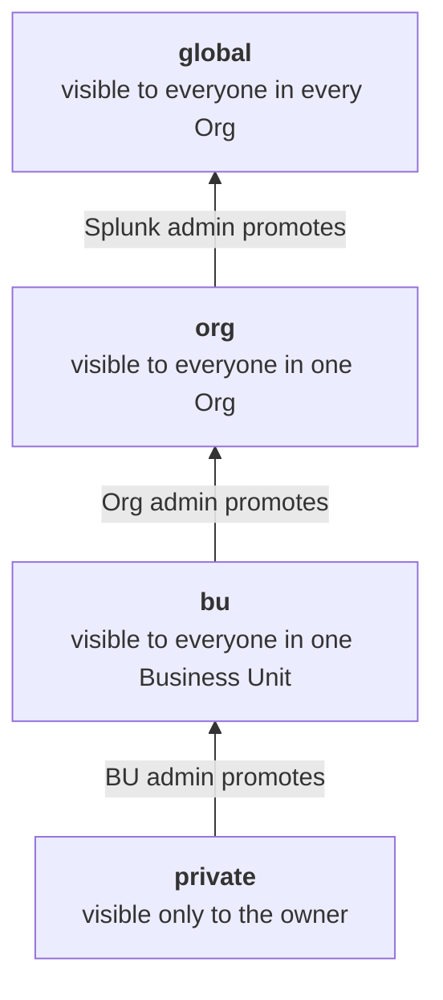

# Overview: agent templates and built-in tools

**App version:** 2.7.5
**Last updated:** 2026-10-28
**Audience:** Splunk admins, integrators and reviewers who need one flat
reference of everything that ships in the box: every agent template (a ready
definition of a governed agent, with every action gated and logged) and every
built-in tool, with their parameters and how they are scoped per Org and BU.

> **This is a reference catalogue, not a tutorial.** For how agents and tools
> are configured, scoped per Org and BU or extended, see [the tool catalogue](./tool-catalogue.md),
> [the skills page](./skills.md), [the knowledge layer](./knowledge-layer.md),
> [the user manual](../../user/user-manual.md) and [the admin manual](../admin-manual.md).

---

## Table of contents

- [1. How to read this document](#1-how-to-read-this-document)
- [2. Tenancy model: Org and BU scoping](#2-tenancy-model-org-and-bu-scoping)
   - [2.1 What an Org and a BU are](#21-what-an-org-and-a-bu-are)
   - [2.2 Runtime Org and BU resolution](#22-runtime-org-and-bu-resolution)
   - [2.3 Scoping built-in tools](#23-scoping-built-in-tools)
   - [2.4 Scoping custom and MCP tools](#24-scoping-custom-and-mcp-tools)
   - [2.4.5 Sharing scope ladder](#245-sharing-scope-ladder)
   - [2.5 Scoping agents](#25-scoping-agents)
   - [2.6 Defence in depth](#26-defence-in-depth)
- [3. Agent templates](#3-agent-templates)
   - [3.0 Per-feature licensing tags](#30-per-feature-licensing-tags)
   - [3.1 Common agent template fields](#31-common-agent-template-fields)
   - [3.2 Stage: `operational`](#32-stage-operational)
   - [3.3 Stage: `draft`](#33-stage-draft)
   - [3.4 Other agent templates](#34-other-agent-templates)
   - [3.5 Skills and prompt assembly](#35-skills-and-prompt-assembly)
- [4. Built-in tool catalogue](#4-built-in-tool-catalogue)
   - [4.0 Per-feature licensing tags](#40-per-feature-licensing-tags)
   - [4.1 How tools are advertised to the LLM](#41-how-tools-are-advertised-to-the-llm)
   - [4.2 Category: `routing`](#42-category-routing)
   - [4.3 Category: `templates`](#43-category-templates)
   - [4.4 Category: `splunk-core`](#44-category-splunk-core)
   - [4.5 Category: `search`](#45-category-search)
   - [4.6 Category: `metrics`](#46-category-metrics)
   - [4.7 Category: `knowledge-objects`](#47-category-knowledge-objects)
   - [4.8 Category: `dashboards-simplexml`](#48-category-dashboards-simplexml)
   - [4.9 Category: `dashboards-studio`](#49-category-dashboards-studio)
   - [4.10 Category: `alerts`](#410-category-alerts)
   - [4.11 Category: `visualizations`](#411-category-visualizations)
   - [4.12 Category: `ai-toolkit`](#412-category-ai-toolkit)
   - [4.13 Category: `enterprise-security`](#413-category-enterprise-security)
   - [4.14 Category: `itsi`](#414-category-itsi)
   - [4.15 Category: `trackme`](#415-category-trackme)
   - [4.16 Category: `knowledge`](#416-category-knowledge)
   - [4.17 Category: `security-content`](#417-category-security-content)
   - [4.18 Category: `data-onboarding`](#418-category-data-onboarding)
   - [4.19 Category: `servicenow`](#419-category-servicenow)
   - [4.20 Category: `network-policy`](#420-category-network-policy)
   - [4.21 Category: `data-platform`](#421-category-data-platform)
   - [4.22 Category: `fraud`](#422-category-fraud)
   - [4.23 Category: `dashboards-compiler`](#423-category-dashboards-compiler)
   - [4.24 Tools the unattended runner adds](#424-tools-the-unattended-runner-adds)
- [5. Cross-reference indices](#5-cross-reference-indices)
   - [5.1 Agent template to tools](#51-agent-template-to-tools)
   - [5.2 Tool to agent templates](#52-tool-to-agent-templates)
   - [5.3 Agent template to skills and knowledge](#53-agent-template-to-skills-and-knowledge)
   - [5.4 Skill to agent templates](#54-skill-to-agent-templates)
- [6. What ships, in numbers](#6-what-ships-in-numbers)

---

## 1. How to read this document

- **Agent templates** ship with the app and are added to the app's KV store when
  an admin first opens it. A shipped row that nobody has edited is refreshed
  from the app after an upgrade; once an admin edits a row, it keeps the
  admin's version.
- **Tools** are built into the app. Each has tags, categories and a short
  description. An admin can override those per tool (**Tools > Manage tool >
  Metadata**); the overrides are stored in the `itmip_tool_overrides` KV store
  collection and laid over the defaults.
- **Skills** are the reusable rules an agent template includes. The
  [skills page](./skills.md) documents each one.
- **Knowledge** is what the assistant reads and creates. The
  [knowledge layer](./knowledge-layer.md) explains the connectors, and names the
  [knowledge objects](./knowledge-layer.md#knowledge-objects-in-splunk) the tools
  create in Splunk.
- **Parameter notation in this document:**
  `name (type, required | optional, default: X)`, followed by a one-line
  description. For enums, the allowed values are listed inline.
- Every built-in tool returns a structured result. Tools that create something
  return `{ok, kind, name, action, url}`, so the **Created in Splunk** panel can
  link to it. Tools that change an existing object are also tagged `gated` and
  do not run until the person confirms in the app.

---

## 2. Tenancy model: Org and BU scoping

Everything in §3 (agent templates) and §4 (tools) is filtered through a
two-level Org and BU model, both when the assistant is offered something and
when it runs it. This section explains the model so the entries that follow
make sense.

### 2.1 What an Org and a BU are

An **Organisation (Org)** is the top-level scope; a **Business Unit (BU)** is a
scope within an Org. Neither is hardcoded: both are stored in the KV store and
resolved from Splunk roles and app patterns at runtime.

| Concept | KV store collection | Key fields |
|---|---|---|
| Org | `itmip_organisations` | `short` (uppercase id, for example `ACME` or `DFLT`), `name`, `description`, `app_patterns` (globs of Splunk app ids), `role_patterns` (globs of Splunk role names) |
| BU | `itmip_business_units` | `org_short` (parent), `short` (BU id), `extra_role_patterns` (additional role globs), `extra_user_names` (explicit user grants) |

A built-in **`DFLT` / `DFLT`** pair always exists as the fallback. The `DFLT`
Org has `role_patterns = ["admin"]`, so admins always resolve cleanly.
Non-admins who match no Org fall through to it as *unassigned*: the app shows a
grey overlay with an admin-configurable message, and every REST handler that
reads or writes Org-scoped data refuses them with HTTP 403 and the same message.

### 2.2 Runtime Org and BU resolution

The resolver runs in two steps:

```
Step 1: Org match
  FOR EACH Org:
    appOk  = (Org.app_patterns matches current Splunk app id)
    roleOk = user.isAdmin OR (any Org.role_patterns matches a user role)
    IF appOk AND roleOk: Org matched, go to Step 2.

Step 2: BU within the matched Org
  FOR EACH BU in that Org (excluding DFLT):
    IF user.name IN BU.extra_user_names
       OR any BU.extra_role_patterns matches a user role:
       BU matched. Return { org_short, bu_short, ... }.
  ELSE: use the Org's DFLT BU (created if missing).

Fallback (no Org matched)
  return { org_short: "DFLT", bu_short: "DFLT", is_unassigned: !isAdmin }
```

The same resolver runs on the server, so the server works out the caller's Org
and BU on its own: the browser cannot claim a different identity.

### 2.3 Scoping built-in tools

Built-in tools (§4) are enabled by default. Admins can disable them per Org and
BU with rules stored in `itmip_tool_assignments`.

**Precedence: the most specific rule wins.**

| Rank | Match | Example use |
|---|---|---|
| 1 | `org_short == caller.org` AND `bu_short == caller.bu` | Disable `es_update_notable` for ACME / SOC-B only |
| 2 | `org_short == caller.org` AND `bu_short == "*"` | Disable `splunk_create_alert` org-wide for ACME |
| 3 | `org_short == "*"`         AND `bu_short == caller.bu` | Rare; a BU rule across Orgs |
| 4 | `org_short == "*"`         AND `bu_short == "*"`         | Global switch (for example, disable AI Toolkit tools in every Org and BU) |
| (none) | no rule exists for the tool | enabled |

The first match in this order wins; later rules are not evaluated.

**Metadata overrides** (`itmip_tool_overrides`) are app-wide, not per Org or BU:
one row per tool replaces the built-in tags, categories, short description and
concise short description everywhere they are shown.

### 2.4 Scoping custom and MCP tools

Custom HTTP tools (`itmip_llm_custom_tools`) and imported MCP tools
(`itmip_mcp_tools`) use a **sharing** model instead of the assignment ladder:

| `scope_sharing` | Visible to |
|---|---|
| `private` (default) | Only callers whose Org and BU exactly match the tool's `scope_owner_org` and `scope_owner_bu`. |
| `app` | Any caller in the tool's Org, whatever their BU. |
| `global` | Every caller, in every Org and BU. |

Admins always see every custom tool.

MCP-imported tools follow the same model and also pass through the per-Org and
per-BU enable and disable ladder of §2.3, so an admin can mute one imported tool
for one Org or BU without removing it for everyone.

### 2.4.5 Sharing scope ladder

Every agent and every skill carries a four-step **sharing scope ladder**, stored
on the row:



A caller sees a `bu` row when their Org **and** Business Unit both match, and an
`org` row when their Org matches. **Administrators do not bypass `private`.**
Rows without a `sharing` value fall back to their `org_short` and `bu_short`.

**Agents that end users create** with the assistant always start at
`sharing=private`; the server forces this whatever the model sends. Admins
promote them on the **Agents** tab, following the ladder above.

**Skills** can be at any scope, but the shipped skills are `global` and only
admins author skills.

### 2.5 Scoping agents

Agents carry `org_short` and `bu_short` directly:

| Agent's `(org_short, bu_short)` | Visible to |
|---|---|
| `(DFLT, DFLT)` | Everyone (subject to the role and app gates below). All agent templates ship as `DFLT / DFLT`. |
| `(ACME, DFLT)` | All callers resolved to Org `ACME`, whatever their BU. |
| `(ACME, OPS)` | Only callers resolved to Org `ACME` and BU `OPS`. |
| Other combinations | Hidden. Admins see them only with the *Show drafts / all tenants* toggle on the **Agents** tab. |

Two more gates apply on top of the Org and BU filter:

- **`required_roles`**: when set, the caller must hold at least one listed
  Splunk role. Admins bypass it. Two agent templates set it today:
  *Build / improve an alert* and *AI Toolkit – CDTSM Predictive Alerting*, both
  `power` or `admin`.
- **`dependent_apps`**: Splunk apps (with an optional minimum version) that
  must be installed on the search head. An agent whose dependencies are missing
  is left out of the person's list; it is never shown as broken. Used by the
  AI Toolkit agent templates (`Splunk_ML_Toolkit`; 5.7.3 or later for the
  three CDTSM ones), the Enterprise Security ones (`SplunkEnterpriseSecuritySuite`),
  the ITSI ones (`SA-ITOA`), the TrackMe ones (`trackme`, sometimes with ITSI or
  Enterprise Security), the ATT&CK tactic hunt (`Splunk_Security_Essentials`), and
  the ServiceNow, security incident and fraud agent templates that start from an
  ITSI episode or an Enterprise Security notable.

Licence gates (`required_capability`, `required_feature`) are listed in §3.0.

Two agent templates are special:

- `is_general=true` (only **General**, the base guardrails): never shown in a
  picker; placed in front of every other agent template's prompt.
- `is_default=true` (only **Default**, the router): selected when a person asks
  a free-form question without picking an agent. It calls
  `splunk_list_use_case_templates` and `splunk_get_use_case_template_prompt` to
  hand the request to the right agent template.

### 2.6 Defence in depth

Every scoping rule is enforced twice: when the assistant is offered a tool or an
agent template, and again when it is used. This protects against a model calling
a tool it was never offered, and against a modified browser.

| Surface | When offered | When used |
|---|---|---|
| Built-in tool | Disabled tools are left out of the list sent to the model. | The app checks again before running the tool and refuses with "Tool 'X' is disabled for Org=Y/BU=Z". |
| Custom HTTP tool | The server sends only the tools visible to the caller. | The server checks visibility and the `enabled` flag again, and refuses with HTTP 403. |
| MCP-imported tool | The same sharing check plus the enable and disable ladder. | The same two checks. |
| Agent | The list is filtered before the picker or the router sees it. | The server filters again before it returns an agent template's prompt. |

> **Audit.** Every custom and MCP tool call is recorded in
> `itmip_llm_custom_tool_calls`, and built-in tool calls in the usage
> telemetry. Both carry `org_short` and `bu_short`, so an admin can answer
> "what did Org X run last week" with `| inputlookup`. See
> [Auditing](../security/auditing.md).

### Where the admin UI surfaces this

- **Tools tab > Manage** (per built-in tool): the Availability rules in
  `itmip_tool_assignments`.
- **Tools tab > Custom tools editor**: `sharing`, `scope_owner_org` and
  `scope_owner_bu` on a custom tool.
- **Tools tab > MCP servers editor**: the same scope fields on a registered MCP
  server; imported tools inherit them and can be overridden per tool.
- **Agents tab > Edit**: `org_short`, `bu_short`, `required_roles`,
  `dependent_apps` and `status` (operational or draft).
- **Orgs & BUs tab**: new Orgs and BUs, and their `app_patterns` and
  `role_patterns`.

> **Splunk Cloud.** The Org and BU model works on Splunk Cloud unchanged. What
> differs is what an admin can switch on: for example, the development-only
> `tls_skip_verify` option is removed on Splunk Cloud whatever the Org and BU
> rules say. See [the tool catalogue](./tool-catalogue.md#working-with-pem-files-tls-cas-self-signed-certs-dev-mode-skip).

---

## 3. Agent templates

The app ships 90 agent templates: 67 operational and 23 in preview (`draft`).
§3.2 and §3.4 describe the operational ones, §3.3 the ones in preview.

Some agent template names contain a long dash in the app, for example
`ES — Triage a notable`. This document writes those names in code format so you
can search for them exactly as the app shows them.

### 3.0 Per-feature licensing tags

The licence is a **capability matrix**: every capability has its own minimum
tier. The server resolves it and returns the result as
`capabilities` from `GET /services/itmip_llm/license`. The check is
server-side and fails closed: a capability the licence does not grant is
refused, even if the UI offers it.

An agent template can carry two licence fields:

- **`required_capability`**: a capability from the matrix. When the tier does
  not grant it, the server withholds the agent template's prompt and question
  text and marks it `locked`. The UI greys it out.
- **`required_feature`**: a named licence feature. A feature needs both the
  right edition and the feature on the licence key. When either is missing, the
  app greys the agent template out.

**Capabilities used by agent templates:**

| Capability | Minimum tier | Agent templates |
|---|---|---|
| `security_workflows` | Enterprise | 18: the 9 Enterprise Security agent templates and 6 of the 8 ITSI agent templates (all in preview, §3.3), `ATT&CK Tactic Hunt — Technique Coverage Dashboard`, **Generic Alert Triage** and **ES Notable Triage**. The `es_*`, `itsi_*` and `sse_*` tools are gated to the same capability. |
| `itsi_rca` | Enterprise | 2: `ITSI — Automatic Root Cause Analysis` and `ITSI — Root-cause an episode`. Both also need the `itsi-rca` feature. |
| `ml_generation` | Professional | 10, the agent templates that train or run a model: Smart outlier detection (single metric), Multi-field anomaly detection, Smart forecasting, the three CDTSM agent templates, Smart clustering, Smart prediction (categorical or numeric), Outlier ALERT + diagnostic dashboard, and Audit & refresh an existing ML use case. Also gates `splunk_share_mltk_model_globally`. |
| `data_onboarding` | Professional | 3: **CIM Coverage Audit**, **Data Source Onboarding (full)** and **Cisco ASA Policy Ingestion (mapping-driven)**. |
| `fraud_analytics` | Enterprise | 7: the six operational fraud agent templates in §3.4.11 and **Fraud Command Center** (in preview). All also need the `fraud-analytics` feature. |
| `ai_activity_dashboard` | Enterprise | 1: **Adjutant AI Behaviour Analysis**. |

**Features used by agent templates:**

| Feature | Minimum edition | Agent templates |
|---|---|---|
| `servicenow` | Professional | The 14 ServiceNow and security incident agent templates (§3.4.7). |
| `itsi-rca` | Enterprise | The two `itsi_rca` agent templates above. |
| `fraud-analytics` | Enterprise | The seven `fraud_analytics` agent templates above. |

**Scheduled integrations.** **ServiceNow Sync (mapping-driven)** and
**Cisco ASA Policy Ingestion (mapping-driven)** are tagged `integration`. Running
an integration-tagged agent template on a schedule needs the Enterprise
`data_integration` capability. So does any mapping run that writes to a
ServiceNow or stage destination. Writes to a KV store collection or an index
stay open on every tier.

Everything else is open on every tier, Personal included: SPL, dashboard and
alert authoring, bring-your-own-key and multiple LLMs, the knowledge layer,
skills, and authoring your own agents. The AI Toolkit agent templates that do
not train a model are open too: *Stats vs ML decision helper*, *Ask an external
LLM about your Splunk data (`ai` command)*, *Bring your own ONNX model (score in
Splunk)* and *Score against an AWS SageMaker endpoint*. The data-quality
checks (ingestion health, TrackMe, Cribl Stream, Edge Processor) are available
on every tier; the boundary there is Splunk's own roles and index ACLs. The
capability `in_splunk_awareness` still appears in the licence response but
gates nothing.

### 3.1 Common agent template fields

Every agent template carries the fields below. Most keep their default value;
the sections that follow name the agent templates that set the others.

| Field | Meaning |
|---|---|
| `name` | Unique human-readable id, shown on the **Agents** tab and in the agent picker. |
| `status` | `operational` (offered to users), `draft` (in preview: shown only to admins, in the **Draft** group of the **Agents** tab) or `deleted` (tombstone). |
| `prompt_text` | The prompt body the LLM sees when this agent template is active. |
| `question_text` | The form the user fills in before the run starts. |
| `short_description` | One-line description, used by the router and by `splunk_list_use_case_templates`. |
| `short_description_concise` | Optional shorter variant, used when Concise Mode is on. |
| `style_profile` | Optional style hint: `default`, `concise` or `verbose`. |
| `categories` | Groupings such as `search`, `ai-toolkit`, `security-soc`. |
| `tags` | Searchable labels such as `creates-objects`, `read-only`, `iterative`, `triggered`. |
| `includes_skills` | The skills this agent template includes, in order. See §3.5. |
| `dependent_apps` | Apps the agent template needs, each `{name, min_version}`. When one is missing, the agent template is left out of the user's list. |
| `required_roles` | Splunk roles the caller needs (at least one). Admins bypass it. Set on two agent templates only: **Build / improve an alert** and **AI Toolkit – CDTSM Predictive Alerting**, both `power` or `admin`. |
| `required_capability` | Licence capability needed to use the agent template. See §3.0. |
| `required_feature` | Named licence feature needed to use the agent template. See §3.0. |
| `proof_dashboard_default` | `on` or `off`: where the **Also build a proof dashboard** switch starts when the agent template is picked. Absent means off. The user can flip it for each Ask. On by default for 17 agent templates. |
| `dashboard_route` | How the agent template builds a dashboard: `compiler` (one call to `splunk_compile_dashboard`; **Improve an existing SPL** and **Fraud Rule Builder**), `legacy` (the `splunk_xml_*` or `splunk_builder_*` tools), `legacy_by_choice`, or `none` (no dashboard). |
| `finding_shape` | For agent templates that triage a finding unattended: the shape of that finding (`single_event`, `aggregated`, `episode` or `raw`). Set to `single_event` on **Generic Alert Triage**, **ES Notable Triage** and **MCP Example: Read-only Health Check**. |
| `integration_contract` | For integration agent templates: the integration id, the input and output tools, the mapping to use, and the destinations `splunk_writer` may write to (the model cannot widen that list). Set on **ServiceNow Sync (mapping-driven)** and **Cisco ASA Policy Ingestion (mapping-driven)**. |
| `allowed_tools` | Hard list of tools the agent template may use. Set on 5: **Explain a SPL search**, **CIM Coverage Audit**, **Data Source Onboarding (full)**, **ServiceNow Sync (mapping-driven)** and **Cisco ASA Policy Ingestion (mapping-driven)**. |
| `tool_category_filters` | Tool categories the agent template unlocks up front. Set on 14: Improve an existing SPL, Build a Simple XML dashboard, the Cribl Stream and Edge Processor checks, Investigation, the ATT&CK tactic hunt, the six operational fraud agent templates, Behavioral Profile Builder and Fraud Command Center. |
| `denied_tools` / `tool_tag_filters` | Optional tool restrictions. No shipped agent template sets them. |
| `allowed_template_refs` / `denied_template_refs` / `template_tag_filters` / `template_category_filters` | Optional controls for handing off to other agents. No shipped agent template sets them. |
| `org_short` / `bu_short` | Tenant scope. Every agent template ships as `DFLT` / `DFLT` (visible everywhere). |
| `is_default` | True only for **Default**, the router. |
| `is_general` | True only for **General**, the base guardrails. Never offered in a picker. |

### 3.2 Stage: `operational`

These agent templates are ready and offered to users. Each group has a table
(tags, short description, form inputs) followed by a workflow detail per
agent template. §3.4 covers the remaining operational agent templates more
briefly.

What an agent template creates in Splunk is a knowledge object of a known kind:
[saved searches and alerts](./knowledge-layer.md#saved-searches-and-alerts),
[dashboards](./knowledge-layer.md#dashboards), [lookups](./knowledge-layer.md#lookups),
[KV store collections](./knowledge-layer.md#kv-store-collections), or
[records in other apps](./knowledge-layer.md#records-in-other-apps). The
workflow details link the kind the first time it comes up.

#### 3.2.1 Foundation: applied automatically

| Agent template | Categories | Tags | Short description |
|---|---|---|---|
| **General** | `general` | `guardrail`, `read-only`, `splunk-cloud-safe` | Universal scope and safety guardrail placed in front of every prompt; defines refusals, the no-emoji rule, the uniform colour palette and the base-search dashboard rules. |
| **Default** | `general` | `router`, `read-only`, `splunk-cloud-safe` | Router used when the user did not pick an agent; lists the agents and hands the free-form question to the best match. |

**General**, the base guardrails, is never offered in a picker
(`is_general=true`). It is placed in front of every other agent template's
prompt. **Default** (`is_default=true`) is the router: when someone asks a
question without picking an agent, the app sends the router, which lists the
available agents and routes the question.

##### General: workflow detail

- **Intent:** universal scope guardrail and safety framework, placed in front of every prompt.
- **Workflow phases:** (1) define scope: Splunk Enterprise, Splunk Cloud and the AI Toolkit only; (2) list refusals (out of scope, sexual, violent or discriminatory content, legal, medical or financial advice, credential extraction, jailbreaks); (3) enforce safety rules (no SPL exfiltration, no audit-disabling configuration, explicit authorisation before destructive changes); (4) state style expectations (plain-language explanations, persist outcomes as clickable Splunk objects); (5) define universal dashboard rules (uniform colour semantics, the base-search pattern, **no emojis or icons anywhere**, HTML only inside `<panel><html>`, dual axis when value ranges differ by 10 times or more).
- **Tools invoked:** none.
- **Output artifacts:** none.
- **Output style:** a refusal always offers one Splunk-related alternative. The no-emoji rule explains why: URL routing, lookups and email rendering break, and XML clips unpredictably.

##### Default: workflow detail

- **Intent:** route a free-form question to the right agent template by matching its intent against the short descriptions.
- **Workflow phases:** (1) `splunk_list_use_case_templates` (already filtered by role, Org, BU and dependent apps); (2) read the question for intent signals; (3) match it to a short description, preferring the most specific fit; (4) `splunk_get_use_case_template_prompt` for the chosen agent template; (5) apply that agent template's workflow, with a one-line reason for the choice.
- **Tools invoked:** `splunk_list_use_case_templates`, `splunk_get_use_case_template_prompt`.
- **Output artifacts:** none directly; the chosen agent template does the work.
- **Output style:** one-line justification of the chosen agent before handing over.

#### 3.2.2 Search authoring

| Agent template | Tags | Short description | Question-text inputs |
|---|---|---|---|
| **Build a SPL search** | `creates-objects`, `saved-search-output`, `spl`, `iterative`, `splunk-cloud-safe` | Author a NEW optimised SPL search from intent, validate it with a test run, then persist it as a named saved search. | saved-search name • intent • indexes • sourcetype, source or host • time range • fields • aggregation • output shape • performance notes |
| **Improve an existing SPL** | `dashboard-output`, `modifies-objects`, `saved-search-output`, `spl`, `iterative`, `splunk-cloud-safe`, `audit` | Review an existing SPL against the full correctness and performance checklist, prove the rewrite returns identical results, and publish a dashboard carrying the findings, the change log and the evidence. | saved search or report name • the SPL • what triggered the review (slow, wrong results, failed run, hard to read, hygiene) • where it runs (ad hoc, panel, scheduled report, alert, ES correlation search) • typical time range • downstream consumers • environment (ES, CIM acceleration) • what must not change • permission to run both searches |

##### Build a SPL search: workflow detail

- **Workflow phases:** (1) break the request into its parts (measure, every filter, the split, index, time range) and ask numbered questions when index, time range, output or save name is unclear; (2) ground in real names with `splunk_list_indexes`, `splunk_list_saved_searches` and `splunk_get_version`; (3) optimise: explicit `index` and time range first, `tstats` over accelerated data models, filter before transforming, `fields` early, `eval` and `where` before `regex`, `stats` and `timechart` before `transaction`; (4) validate with `splunk_run_search`; (5) check the name with `splunk_list_saved_searches` and ask on a collision (a collision decides only the name; an overwrite still uses the SPL designed for this request); (6) coverage check per [`spl-intent-coverage`](./skills.md#spl-intent-coverage): every part of the request maps to a clause or becomes a question; (7) persist with `splunk_create_saved_search`, which validates; (8) self-correct when `validation.ok=false`, at most 3 attempts; (9) deliver the SPL, one sentence on what it counts and every filter, the reason for each performance choice, and a link.
- **Tools invoked:** `splunk_list_indexes`, `splunk_list_saved_searches`, `splunk_list_lookups`, `splunk_get_version`, `splunk_run_search`, `splunk_create_saved_search`, `splunk_update_saved_search`.
- **Output artifacts:** 1 [saved search](./knowledge-layer.md#saved-searches-and-alerts).
- **Output style:** never delivers failing SPL and never persists without `validation.ok=true`.

##### Improve an existing SPL: workflow detail

This agent template is a review engine. It returns a review you can act on and,
when the proof switch is on, a dashboard that carries the review. It does not
write the improved search into Splunk unless you ask.

- **Workflow phases:** (1) intake: what the search answers, where it runs, its window and schedule, the environment, whether the output must stay identical for a downstream consumer, and what triggered the review; unknowns become open questions with the assumption used; (2) run `splunk_review_spl`, which expands macros by reading them, checks every function against this Splunk's grammar, walks the anti-pattern and silent-failure checklists and traces field lineage; its findings are reported verbatim, most severe first; (3) add what the engine cannot see: whether the lookups, event types, data models and saved searches the search depends on exist, and whether the search answers the question its owner thinks it does; a clean result is reported as clean; (4) one recommended rewrite, with every behaviour change called out; (5) evidence: `splunk_verify_equivalence` runs the original and the rewrite over one fixed window and returns a measured verdict (a mismatch means the rewrite is wrong and is fixed or withdrawn); (6) with the proof switch on, one `splunk_compile_dashboard` call builds an explanation [dashboard](./knowledge-layer.md#dashboards) with severity tiles, the findings, the rewrite and change log, the equivalence evidence and the verification steps; (7) only on request, persist the rewrite with `splunk_create_saved_search` or `splunk_update_saved_search` after a name check and explicit confirmation; (8) deliver the review: summary, context and assumptions, findings, rewritten SPL, change log (including what was deliberately left alone), risk list and verification steps.
- **Skills:** [`spl-review-conduct`](./skills.md#spl-review-conduct), [`spl-review-correctness`](./skills.md#spl-review-correctness), [`spl-review-rewrites`](./skills.md#spl-review-rewrites), [`spl-review-evidence`](./skills.md#spl-review-evidence), [`dashboard-ir-authoring`](./skills.md#dashboard-ir-authoring) and others.
- **Tools invoked:** `splunk_review_spl`, `splunk_verify_equivalence`, `splunk_compile_dashboard`, `splunk_list_saved_searches`, `splunk_create_saved_search`, `splunk_update_saved_search`.
- **Output artifacts:** the review; 1 compiled dashboard when the proof switch is on (off by default for this agent template); a new or updated [saved search](./knowledge-layer.md#saved-searches-and-alerts) only on request.
- **Output style:** correctness first, performance second, readability third; never claims a speed-up or equivalence it did not measure.

#### 3.2.3 Dashboard authoring (Simple XML)

| Agent template | Tags | Short description | Question-text inputs |
|---|---|---|---|
| **Build a Simple XML dashboard** | `creates-objects`, `dashboard-output`, `dashboard-xml`, `spl`, `iterative`, `splunk-cloud-safe` | Generate a complete Simple XML dashboard (tokens, inputs, panels, dual-axis rules) and self-correct via panel-data validation until it renders clean. | dashboard name • description • primary indexes • time picker (yes/no) • default range • form inputs • panels (free-form) • visualisation preferences • drilldown and refresh |
| **Improve a Simple XML dashboard** | `modifies-objects`, `dashboard-output`, `dashboard-xml`, `spl`, `iterative`, `splunk-cloud-safe`, `audit` | Diagnose anti-patterns in pasted Simple XML (missing inputs, slow SPL, bad viz choices) and apply a validated rewrite to the existing dashboard. | dashboard name • problem (performance, errors, layout, inputs, migration) • existing XML (pasted) • what must stay |
| `ATT&CK Tactic Hunt — Technique Coverage Dashboard` (requires Splunk Security Essentials) | `creates-objects`, `dashboard-output`, `dashboard-xml`, `spl`, `iterative`, `splunk-cloud-safe`, `soc`, `siem`, `mitre`, `threat-hunting`, `coverage-gap` | For a chosen MITRE ATT&CK tactic and techniques over a data source, ground detection logic in Splunk Security Essentials and build one Simple XML dashboard with a per-technique evidence panel, a technique rollup and a combined timeline. Zero-evidence tiles are neutral, never green; fixed-window demo datasets are re-anchored to the data's active period. | hunt or dashboard name (blank: auto-named `*_aiworkbench`) • tactic • techniques (blank: proposed from SSE) • primary index • sourcetype (optional) • time picker • default range • theme • zero-evidence policy (ask, broaden, drop, show neutral) • zero-tile colour |

> Dashboard Studio (JSON) is in preview: see [§3.3.1](#331-dashboard-studio).

##### Build a Simple XML dashboard: workflow detail

The agent template never hand-writes raw XML. It drives the `splunk_xml_*`
builder, which assembles and escapes the XML one panel at a time, so a large
dashboard is as safe as a small one. It sets `tool_category_filters` to
`dashboards-simplexml`, `splunk-core`, `knowledge-objects` and `visualizations`.

- **Workflow phases:**
  1. Clarify the name (lowercase with underscores, unique), at least one panel, time-picker behaviour and critical inputs. The agent never picks a name without confirmation.
  2. Ground with `splunk_get_version`, `splunk_list_indexes`, `splunk_list_saved_searches` and, when a custom visualisation fits the data, `splunk_list_visualizations`.
  3. Build:
     - **Data quality (step a0).** Since 2.7.5, `splunk_xml_publish` adds the **Data quality** row at the top itself: the ingestion-check verdict with counts and the newest event per index, a "No new data" banner, or "not checked" with the reason. A dashboard that reads only lookups gets no such row. The agent adds no ingestion section of its own. The app's row covers Splunk parsing only. The other checks stay the agent's job and sit beside it: a TrackMe panel when `trackme_health_for_indexes` reports the feed as tracked, and a one-line note with the verdict of `splunk_check_cribl_ingest_health` or `splunk_check_edge_processor_health` when Cribl Stream or Edge Processor fronts the feed. The reply reports the `data_quality` result the publish returns.
     - `splunk_xml_create` (title, plain-text description, theme, panels per row).
     - `splunk_xml_add_input`: the time picker first (ISO 8601 or relative defaults, never epoch or slashed dates), then other filters.
     - `splunk_xml_add_base_search`: only for a transforming base search shared by two or more panels that split the same aggregation different ways; panels then post-process it.
     - `splunk_xml_add_panel`: one call per panel, raw SPL, layout options for KPI strips, full-width rows and dual axis.
     - `splunk_xml_add_tab_group`: groups panels into tabs when the dashboard has distinct sections or more than about six panels.
     - `splunk_xml_preview` (optional).
  4. Name check and publish with `splunk_xml_publish`. It refuses an orphan `$token$`, applies the same guardrails as `splunk_create_dashboard_xml`, and refuses a name collision until the user confirms an overwrite.
  5. Validate and render-check: fix a failing panel with `splunk_xml_update_panel` and publish again, then `splunk_get_dashboard_panel_data` (`response.ok=true` is the success gate). At most 3 attempts.
  6. Deliver only after the render check passes, with a link. The dashboard lives in the user's private namespace.
- **Skills:** [`dashboard-xml-discipline`](./skills.md#dashboard-xml-discipline), [`dashboard-xml-validation-loop`](./skills.md#dashboard-xml-validation-loop), [`dashboard-ingestion-health`](./skills.md#dashboard-ingestion-health), [`viz-best-fit`](./skills.md#viz-best-fit), [`spl-perf-priorities`](./skills.md#spl-perf-priorities), [`naming-collision-handling`](./skills.md#naming-collision-handling).
- **Tools invoked:** `splunk_get_version`, `splunk_list_indexes`, `splunk_list_saved_searches`, `splunk_list_visualizations`, `splunk_xml_create`, `splunk_xml_add_input`, `splunk_xml_add_base_search`, `splunk_xml_add_panel`, `splunk_xml_add_tab_group`, `splunk_xml_preview`, `splunk_xml_publish`, `splunk_xml_update_panel`, `splunk_get_dashboard_panel_data`.
- **Output artifacts:** 1 Simple XML [dashboard](./knowledge-layer.md#dashboards).
- **Output style:** token discipline is strict (an orphan token fails); dual-axis use is stated; success is announced only when validation and the render check both pass.

##### Improve a Simple XML dashboard: workflow detail

- **Workflow phases:** (1) read the pasted XML for anti-patterns (missing or mismatched tokens, missing `version="1.1"`, `index=*`, no time range, early transforms, unused tokens, dead inputs, layout issues, visualisation mismatches); (2) ground with `splunk_get_version`, `splunk_list_indexes`, `splunk_list_lookups` and `splunk_list_visualizations`, swapping in an installed custom visualisation only for a real readability gain; when only a name was given, fetch the XML with `splunk_get_dashboard_xml`; (3) rewrite, keeping the structure and changing only what fixes a real problem; (4) apply with `splunk_update_dashboard_xml`, which validates; (5) self-correct, at most 3 attempts; (6) deliver what was wrong, what changed, the expected impact and what was left alone.
- **Tools invoked:** `splunk_get_version`, `splunk_list_indexes`, `splunk_list_lookups`, `splunk_list_visualizations`, `splunk_get_visualization_docs`, `splunk_get_dashboard_xml`, `splunk_update_dashboard_xml`.
- **Output artifacts:** 1 Simple XML [dashboard](./knowledge-layer.md#dashboards), updated in place.
- **Output style:** every change justified; `validation.ok=true` is the success gate.

##### `ATT&CK Tactic Hunt — Technique Coverage Dashboard`: workflow detail

- **Licensing:** `required_capability = security_workflows` (Enterprise). Its `sse_*` tools are gated to the same capability. See §3.0.
- **Dependency:** Splunk Security Essentials (`Splunk_Security_Essentials`). The agent template is offered only when SSE is installed, and phase 1 stops when `sse_check_prerequisites` reports `ready=false`. The tactic, techniques, index and sourcetype are parameters; nothing is hard-coded to one tactic or dataset.
- **Workflow phases:** (1) prerequisite gate (`splunk_get_version`, `sse_check_prerequisites`); (2) resolve the tactic and techniques (from the form, or proposed with `sse_list_content`); (3) ground each technique in SSE (`sse_list_content`, then `sse_get_detection` for the real detection SPL and its lineage); (4) ground the data source (`splunk_list_indexes` and a `splunk_run_search` field probe); (5) time window per [`demo-dataset-time-reanchor`](./skills.md#demo-dataset-time-reanchor): re-anchor only when the index matches a known fixed dataset; (6) per-technique evidence and zero-evidence handling per [`hunt-evidence-honesty`](./skills.md#hunt-evidence-honesty): run the search for the hit count before building the tile, never a green zero; (7) fidelity checks for network-service discovery and process discovery techniques; (8) build the dashboard with the `splunk_xml_*` builder: KPI row with one tile per technique, one evidence panel per technique citing its SSE card, a technique rollup, a combined timeline, a raw audit table and an HTML intro panel; (9) publish and render-check (`splunk_xml_publish`, `splunk_get_dashboard_panel_data`, fix with `splunk_xml_update_panel`, at most 3 attempts).
- **Knowledge:** the agent template [consults the knowledge layer](./knowledge-layer.md#how-the-assistant-reads-knowledge) through [`consult-security-knowledge-first`](./skills.md#consult-security-knowledge-first) for the sourcetype's field-extraction recipe, for example the static rule for Sysmon and Windows event logs, instead of deriving it again. The prompt keeps only a short fallback.
- **Tools invoked:** `splunk_get_version`, `sse_check_prerequisites`, `sse_list_content`, `sse_get_detection`, `splunk_route_knowledge`, `splunk_search_knowledge`, `splunk_list_indexes`, `splunk_list_lookups`, `splunk_run_search`, `splunk_xml_create`, `splunk_xml_add_input`, `splunk_xml_add_panel`, `splunk_xml_publish`, `splunk_xml_update_panel`, `splunk_get_dashboard_panel_data`.
- **Output artifacts:** 1 Simple XML coverage [dashboard](./knowledge-layer.md#dashboards) with per-technique SSE citations.
- **Output style:** counts quoted, nothing invented; red means bad and a zero is never green; re-anchoring is explained when it happens.
- **Naming:** uses the hunt name as given; when blank, proposes a `*_aiworkbench` view name and confirms before creating.
- **Time defaults (all Simple XML):** the dashboard validator rejects two traps in a time input's default: a slashed date such as `08/20/2018:00:00:00` (rejected by Splunk's time parser in non-US locales) and a bare epoch such as `1534723200` (shown in the picker but not bound to the time tokens, so panels return nothing). Use ISO 8601 (`2018-08-20T00:00:00`), a relative time (`-24h`) or `0`.

#### 3.2.4 Alerts and reports

| Agent template | Tags | Short description | Question-text inputs |
|---|---|---|---|
| **Build / improve an alert** | `creates-objects`, `alert-output`, `dashboard-output`, `spl`, `iterative`, `splunk-cloud-safe`, `requires-power-user` | Design a scheduled alert (cron, throttle, severity, email). With **Also build a proof dashboard** on, it also ships a companion diagnostic dashboard, so on-call has one click from email to investigation. Requires the `power` or `admin` role. | alert name • dashboard name • trigger condition • cadence (cron) • time window • severity • email • throttle period • indexes, sources, sourcetypes |
| **Build / improve a report** | `creates-objects`, `report-output`, `spl`, `single-pass`, `splunk-cloud-safe` | Design or improve a Splunk report (a saved search shown as a report), run it to prove it returns rows, and create it. | report name • question it answers • audience • visualisation • schedule • time range per run • indexes and sourcetypes • sharing scope |

##### Build / improve an alert: workflow detail

- **Workflow phases:** (1) clarify the trigger condition, cron, window, severity, notification, throttle, indexes and sourcetypes; (2) ground with `splunk_get_version`, `splunk_list_indexes` and `splunk_list_saved_searches`; (3) design SPL that yields exactly the trigger rows, with the time range in `dispatch.earliest_time` and `dispatch.latest_time`, so "number of events greater than 0" is the trigger; (4) name-check the alert (`<thing>_alert`) and, with the proof switch on, the companion dashboard (`<thing>_dashboard`); (5) with the switch on, create the companion [dashboard](./knowledge-layer.md#dashboards) first with the `splunk_xml_*` builder: time picker (last 24 hours), KPI of trigger rows, a timechart of trigger rows, a table of recent trigger rows, and a static panel on when the alert fires and how to investigate; (6) create the [alert](./knowledge-layer.md#saved-searches-and-alerts) with `splunk_create_alert` (cron, dispatch window, condition, severity, throttle, optional email, and a description that links the dashboard); (7) self-correct, at most 3 attempts per object; (8) deliver a plain-language summary, links, and the reasons for throttle and severity.
- **Skills:** [`alert-companion-dashboard`](./skills.md#alert-companion-dashboard), [`dashboard-proof-required`](./skills.md#dashboard-proof-required), [`feed-health-verdict`](./skills.md#feed-health-verdict) and others.
- **Tools invoked:** `splunk_get_version`, `splunk_list_indexes`, `splunk_list_saved_searches`, `splunk_list_visualizations`, `splunk_get_visualization_docs`, `splunk_xml_create`, `splunk_xml_add_input`, `splunk_xml_add_panel`, `splunk_xml_publish`, `splunk_create_alert`.
- **Output artifacts:** 1 alert, plus 1 companion dashboard when **Also build a proof dashboard** is on (on by default for this agent template).
- **Output style:** with the switch on, the alert description links the dashboard.

##### Build / improve a report: workflow detail

- **Workflow phases:** (1) ask only what cannot be inferred: output shape, sharing scope, audience; (2) design the SPL with an explicit index, a bounded time range and `tstats` where only indexed fields are counted; (3) run it first with `splunk_run_search`; a report that has never returned a row is not finished; (4) create it with `splunk_create_saved_search`, or update it with `splunk_update_saved_search`; without a stated audience the report stays private, and the agent reports the sharing the object actually got; (5) deliver the name, the top rows of the validating run, the time range and a suggested visualisation.
- **Scheduling:** these tools create an on-demand report. They cannot put it on a schedule. The agent tells the user to build a scheduled alert instead, or to set the schedule in Splunk (**Settings > Searches, reports and alerts > Edit schedule**).
- **Tools invoked:** `splunk_run_search`, `splunk_create_saved_search`, `splunk_update_saved_search`.
- **Output artifacts:** 1 report ([saved search](./knowledge-layer.md#saved-searches-and-alerts)). A proof dashboard only when the user asks for one.
- **Output style:** single pass; real figures from the validating run.

#### 3.2.5 Knowledge objects

| Agent template | Tags | Short description | Question-text inputs |
|---|---|---|---|
| **Build / improve a lookup** | `creates-objects`, `lookup-output`, `single-pass`, `splunk-cloud-safe` | Design a CSV or KV store lookup: schema, sample rows, `lookups.conf` and `transforms.conf`, optional automatic lookup wiring, ready for manual upload. | lookup name • type (CSV or KV store) • purpose • fields (`name\|type\|sample`) • match key • auto-apply (yes/no) • sourcetypes • case sensitivity |
| **Build / improve a field extraction** | `creates-objects`, `extraction-output`, `single-pass`, `splunk-cloud-safe` | Author a tight regex field extraction from a sample event, validate captures with `rex`, and emit `props.conf` and `transforms.conf` stanzas. | sourcetype • sample raw events • fields to extract • search time or index time • extractions to keep |

##### Build / improve a lookup: workflow detail

- **Workflow phases:** (1) clarify the type (CSV or KV store), fields and types, match keys, automatic or manual, case sensitivity; (2) design the schema, 5 to 20 sample rows, `collections.conf` (KV store), `lookups.conf` and `transforms.conf` stanzas, and an optional automatic lookup in `props.conf`; (3) deliver the schema table, sample data, stanzas and example SPL.
- **Tools invoked:** none; recommend-only.
- **Output artifacts:** configuration for you to apply. Nothing is created in Splunk.
- **Output style:** single pass.

##### Build / improve a field extraction: workflow detail

- **Workflow phases:** (1) clarify the type (regex, delimited, structured), the source, search time or index time, and the fields; (2) design from a pasted sample event: anchor strings, a tight regex (no `.*`, non-greedy where possible), one named capture group per field; (3) validate with `splunk_run_search` using `... | head 5 | rex "<regex>" | table _raw, <fields>`, at most 3 retries; (4) deliver `props.conf` (`REPORT-...`), `transforms.conf` (`REGEX`, `FORMAT`), test SPL and a note about restart or refresh.
- **Skills:** [`spl-validation-loop`](./skills.md#spl-validation-loop).
- **Tools invoked:** `splunk_run_search`.
- **Output artifacts:** stanzas and test SPL. Nothing is created in Splunk.
- **Output style:** the regex is always validated; stanzas in `ini` blocks.

#### 3.2.6 Data onboarding

| Agent template | Tags | Short description | Question-text inputs |
|---|---|---|---|
| **Data onboarding helper** | `creates-objects`, `single-pass`, `splunk-cloud-safe`, `onboarding`, `requires-admin` | Guide a Splunk admin through bringing a new source online: `inputs.conf`, `props.conf` timestamp and line-merge tuning, sizing, and verification SPL. | source description • where from (file, syslog, HEC, modular input, forwarder, API) • format • sample events • volume • destination index • sourcetype • retention • sensitive fields |
| **Data Source Onboarding (full)** (`required_capability = data_onboarding`, Professional) | `allowed_tools` set | Turn a raw sample into a deployment-ready package of four apps (a downloadable `.tar.gz`) with `splunk_generate_conf_package`. Every `props.conf` and `transforms.conf` stanza is validated against the real `.conf.spec`, and a 0 to 100 Data Quality Score is computed (iterate below 90). For a feed that already arrives, it also checks ingestion with `splunk_check_ingest_health`. | sample raw events (required) • sourcetype • destination index • input type • format • expected volume • CIM model intent • forwarder host patterns • retention • sensitive fields |

##### Data onboarding helper: workflow detail

- **Workflow phases:** (1) clarify the source type, volume, format, destination index and sourcetype; (2) design the `inputs.conf` stanza, the `props.conf` stanza (`LINE_BREAKER`, `SHOULD_LINEMERGE`, `TIME_PREFIX`, `TIME_FORMAT`, `TRUNCATE`, `MAX_TIMESTAMP_LOOKAHEAD`, `KV_MODE`), an optional `transforms.conf`, and index sizing; (3) check timestamp and parse settings against the pasted sample; (4) deliver stanzas per file, sizing, verification SPL and common pitfalls for the source type.
- **Skills:** [`data-onboarding-readiness`](./skills.md#data-onboarding-readiness) (when the feed already exists, call `splunk_check_ingest_health` and report the verdict) and [`feed-health-verdict`](./skills.md#feed-health-verdict).
- **Tools invoked:** none of its own; `splunk_check_ingest_health` through the skill when the sourcetype already arrives.
- **Output artifacts:** stanzas and verification SPL. Nothing is created in Splunk.
- **Roles:** the tag `requires-admin` is a label only. The agent template sets no `required_roles`.

##### Data Source Onboarding (full): workflow detail

- **Skills:** [`conf-package-discipline`](./skills.md#conf-package-discipline) (four-app layout, index-time versus search-time split, no invented attributes), [`magic-8-compliance`](./skills.md#magic-8-compliance) (validate every stanza against the real `.conf.spec`, then score), [`data-onboarding-readiness`](./skills.md#data-onboarding-readiness) and [`naming-collision-handling`](./skills.md#naming-collision-handling).
- **Workflow phases:** (1) gather the sample (required), target sourcetype and index, input type, volume, optional CIM intent and host patterns; (2) analyse the sample (line breaking, timestamp, shape, candidate fields); (3) read-only existence and collision check with `splunk_list_indexes` and a `splunk_run_search` probe; (4) draft the four apps, grounding every attribute name in the [`conf-spec`](./knowledge-layer.md#conf-spec) and [`cim-data-models`](./knowledge-layer.md#cim-data-models) connectors, which read the running install; (5) validate with `splunk_validate_props_conf` and `splunk_validate_transforms_conf`, fix every `unknown_attribute`, then score with `splunk_compute_data_quality_score`; below 90, improve the weakest dimensions and score again (about 3 rounds at most); (6) generate the package with `splunk_generate_conf_package`; (7) deliver the score and grade first, then the download (the link lasts about an hour), a one-line summary per app, the checklist status, sizing and verification SPL. For a feed that already arrives, `splunk_check_ingest_health` reports parse and ingestion errors from `index=_internal`.
- **Tools invoked:** `splunk_generate_conf_package`, `splunk_validate_props_conf`, `splunk_validate_transforms_conf`, `splunk_compute_data_quality_score`, `splunk_check_ingest_health`, `splunk_run_search`, `splunk_list_indexes` (this is its `allowed_tools` list).
- **Output artifacts:** a downloadable package of four apps (not installed into Splunk), a Data Quality Score, and the drafted stanzas in chat.
- **Licensing and fallbacks:** below Professional the generate, validate and score tools refuse with a licence message; the drafted stanzas still appear in chat. On Splunk Cloud the validators report `spec_available=false`, because the `.conf.spec` files cannot be read there.

#### 3.2.7 Visualisation, correlation, enrichment

| Agent template | Tags | Short description | Question-text inputs |
|---|---|---|---|
| **Data visualization helper** | `read-only`, `spl`, `single-pass`, `splunk-cloud-safe` | Recommend the right chart type for a question and data shape, and emit SPL that produces the exact row shape the chart needs. | question • index, sourcetype, key fields • time dimension • categorical dimensions • numeric metric • audience • where it is shown |
| **Data correlation helper** | `read-only`, `spl`, `single-pass`, `splunk-cloud-safe` | Design a multi-source correlation SPL (stats by, streamstats, baseline and standard deviation) across data sets joined on a pivot entity, with performance reasoning. | goal • sources 1 to 3 (index, sourcetype, key field) • correlation key • time window • threshold • output (alert, dashboard, report) |
| **Data enrichment helper** | `creates-objects`, `lookup-output`, `extraction-output`, `single-pass`, `splunk-cloud-safe` | Pick the right enrichment strategy (iplocation, KV store threat intel, CSV business context, eval-derived) and emit configuration plus example SPL. | field to enrich • source events • enrichment type • enrichment data source • auto-apply • sourcetypes • refresh frequency |

##### Data visualization helper: workflow detail

- **Workflow phases:** (1) clarify the question, data shape and audience; (2) pick the chart by intent: "how many" is a single value, "over time" a `timechart`, "breakdown" a bar chart (a pie only with 5 slices or fewer), "X versus Y" a scatter or heat map, "where" a map, "which has most" a top-N table or horizontal bar; (3) design SPL that produces the row shape the chart needs; (4) deliver the chart type, the reason, the SPL, style notes and drilldown ideas.
- **Tools invoked:** none; recommend-only.
- **Output artifacts:** recommendation and SPL. Nothing is created in Splunk.

##### Data correlation helper: workflow detail

- **Workflow phases:** (1) clarify the entity, sources, window and output target; (2) pick the strategy: two sources on a key use `stats by <key>` with flags; a sequence uses `streamstats` (not `transaction`); a pattern uses `union` and `stats`; an anomaly against a baseline computes mean and standard deviation, then `where current > N*stdev`; (3) write the SPL; (4) validate with `splunk_run_search` on a small window, at most 3 retries; (5) deliver the SPL, performance reasoning and the tunables.
- **Tools invoked:** `splunk_run_search`.
- **Output artifacts:** correlation SPL and notes. Nothing is created in Splunk.

##### Data enrichment helper: workflow detail

- **Workflow phases:** (1) clarify the input field, the enrichment, and where it applies; (2) pick the strategy: `iplocation` or a lookup for geo data, a KV store lookup with refresh for threat intel, a CSV lookup for business context, a calculated field for derived values; (3) design the configuration and example SPL; (4) validate with `splunk_run_search`; (5) deliver the stanzas and verification SPL.
- **Tools invoked:** `splunk_run_search`.
- **Output artifacts:** enrichment configuration and SPL for you to apply. Nothing is created in Splunk.

#### 3.2.8 Authoring family

Two agent templates let users write their own private agents in plain
language. They were renamed to **Create your own agent** and **Update your own
agent**; their tag is still `playbook-output`. Both are shared globally,
created by the system, and offered to every user.

| Agent template | Tags | Short description | Question-text inputs |
|---|---|---|---|
| **Create your own agent** | `creates-objects`, `playbook-output`, `iterative`, `splunk-cloud-safe`, `llm-mediated-authoring` | Describe a use case in plain English; the assistant creates your own private agent, which you can run immediately from the Console and refine later. | what it should do • inputs to ask • create or recommend-only • closest existing agent (optional) |
| **Update your own agent** | `modifies-objects`, `playbook-output`, `iterative`, `splunk-cloud-safe`, `llm-mediated-authoring` | Refine a private agent you own: change its inputs, skills, workflow, or the tool categories it can reach. | agent name • what should change |

##### Create your own agent: workflow detail

- **Workflow phases:** (1) read the description for the use-case category, the artifacts it should produce, and whether it is read-only; (2) find a precedent: the named closest agent, or the best match from `splunk_list_use_case_templates`, fetched with `splunk_get_use_case_template_prompt` as a structural reference; (3) pick skills: there is no tool that lists the skill catalogue, so the agent takes skill names from the precedent's `includes_skills` or names a skill it is confident exists and lets the server check it; (4) pick tool categories and tag filters, and write the agent's prompt so that its runs unlock them with `splunk_route_tools`; (5) compose the body (name, prompt text up to 8,000 characters, question text up to 2,000, short description, categories, tags); (6) apply [`prompt-injection-defense-on-authored-content`](./skills.md#prompt-injection-defense-on-authored-content): refuse scope escalation, owner spoofing, skill back doors, guardrail bypass, role elevation and system impersonation; (7) call `splunk_create_user_template`, which forces `sharing=private`, the caller as owner, no roles and no dependent apps, and checks policy, quota (25 private agents per user by default), name uniqueness (a suffix on collision), fields, references and forbidden content; self-correct on errors, at most 3 attempts; (8) deliver one paragraph: what was created, which skills and why, which tool categories, and that it is now in the agent picker in the Console.
- **Skills:** [`template-authoring-discipline`](./skills.md#template-authoring-discipline), [`prompt-injection-defense-on-authored-content`](./skills.md#prompt-injection-defense-on-authored-content), [`naming-collision-handling`](./skills.md#naming-collision-handling).
- **Tools invoked:** `splunk_list_use_case_templates`, `splunk_get_use_case_template_prompt`, `splunk_route_tools`, `splunk_create_user_template`.
- **Output artifacts:** 1 private agent, stored in the `itmip_ai_use_cases` [KV store collection](./knowledge-layer.md#kv-store-collections) with `sharing=private` and the caller as owner.
- **Output style:** conversational; never copies refused text into the stored agent.

##### Update your own agent: workflow detail

- **Workflow phases:** (1) fetch the agent with `splunk_get_use_case_template_prompt`; the server returns it only when it is private and owned by the caller; (2) read the change request against the current agent; the patch can touch the prompt, the questions, the skills, the tool filters, categories and tags, the short descriptions, the style and the hand-off controls; (3) when the user reports a behaviour problem, diagnose first: a missing tool category, a vague workflow step, or a rule in a skill the agent does not include; (4) apply the injection-defence skill and refuse changes to sharing, owner, roles or dependent apps; (5) compose a minimal patch; (6) call `splunk_update_user_template`, which re-checks ownership, forbidden fields, references and content; self-correct, at most 3 attempts; (7) deliver a diff narrative: what changed, what was kept, what was refused.
- **Tools invoked:** `splunk_get_use_case_template_prompt`, `splunk_update_user_template`.
- **Output artifacts:** 1 updated private agent in the same KV store collection; sharing and owner are preserved by the server.
- **Output style:** never changes what the user did not ask to change.

#### 3.2.9 AI Toolkit family

The AI Toolkit agent templates need the Splunk AI Toolkit (`Splunk_ML_Toolkit`).
Every agent template whose name starts with `AI Toolkit –` declares it: version
5.0.0 or later, or 5.7.3 or later for the three CDTSM ones. **Audit & refresh an
existing ML use case** declares no dependent app. An agent template whose
dependency is missing is left out of the user's list.

> **Licensing.** The 10 agent templates that train or run a model carry
> `required_capability = ml_generation` (Professional): see §3.0. The four that
> do not (*Stats vs ML decision helper*, *Ask an external LLM about your Splunk
> data (`ai` command)*, *Bring your own ONNX model (score in Splunk)*, *Score
> against an AWS SageMaker endpoint*) are open on every tier.

> **Proof dashboards.** All AI Toolkit agent templates except *Stats vs ML
> decision helper* and *Audit & refresh an existing ML use case* start with
> **Also build a proof dashboard** on. With the switch off they skip the
> dashboard and say so. A dashboard must not run `apply`, `fit`, `ai` or another
> risky command itself, so the agent runs the scoring search once, saves the
> rows with `splunk_proof_snapshot` into a CSV
> [lookup](./knowledge-layer.md#lookups) named `adjutant_proof_<dashboard>.csv`, and
> builds the score panels on that snapshot. Snapshot panels do not follow a time
> picker, and anyone who can open the dashboard can see the scores.

| Agent template | Tags | Short description | Question-text inputs |
|---|---|---|---|
| **AI Toolkit – Smart outlier detection (single metric)** | `creates-objects`, `saved-search-output`, `dashboard-output`, `model-output`, `ml`, `mltk`, `outlier`, `iterative`, `splunk-cloud-safe` | End-to-end DensityFunction outlier detector on one numeric field: training and scoring saved searches, a globally shared model, and a verification dashboard. | index and sourcetype • numeric field • group field (optional) • collection window • risk tolerance (tight, balanced, loose) • alert (yes/no, cadence, email) • baseline notes |
| **AI Toolkit – Multi-field anomaly detection** | `creates-objects`, `saved-search-output`, `dashboard-output`, `model-output`, `ml`, `mltk`, `outlier`, `anomaly`, `iterative`, `splunk-cloud-safe` | MultivariateOutlierDetection across two or more numeric fields (StandardScaler, PCA, DensityFunction) when no single metric tells the whole story; ships scoring and a per-field overlay dashboard. | index and sourcetype • numeric fields (2 or more) • group field (optional) • training window • risk tolerance • alert (yes/no) |
| **AI Toolkit – Smart forecasting** | `creates-objects`, `saved-search-output`, `dashboard-output`, `model-output`, `ml`, `mltk`, `forecast`, `iterative`, `splunk-cloud-safe` | StateSpaceForecast a numeric time series N steps ahead with confidence bands, auto-detected period and holdback, and an actual-versus-predicted accuracy dashboard. | index and sourcetype • numeric field • aggregation • bucket size • look-ahead • training window • alert (yes/no, cadence, email) |
| **AI Toolkit – Smart clustering** | `creates-objects`, `saved-search-output`, `dashboard-output`, `model-output`, `ml`, `mltk`, `cluster`, `iterative`, `splunk-cloud-safe` | Group similar entities into K-means or X-means clusters with a StandardScaler pre-model, a centroid interpretation panel and a stability-over-time chart. | index and sourcetype • entity aggregation • numeric features • cluster count (small, medium, large, auto) • training window • expected clusters |
| **AI Toolkit – Smart prediction (categorical or numeric)** | `creates-objects`, `saved-search-output`, `dashboard-output`, `model-output`, `ml`, `mltk`, `prediction`, `classification`, `iterative`, `splunk-cloud-safe` | AutoPrediction (random forest) for a target field, for classification and regression, with a confusion-matrix or RMSE accuracy dashboard. | target field • type (category or numeric) • index and sourcetype • feature fields • training window • class-balance concerns |
| **AI Toolkit – Stats vs ML decision helper** | `read-only`, `ml`, `mltk`, `single-pass`, `splunk-cloud-safe` | Recommend-only: scores standard deviation, IQR, DensityFunction, MultivariateOutlierDetection, StateSpaceForecast and LocalOutlierFactor against the data and proposes one technique with justification. | what to detect • index, sourcetype, fields • history (labelled?) • false-positive tolerance • false-negative tolerance • group dimension (optional) |
| **Audit & refresh an existing ML use case** | `modifies-objects`, `ml`, `mltk`, `iterative`, `splunk-cloud-safe`, `audit` | Locate the training, scoring, dashboard and alert behind an existing ML use case, measure drift (MAPE, outlier rate) and propose or apply a retrain or threshold refresh. | saved search or dashboard name • concern (noisy, quiet, wrong, routine) • apply fixes (yes/no) • evaluation window |
| **AI Toolkit – Outlier ALERT + diagnostic dashboard** | `creates-objects`, `alert-output`, `saved-search-output`, `dashboard-output`, `model-output`, `ml`, `mltk`, `outlier`, `iterative`, `splunk-cloud-safe`, `requires-power-user` | Alerting path: builds the single-metric outlier detector and a scheduled alert that links to a paired diagnostic dashboard. | index, sourcetype, numeric field • group (optional) • cadence • time window • severity • email • throttle period • risk tolerance • what must stay |
| **AI Toolkit – Bring your own ONNX model (score in Splunk)** | `creates-objects`, `saved-search-output`, `dashboard-output`, `ml`, `mltk`, `iterative`, `splunk-cloud-safe`, `multi-app` | Plug an externally trained `.onnx` model into a Splunk scoring search (`apply onnx:<name>`), confirm the feature mapping and ship a prediction-distribution dashboard. | model name • upload status • feature variables • target variable • prediction type • class labels • index and sourcetype • time window • alert (yes/no, class, cadence, email) |
| **AI Toolkit – Score against an AWS SageMaker endpoint** | `creates-objects`, `saved-search-output`, `dashboard-output`, `ml`, `mltk`, `iterative`, `splunk-cloud-safe` | Call a pre-trained AWS SageMaker endpoint from SPL (`apply <ep> runtime=sagemaker`), pre-aggregate to control cost, and build a prediction and endpoint-health dashboard. | endpoint name (registered in the AI Toolkit) • registration status • region • feature fields • output type and class labels • index, sourcetype, pre-aggregation • batch size (default 100) • time window • alert |
| **AI Toolkit – Ask an external LLM about your Splunk data (`ai` command)** | `creates-objects`, `saved-search-output`, `dashboard-output`, `iterative`, `splunk-cloud-safe` | Use the AI Toolkit `ai` command to send pre-aggregated rows to an external LLM provider and persist the results, with cost and privacy controls. | task (one sentence) • provider • model id • index and sourcetype • pre-filter • aggregation • output shape • privacy concern • time window • schedule |
| **AI Toolkit – CDTSM Smart Forecasting** | `creates-objects`, `saved-search-output`, `dashboard-output`, `ml`, `mltk`, `cdtsm`, `forecast`, `iterative`, `splunk-cloud-safe`, `pretrained` | Forecast a metric N buckets ahead with Cisco's pre-trained Deep Time Series Model (AI Toolkit 5.7.3 or later): no training, no model object, no model sharing. Ships a saved search and a proof dashboard with the AI Toolkit Forecast Chart and TrackMe feed health. | source (index and sourcetype) • metric • aggregation • bucket size • look-ahead in plain time • confidence band • history window • group field (optional) • context |
| **AI Toolkit – CDTSM Anomaly Detection** | `creates-objects`, `saved-search-output`, `dashboard-output`, `ml`, `mltk`, `cdtsm`, `anomaly`, `outlier`, `iterative`, `splunk-cloud-safe`, `pretrained` | Detect anomalies in a metric with CDTSM `mode=anomaly` (pre-trained, AI Toolkit 5.7.3 or later), with no training. Shows anomaly segments and bands; ships a saved search and a proof dashboard with the Anomaly Detection Chart and TrackMe feed health. | source (index and sourcetype) • metric • aggregation • bucket size • detection window • sensitivity • direction (spikes, drops, both) • group field (optional) • history window |
| **AI Toolkit – CDTSM Predictive Alerting** | `creates-objects`, `saved-search-output`, `dashboard-output`, `alert-output`, `ml`, `mltk`, `cdtsm`, `forecast`, `alert`, `iterative`, `splunk-cloud-safe`, `pretrained`, `requires-power-user` | Alert before a metric crosses a threshold: CDTSM forecasts ahead and a scheduled alert fires when the forecast crosses, with lead time to act. Ships a saved search, a dashboard and a scheduled alert. Requires `power` or `admin`. | source • metric • aggregation • bucket size • threshold • direction (upper or lower) • lead time • alert cadence • severity • email (optional) • throttle period |

> **Naming for the model-training agent templates.** Models follow
> `mltk_<algo>_<thing>_aiworkbench_v<N>`. The `_aiworkbench_v<N>` suffix is
> required, because `splunk_share_mltk_model_globally` uses it to recognise the
> model in its registry. Saved searches end in `_train_v1` and `_score_v1`; the
> dashboard ends in `_dashboard`. When the AI Toolkit is missing, the outlier
> agent template says so and falls back to a standard-deviation detector.

> **CDTSM agent templates.** CDTSM is pre-trained: there is no `fit`, no model
> object and no global share. Saved searches follow
> `cdtsm_<purpose>_<thing>_aiworkbench_v<N>` (`forecast`, `anomaly`,
> `predictive_alert`). The [`cdtsm-discipline`](./skills.md#cdtsm-discipline) skill
> holds the constraints (AI Toolkit 5.7.3 or later, fixed resolution, at least
> 60 and at most 30,000 points, rate limit, mode-specific parameters). The
> optional preflight tool is `splunk_check_cdtsm_availability`. The forms are
> written for people who do not know ML: every setting has a recommended
> default and an "if unsure" hint, horizons are asked in plain time, and the
> assistant picks and explains the technical choices. The forecasting proof
> dashboard is hand-written and published with `splunk_create_dashboard_xml`,
> because the builder has no panel type for the AI Toolkit's forecast
> visualisation. See [the CDTSM guide](../integrations/cdtsm-forecasting.md).

##### AI Toolkit – Smart outlier detection (single metric): workflow detail

- **Workflow phases:** (1) precheck with `splunk_list_apps` (AI Toolkit present?), `splunk_get_version` and `splunk_list_indexes`; without the AI Toolkit, say so and fall back to `eventstats avg, stdev` with a 3-sigma rule; (2) explore with `splunk_run_search` (volume, distribution, hourly seasonality, group cardinality, null fraction) and report a 3 to 5 line summary before designing; (3) choose and explain the parameters: DensityFunction, a `by` clause only for 5 to 200 groups with at least 50 samples each, threshold 0.01, 0.005 or 0.001 by risk tolerance, at least 7 days of training data (4 weeks for weekly seasonality); (4) name-check every object; (5) create the training [saved search](./knowledge-layer.md#saved-searches-and-alerts) (`fit DensityFunction ... into <model>`); (6) run it once with `splunk_run_saved_search_by_name`; (7) share the model globally with `splunk_share_mltk_model_globally` (without this the dashboard reports "Model does not exist"); (8) create the scoring saved search (`apply <model> | where 'IsOutlier(<field>)'=1`); (9) with the proof switch on, run the scoring search once, snapshot it with `splunk_proof_snapshot`, and build the [dashboard](./knowledge-layer.md#dashboards) with the `splunk_xml_*` builder: outlier count, outlier rate, the field over time with outliers marked, outlier versus normal, scored rows, and an HTML panel explaining BoundaryRanges; (10) self-correct, at most 3 attempts per object, with `splunk_get_dashboard_panel_data` for the dashboard; (11) optional alert with `splunk_create_alert` that keeps only outliers and scores only the last complete bucket; (12) deliver the technique and why, links, how to read the dashboard, and a calibration note.
- **Tools invoked:** `splunk_list_apps`, `splunk_get_version`, `splunk_list_indexes`, `splunk_list_saved_searches`, `splunk_get_dashboard_xml`, `splunk_check_ml_capabilities`, `splunk_run_search`, `splunk_create_saved_search`, `splunk_run_saved_search_by_name`, `splunk_share_mltk_model_globally`, `splunk_proof_snapshot`, `splunk_xml_create`, `splunk_xml_add_panel`, `splunk_xml_publish`, `splunk_get_dashboard_panel_data`, `splunk_create_alert` (optional).
- **Output artifacts:** 1 training and 1 scoring saved search, a globally shared model, and (switch on) 1 dashboard with its snapshot lookup; optionally 1 alert.
- **Output style:** data summary before design; every parameter explained in plain language.

##### AI Toolkit – Multi-field anomaly detection: workflow detail

- **Workflow phases:** as the single-metric agent template, with MultivariateOutlierDetection (StandardScaler, PCA, DensityFunction) across two or more fields, for example high CPU together with low memory. An extra exploration step checks with `stats correlation(...)` that the fields are not redundant. The proof dashboard adds per-field overlay panels.
- **Tools invoked:** `splunk_run_search`, `splunk_create_saved_search`, `splunk_run_saved_search_by_name`, `splunk_share_mltk_model_globally`, `splunk_proof_snapshot`, and the dashboard builder.
- **Output artifacts:** training and scoring saved searches, a global model, and (switch on) a dashboard on a snapshot lookup; optionally an alert.

##### AI Toolkit – Smart forecasting: workflow detail

- **Workflow phases:** (1) precheck and explore (period detection from the time chart, span derived from the range, holdback 0.2 by default); (2) StateSpaceForecast N steps ahead with confidence bands; (3) training search; (4) global share; (5) scoring search; (6) with the switch on, a dashboard on a snapshot with actual versus predicted, the confidence band, residuals, MAPE and RMSE, and a panel explaining holdback accuracy; (7) optional alert when the value leaves the forecast band; (8) deliver with a calibration note (retrain when MAPE doubles).
- **Tools invoked:** `splunk_list_apps`, `splunk_run_search`, `splunk_create_saved_search`, `splunk_run_saved_search_by_name`, `splunk_share_mltk_model_globally`, `splunk_proof_snapshot`, and the dashboard builder.
- **Output artifacts:** training and scoring saved searches, a global model, and (switch on) a forecast dashboard; optionally an alert.

##### AI Toolkit – Smart clustering: workflow detail

- **Workflow phases:** (1) precheck and explore (entity aggregation, feature distributions, scale differences); (2) StandardScaler and KMeans or XMeans (`k` small, medium, large or auto); (3) training; (4) global share; (5) scoring writes the cluster id; (6) with the switch on, a dashboard with cluster sizes, the centroid table, per-feature distributions by cluster and cluster stability over time; (7) deliver with calibration (empty, identical or unstable clusters).
- **Tools invoked:** `splunk_list_apps`, `splunk_run_search`, `splunk_create_saved_search`, `splunk_run_saved_search_by_name`, `splunk_share_mltk_model_globally`, `splunk_proof_snapshot`, and the dashboard builder.
- **Output artifacts:** training and scoring saved searches, a global model, and (switch on) a dashboard.

##### AI Toolkit – Smart prediction (categorical or numeric): workflow detail

- **Workflow phases:** (1) precheck and explore (target type, class balance with a warning below 50 examples, feature cardinality, nulls); (2) AutoPrediction with a 0.3 test split; (3) training; (4) global share; (5) scoring writes `predicted(<target>)`; (6) with the switch on, a dashboard by target type: confusion matrix, per-class precision and recall and accuracy for a category; actual versus predicted, residuals, RMSE and MAPE for a number; (7) deliver with calibration (retrain monthly; add features when accuracy is below 75 percent or RMSE doubles).
- **Tools invoked:** `splunk_list_apps`, `splunk_run_search`, `splunk_create_saved_search`, `splunk_run_saved_search_by_name`, `splunk_share_mltk_model_globally`, `splunk_proof_snapshot`, and the dashboard builder.
- **Output artifacts:** training and scoring saved searches, a global model, and (switch on) a dashboard.

##### AI Toolkit – Stats vs ML decision helper: workflow detail

- **Workflow phases:** (1) understand the question (what an anomaly is, risk tolerance, history, labels, group dimension); (2) explore with `splunk_run_search`; (3) score each candidate technique in a yes/no-and-why table; (4) recommend one technique, grounded in the observed data; (5) show the training and scoring SPL without persisting it; (6) name the follow-up agent template that would build it.
- **Tools invoked:** `splunk_run_search`.
- **Output artifacts:** a recommendation and SPL preview. Nothing is created in Splunk.

##### Audit & refresh an existing ML use case: workflow detail

- **Workflow phases:** (1) locate the use case with `splunk_list_saved_searches` and `splunk_get_dashboard_xml`; (2) list its training and scoring searches, dashboard, model and alert; (3) check freshness: does scoring run, do panels return data, has forecast accuracy degraded, has the outlier rate drifted more than 5 times up or down; (4) write an audit report (working, broken, drifting, recommendation); (5) propose fixes and apply them only after a yes, with `splunk_update_saved_search`, `splunk_update_alert` or `splunk_update_dashboard_xml`, at most 3 attempts; (6) deliver the audit, the applied fixes and a suggested monthly re-audit.
- **Tools invoked:** `splunk_list_saved_searches`, `splunk_get_dashboard_xml`, `splunk_run_saved_search_by_name`, `splunk_get_dashboard_panel_data`, `splunk_update_saved_search`, `splunk_update_alert`, `splunk_update_dashboard_xml`.
- **Output artifacts:** an audit report; updates to existing searches, alerts or dashboards only after confirmation.

##### AI Toolkit – Outlier ALERT + diagnostic dashboard: workflow detail

- **Workflow phases:** run the single-metric outlier workflow, then: (1) create the [alert](./knowledge-layer.md#saved-searches-and-alerts) with `splunk_create_alert`, keeping only outliers and scoring only the last complete bucket, with throttling and severity; (2) put the dashboard link in the alert description; (3) with the switch on, build the diagnostic dashboard exactly as the single-metric agent template does.
- **Tools invoked:** as the single-metric agent template, plus `splunk_create_alert`.
- **Output artifacts:** training and scoring saved searches, a global model, an alert, and (switch on) a dashboard.
- **Roles:** the tag `requires-power-user` is a label only. This agent template sets no `required_roles`.

##### AI Toolkit – Bring your own ONNX model (score in Splunk): workflow detail

- **Workflow phases:** (1) precheck with `splunk_list_apps` for the AI Toolkit and the Python for Scientific Computing add-on; stop when either is missing; (2) confirm the model is uploaded (`| listmodels` or a one-row `apply`); stop with upload steps when it is not; (3) confirm every feature exists in the data; stop when one is missing or always null; (4) design the scoring SPL; (5) name-check `onnx_<model>_score_v1` and `onnx_<model>_dashboard`; (6) create the scoring saved search; (7) with the switch on, a dashboard on a snapshot with the scored-row count, the prediction distribution, per-feature input distributions, recent predictions and a panel explaining the model; (8) optional class-targeted alert; (9) self-correct; (10) deliver with calibration (watch input drift).
- **Tools invoked:** `splunk_list_apps`, `splunk_get_version`, `splunk_list_saved_searches`, `splunk_get_dashboard_xml`, `splunk_run_search`, `splunk_create_saved_search`, `splunk_proof_snapshot`, `splunk_xml_create`, `splunk_xml_publish`, `splunk_create_alert` (optional).
- **Output artifacts:** 1 scoring saved search, (switch on) 1 dashboard, optionally an alert.

##### AI Toolkit – Score against an AWS SageMaker endpoint: workflow detail

- **Workflow phases:** (1) precheck the AI Toolkit; (2) confirm the endpoint exists on AWS (this app does not deploy SageMaker); (3) confirm the endpoint is registered with a one-row probe and stop with registration steps on an error; (4) explore the feature fields; (5) design the scoring SPL; (6) name-check `sagemaker_<ep>_score_v1` and `sagemaker_<ep>_dashboard`; (7) create the scoring saved search; (8) with the switch on, a dashboard with calls in the window, estimated invocations, prediction and feature distributions, recent predictions, endpoint health, and static cost and IAM notes; (9) optional alert; (10) self-correct; (11) deliver with troubleshooting order (CloudWatch, then IAM, then Splunk).
- **Tools invoked:** `splunk_list_apps`, `splunk_run_search`, `splunk_proof_snapshot`, the dashboard builder, `splunk_create_alert` (optional).
- **Output artifacts:** 1 scoring saved search, (switch on) 1 dashboard, optionally an alert.
- **Output style:** never puts AWS credentials in SPL; explains the batch-size and cost trade-off.

##### AI Toolkit – Ask an external LLM about your Splunk data (`ai` command): workflow detail

- **Workflow phases:** (1) precheck the AI Toolkit, the caller's permission to run the `ai` command, and a configured AI Toolkit connection (not this app's own LLM key); (2) design the prompt: one-sentence goal, output shape, token estimate per row, privacy caveat (data leaves Splunk); (3) pre-filter and aggregate hard so each row is one thing to ask about; (4) design the SPL with `| ai prompt=... provider=... model=...`; (5) name-check `ai_<usecase>_v1` and `ai_<usecase>_dashboard`; (6) create the saved search with provider, model and a cost estimate in its description; (7) with the switch on, a dashboard on a snapshot with rows sent, estimated tokens and the results; (8) self-correct; (9) advise against alerting (cost); (10) deliver with cost and privacy notes.
- **Tools invoked:** `splunk_list_apps`, `splunk_run_search`, `splunk_create_saved_search`, `splunk_proof_snapshot`, and the dashboard builder.
- **Output artifacts:** 1 saved search and (switch on) 1 dashboard.

The three CDTSM agent templates follow the same pattern: a preflight, a saved
search with the CDTSM command, a verification run with
`splunk_run_saved_search_by_name`, and (switch on) a proof dashboard on a
snapshot with TrackMe feed health. **AI Toolkit – CDTSM Predictive Alerting**
also creates a scheduled alert with `splunk_create_alert`; it fires when the
forecast crosses the threshold.

#### 3.2.10 Troubleshooting and investigation

| Agent template | Categories | Tags | Short description | Question-text inputs |
|---|---|---|---|---|
| **Data troubleshooting helper** | `troubleshooting` | `read-only`, `iterative`, `splunk-cloud-safe`, `troubleshoot`, `metric-aware` | Debug missing events, wrong timestamps, broken multi-line events, zero results, slow searches or failing lookups; handles metric versus event indexes and a TrackMe feed-health preflight. | symptom • when it started • scope • sample `_raw` • SPL or config • what has been tried • Splunk version |
| **Investigation** | `investigation` | `read-only`, `iterative`, `splunk-cloud-safe`, `metric-aware` | Multi-angle correlation from main indexes and a field of interest: profiles the field, checks data quality and TrackMe health, pivots into other event indexes, correlates metric indexes, and surfaces recent change and ES or ITSI signals. | main indexes • field of interest • value (or any) • time window • metric indexes (optional) • pivot fields (optional) • the question behind the question • what to rule out |

##### Data troubleshooting helper: workflow detail

- **Workflow phases:** (1) state the symptom in operational terms; (2) check whether another agent template fits better with `splunk_list_use_case_templates` (zero results: a TrackMe one; red KPI: an ITSI one; ML dashboard: the ML audit); (3) ground: ask for a sample, the SPL or config, when it started and the scope; use `splunk_list_indexes` to tell metric from event indexes (a metric index needs `mstats` or `mcatalog`); (4) feed-health preflight when TrackMe is installed (`trackme_health_for_indexes`, `trackme_list_acks`, `trackme_list_maintenance`); (5) diagnose in order: ingestion, timestamps, line breaking, zero results, slow searches, extractions; (6) propose a fix and verify it with `splunk_run_search` where possible; (7) deliver the diagnosis, an explicit feed-health verdict, an explicit metric-or-event verdict, the fix, verification SPL and prevention.
- **Tools invoked:** `splunk_list_indexes`, `splunk_get_version`, `splunk_list_use_case_templates`, `splunk_get_use_case_template_prompt`, `trackme_health_for_indexes`, `trackme_list_acks`, `trackme_list_maintenance` (TrackMe tools optional), `splunk_run_search`.
- **Output artifacts:** diagnosis, fix and verification SPL. Nothing is created in Splunk.
- **Output style:** says what was checked and found clean, as well as what was wrong.

##### Investigation: workflow detail

The user picked this agent on purpose. When another agent fits better, it says
so in one line and carries on; it does not quietly switch to another agent
template.

- **Workflow phases:** (1) understand the target: main indexes, field, value, window (default 4 hours, confirmed before heavy work); `splunk_list_indexes` once to tell event from metric indexes; (2) profile the field with `splunk_run_search` (top values, cardinality, time chart), using `mstats` on a metric index; (3) data quality and ingestion on every run, before anything is interpreted: `splunk_check_ingest_health` on every index in scope (it reads `_internal` with the system token), TrackMe when installed (`trackme_health_for_indexes`, `trackme_list_acks`, `trackme_list_maintenance`; untracked counts as unknown, not healthy), and `splunk_check_cribl_ingest_health` or `splunk_check_edge_processor_health` when a pre-processor fronts the feed (not configured or silent means unverified); (4) correlated events in other event indexes: choose selective pivot fields, scope the fan-out with one `tstats` over all indexes, then search the top 10 candidate indexes in one batch and say how many were left out; (5) correlated metrics in metric indexes (Splunk's own metric indexes excluded unless the symptom is about Splunk), discovering names with `splunk_list_metrics`; (6) recent change, plus splunkd errors from `_internal` (which run as the calling user, so an empty result may be a rights issue); (7) ES notables and ITSI episodes when those apps are installed; (8) synthesis: field profile, data quality (always present, before the findings), cross-index and metric correlation, recent change, ES and ITSI signals, 1 to 3 ranked hypotheses, and an explicit list of what was checked and found clean or not checked; (9) with the proof switch on, a [dashboard](./knowledge-layer.md#dashboards) named `investigation_<pivot>_<yyyymmdd>_aiworkbench`, built with the `splunk_xml_*` builder; since 2.7.5 `splunk_xml_publish` pins the Data quality row at the top itself, and the agent adds the TrackMe panel (skipped for a static dataset), the field profile, correlation panels, recent change, ES and ITSI signals and an HTML summary; then a render check; (10) offer to save useful SPL as [saved searches](./knowledge-layer.md#saved-searches-and-alerts), only after the user agrees.
- **Skills:** [`feed-health-verdict`](./skills.md#feed-health-verdict), [`data-onboarding-readiness`](./skills.md#data-onboarding-readiness), [`dashboard-ingestion-health`](./skills.md#dashboard-ingestion-health), [`data-vs-service-distinction`](./skills.md#data-vs-service-distinction) and others.
- **Tools invoked:** `splunk_list_indexes`, `splunk_get_version`, `splunk_run_search`, `splunk_list_metrics`, `splunk_check_ingest_health`, `splunk_check_cribl_ingest_health`, `splunk_check_edge_processor_health`, `trackme_health_for_indexes`, `trackme_list_acks`, `trackme_list_maintenance`, `es_list_notables`, `itsi_list_episodes`, `itsi_get_episode`, `splunk_xml_create`, `splunk_xml_add_panel`, `splunk_xml_publish`, `splunk_xml_update_panel`, `splunk_get_dashboard_panel_data`, `splunk_create_saved_search` (optional).
- **Output artifacts:** the investigation summary, 1 dashboard when the switch is on (on by default), and saved searches only on request.
- **Output style:** nothing invented; hypotheses ranked by evidence; the "checked clean" list names the tool call behind each line.

#### 3.2.11 ITSI: episode root cause

`ITSI — Root-cause an episode` needs ITSI (`SA-ITOA`), the `itsi_rca`
capability and the `itsi-rca` feature (both Enterprise). It carries the tag
`triggered`.

| Agent template | Tags | Short description | Question-text inputs |
|---|---|---|---|
| `ITSI — Root-cause an episode` | `read-only`, `iterative`, `splunk-cloud-safe`, `itsi`, `episode`, `kpi`, `triggered` | Given an ITSI episode `group_id`, reconstruct the grouped events, affected entities and services, correlated KPI dips, the aggregation policy and recent change, to rank root causes. | episode `group_id` • hypothesis to test (optional) • permission scope (propose or recommend-only) |

##### `ITSI — Root-cause an episode`: workflow detail

- **Workflow phases:** (1) ground; (2) `itsi_get_episode(group_id)` for the grouped events; (3) `itsi_get_entity` for each affected entity; (4) `itsi_get_service` for each affected service, with its health score; (5) correlated KPI dips: `itsi_get_kpi_search` for each KPI, then `splunk_run_search` over the episode window (5 minutes either side); (6) feed health with `trackme_health_for_indexes`, to tell "service broken" from "data missing"; (7) recent change touching the affected entities; (8) aggregation policy context with `itsi_list_neaps`; (9) deliver a timeline, ranked candidate causes, the services affected and feed-health caveats.
- **Skills:** [`read-only-by-default-itops`](./skills.md#read-only-by-default-itops), [`feed-health-verdict`](./skills.md#feed-health-verdict), [`data-vs-service-distinction`](./skills.md#data-vs-service-distinction) and others.
- **Tools invoked:** `itsi_get_episode`, `itsi_get_entity`, `itsi_get_service`, `itsi_get_kpi_search`, `splunk_run_search`, `trackme_health_for_indexes` (optional), `itsi_list_neaps`.
- **Output artifacts:** a root-cause analysis. Nothing is created in Splunk.

### 3.3 Stage: `draft`

Agent templates in preview are not offered to end users. Admins see them in
the **Draft** group of the **Agents** tab. They are in preview because the
underlying pipeline still has known failure modes (Dashboard Studio) or
because they need more hardening before release.

#### 3.3.1 Dashboard Studio

| Agent template | Categories | Tags | Short description | Question-text inputs |
|---|---|---|---|---|
| **Build a Dashboard Studio JSON dashboard** | `dashboards` | `creates-objects`, `dashboard-output`, `studio-json`, `spl`, `iterative`, `splunk-cloud-safe` | In preview: the builder tools work, but render validation gives false positives and some Studio shapes still fail. Use Simple XML for production dashboards. Composes a Dashboard Studio (v2) dashboard with the `splunk_builder_*` tools (never raw JSON), version-aware visualisation choice, and full render validation. | dashboard name • description • indexes and sourcetypes • time picker and default • form inputs • panels (visualisation and data source) • layout (absolute or grid) • theme |

##### Build a Dashboard Studio JSON dashboard: workflow detail

- **Workflow phases:** (1) optional preflight with `splunk_check_studio_runtime`; (2) clarify name, description, theme, inputs, panels and layout; (3) ground with `splunk_get_version` first, because the Studio JSON shape changes per Splunk release, then `splunk_list_indexes`, `splunk_list_saved_searches` and `splunk_list_visualizations`; (4) name check with `splunk_get_dashboard_studio_json`; (5) build with the builder: `splunk_builder_create_dashboard`, `splunk_builder_add_time_picker`, optional `splunk_builder_add_dropdown`, then per panel `splunk_builder_add_data_source`, `splunk_builder_add_visualization` and `splunk_builder_position`, optional `splunk_builder_preview`, and `splunk_builder_publish`; (6) self-correct on a failed publish, at most 3 attempts; (7) deliver a summary, a link and any panel warnings.
- **Skills:** [`dashboard-studio-versioning`](./skills.md#dashboard-studio-versioning) and others.
- **Output artifacts:** 1 Dashboard Studio [dashboard](./knowledge-layer.md#dashboards).

#### 3.3.2 Enterprise Security (ES) family

All nine ES agent templates need Enterprise Security
(`SplunkEnterpriseSecuritySuite`), carry `required_capability =
security_workflows` (Enterprise) and the category `security-soc`. They are
read-only by default: verdicts are backed by evidence, TrackMe feed-health
caveats appear when TrackMe is installed, and the tools that change a notable
(`es_update_notable`, `es_add_investigation_note`) run only after the user
confirms. Each includes [`consult-security-knowledge-first`](./skills.md#consult-security-knowledge-first),
so it [consults the knowledge layer](./knowledge-layer.md#how-the-assistant-reads-knowledge)
first, and [`read-only-by-default-soc`](./skills.md#read-only-by-default-soc).

| Agent template | Tags | Short description | Question-text inputs |
|---|---|---|---|
| `ES — Triage a notable` | `read-only`, `iterative`, `splunk-cloud-safe`, `soc`, `siem`, `notable`, `risk`, `threat-intel` | Walk one notable from queue to verdict with parallel asset, identity, threat and risk enrichment and a feed-health caveat. | `event_id` (or blank to list recent) • context • permission scope |
| `ES — Investigate a user` | `read-only`, `iterative`, `splunk-cloud-safe`, `soc`, `siem`, `risk` | Build a 360-degree view of a user: identity, risk trend, authentication and endpoint behaviour, peer outlier flag, recent notables. | user name • time window • context |
| `ES — Investigate a host` | `read-only`, `iterative`, `splunk-cloud-safe`, `soc`, `siem`, `risk` | Host or IP picture: asset criticality, network traffic, web, malware and authentication patterns, risk score and related notables. | host or IP • internal or external • time window • triggering symptom (optional) |
| `ES — Investigate an IOC` | `read-only`, `iterative`, `splunk-cloud-safe`, `soc`, `siem`, `threat-intel` | Take an IP, domain, URL, hash or email indicator, fetch threat-intel context, pick the right CIM data model for exposure, list affected entities and propose containment. | indicator • type (optional) • source • time window |
| `ES — Phishing email triage` | `read-only`, `iterative`, `splunk-cloud-safe`, `soc`, `siem`, `phishing`, `threat-intel` | Triage a phishing email: threat intel on sender, URL and attachment, recipients through CIM Email, clickers through CIM Web, executions through Endpoint, with containment proposals. | sender • subject • URLs • attachment hashes • time window • reporter |
| `ES — Lateral movement check` | `read-only`, `iterative`, `splunk-cloud-safe`, `soc`, `siem`, `lateral-movement` | From a host or user, spot lateral movement: sudden growth in destinations or accounts, credential spread, SMB, RDP or WinRM fan-out against a baseline window. | seed entity • time window • baseline window • context |
| `ES — Detection coverage gap analysis` | `read-only`, `iterative`, `splunk-cloud-safe`, `soc`, `siem`, `coverage-gap` | For a MITRE technique: list covering correlation searches, check whether they are enabled and firing, and check the data models, index feed health and CIM compliance behind them. | technique • driving incident (optional) • firing history window (default 30 days) |
| `ES — Daily SOC handoff summary` | `read-only`, `single-pass`, `splunk-cloud-safe`, `soc`, `siem`, `notable`, `risk`, `threat-intel` | Start-of-shift briefing: open critical and high notables, unowned queue, top risk movers in 24 hours, fresh threat-intel matches and TrackMe notes. | emphasis (optional) • time window (default 24 hours) |
| `ES — Tune a noisy correlation search` | `read-only`, `iterative`, `splunk-cloud-safe`, `soc`, `siem` | Measure the false-positive rate of a correlation search over 30 days and propose suppression, allow-list or severity tuning for the analyst to apply. | correlation search name • target firings per day • known benign sources |

##### `ES — Triage a notable`: workflow detail

- **Workflow phases:** (1) ground with `splunk_get_version` (stop when ES is not visible); (2) `es_get_notable(event_id)`, or `es_list_notables` to pick one; (3) extract entities (source, destination, user, indicators, rule name); (4) enrich in parallel: `es_asset_lookup`, `es_identity_lookup`, `es_threat_lookup`, `es_get_risk_score` and `es_list_risk_events`; (5) feed health: `es_get_notable_drilldown` for the correlation SPL, then `trackme_health_for_indexes`; (6) drilldown events with `splunk_run_search`, 5 minutes either side of the notable; (7) confidence call; (8) propose the next action without calling `es_update_notable` until the user confirms; (9) deliver a report: notable, entities, risk, feed health, verdict, recommended next step.
- **Output artifacts:** a triage report; a notable update only after confirmation.

##### `ES — Investigate a user`: workflow detail

- **Workflow phases:** (1) ground; (2) identity context with `es_identity_lookup`; (3) risk with `es_get_risk_score` and `es_list_risk_events`; (4) authentication successes and failures with `es_cim_search` on the Authentication model; (5) endpoint behaviour with `es_cim_search` on Endpoint.Processes; (6) optional peer comparison; (7) recent notables with `es_list_notables`; (8) feed health; (9) deliver a summary that says so when a data model returns nothing.
- **Output artifacts:** a user summary. Nothing is changed.

##### `ES — Investigate a host`: workflow detail

- **Workflow phases:** (1) ground; (2) asset context with `es_asset_lookup`; (3) network, web, malware and authentication behaviour with `es_cim_search` on the matching data models; (4) risk with `es_get_risk_score`; (5) notables with `es_list_notables`; (6) feed health; (7) deliver a summary with explicit "no evidence found" lines.
- **Output artifacts:** a host summary. Nothing is changed.

##### `ES — Investigate an IOC`: workflow detail

- **Workflow phases:** (1) ground; (2) threat-intel context with `es_threat_lookup` (no match does not mean safe); (3) exposure: pick the data model by indicator type (Network_Traffic for IP and domain, Web for URL, Malware and Endpoint.Filesystem for a hash, Email for an address); (4) related notables; (5) affected entities with `es_asset_lookup` and `es_identity_lookup`; (6) containment options from `es_list_adaptive_responses` (listed, never triggered); (7) feed health; (8) deliver the indicator summary, exposure, recommended containment and caveats.
- **Output artifacts:** an indicator investigation. Nothing is changed.

##### `ES — Phishing email triage`: workflow detail

- **Workflow phases:** (1) ground; (2) parse the artefacts; (3) threat intel per artefact; (4) recipients with `es_cim_search` on Email; (5) clickers with `es_cim_search` on Web (high priority); (6) downloads and executions with `es_cim_search` on Endpoint.Filesystem; (7) related notables; (8) identity and risk for recipients who clicked or executed; (9) feed health; (10) deliver indicators, threat intel, recipients, clickers and executors, notables and proposed containment (purge, credential reset, sender block).
- **Output artifacts:** a triage report. Nothing is changed.

##### `ES — Lateral movement check`: workflow detail

- **Workflow phases:** (1) ground; (2) seed context for the host or user; (3) growth in distinct destinations or accounts with `es_cim_search` on Authentication; (4) credential spread; (5) network fan-out (SMB, RDP, WinRM, SSH) with `es_cim_search` on Network_Traffic; (6) newly touched peers against an equal-length baseline; (7) risk and notables; (8) feed health; (9) deliver a timeline, newly touched peers, a severity verdict and related notables.
- **Output artifacts:** an assessment. Nothing is changed.

##### `ES — Detection coverage gap analysis`: workflow detail

- **Workflow phases:** (1) ground; (2) list detections with `es_list_correlation_searches` and `es_get_correlation_search`; (3) per detection: enabled, actions, firing over 30 days (`es_list_notables`); (4) data models and indexes behind it, including acceleration; (5) feed health (a red feed means a blind detection); (6) CIM compliance with `trackme_get_cim_compliance`; (7) a verdict per detection: covered and firing, covered but blind, not fed, or SPL likely wrong; plus recommendations.
- **Output artifacts:** a coverage gap report. Nothing is changed.

##### `ES — Daily SOC handoff summary`: workflow detail

- **Workflow phases:** (1) ground; (2) open critical and high notables from the last 24 hours; (3) the unowned queue, oldest first; (4) top risk movers in 24 hours against the previous 24 hours; (5) fresh threat-intel matches with `es_list_threat_sources`; (6) feeds that are not green from `trackme_list_entities`; (7) deliver a briefing with one line on what to look at first.
- **Output artifacts:** a briefing. Nothing is changed.

##### `ES — Tune a noisy correlation search`: workflow detail

- **Workflow phases:** (1) ground; (2) read the rule with `es_get_correlation_search`; (3) firing history over 30 days by hour, day, source, user and destination; (4) disposition split where recorded; (5) sample 5 recent notables with asset and identity context; (6) propose up to 3 tuning options (suppression, allow-list, severity change), each with an estimated reduction; (7) never change the rule; the analyst applies the change.
- **Output artifacts:** tuning proposals. Nothing is changed.

#### 3.3.3 ITSI family

There are eight ITSI agent templates. All need ITSI (`SA-ITOA`). The two
operational ones are gated on `itsi_rca` and the `itsi-rca` feature:
`ITSI — Root-cause an episode` (§3.2.11) and
`ITSI — Automatic Root Cause Analysis` (§3.4.4). The six below are in preview,
carry `required_capability = security_workflows` (Enterprise) and the category
`service-management`. They are read-only by default; `itsi_update_episode`
runs only after the user confirms, and when TrackMe is installed they separate
"service broken" from "data broken".

| Agent template | Tags | Short description | Question-text inputs |
|---|---|---|---|
| `ITSI — Diagnose service degradation` | `read-only`, `iterative`, `splunk-cloud-safe`, `itsi`, `kpi`, `topology` | For a degraded service, trace the health score, red KPIs, KPI search feed health, dependency topology, recent episodes and recent change to identify the root cause. | service name or `_key` • when it started • context |
| `ITSI — Service health timeline` | `read-only`, `iterative`, `splunk-cloud-safe`, `itsi`, `kpi`, `health-timeline` | Tell the health-score story of a service over a window: when it dipped, which KPI led, when feeds may have misled, when it recovered. | service name or `_key` • time window • review context (optional) |
| `ITSI — KPI threshold review` | `read-only`, `iterative`, `splunk-cloud-safe`, `itsi`, `kpi` | Analyse a KPI's 14-day distribution, threshold crossings against real degradation, flapping and feed health, then propose thresholds grounded in the data. | service • KPI • problem (noisy, quiet, flapping) • window (default 14 days) |
| `ITSI — Impact analysis` | `read-only`, `iterative`, `splunk-cloud-safe`, `itsi`, `topology`, `impact` | Before maintenance: from an entity going down, walk the service dependency tree (depth 2) and show current health, owners and KPI exposure. | entity name or `_key` • maintenance window • change type |
| `ITSI — Episode triage queue summary` | `read-only`, `single-pass`, `splunk-cloud-safe`, `itsi`, `episode` | Shift handoff for ITSI: open episodes by severity, oldest unowned, most affected services, and TrackMe splits between service-driven and data-driven. | emphasis (optional) • window |
| `ITSI — Entity health check` | `read-only`, `iterative`, `splunk-cloud-safe`, `itsi`, `kpi` | Read-only entity inspection: the services it belongs to, the KPIs it feeds, recent KPI values and feed-health caveats. | entity name or `_key` • window (default 6 hours) |

##### `ITSI — Diagnose service degradation`: workflow detail

- **Workflow phases:** (1) ground; (2) resolve the service with `itsi_list_services`; (3) current state with `itsi_get_service`; (4) KPIs with `itsi_list_kpis` and `itsi_get_kpi`; (5) KPI searches with `itsi_get_kpi_search`; (6) feed health on the indexes behind each unhealthy KPI (a red feed can make a KPI falsely red); (7) dependencies with `itsi_service_topology`; (8) recent episodes; (9) recent change; (10) deliver which KPI led, when, whether the feed is healthy, the dependencies, and who to call (service owner or data platform team).
- **Output artifacts:** a diagnosis. Nothing is changed.

##### `ITSI — Service health timeline`: workflow detail

- **Workflow phases:** (1) ground; (2) `itsi_get_service_health_history`; (3) each KPI's search over the window; (4) find the first drop and the KPI that crossed first; (5) find the recovery; (6) episodes in the window; (7) feed health; (8) deliver a chronological narrative.
- **Output artifacts:** a timeline. Nothing is changed.

##### `ITSI — KPI threshold review`: workflow detail

- **Workflow phases:** (1) ground; (2) current thresholds with `itsi_get_kpi`; (3) the KPI over 14 days with percentiles; (4) crossings per severity against real degradation; (5) flapping; (6) feed health; (7) up to 3 threshold options with concrete numbers; (8) never applies them.
- **Output artifacts:** threshold proposals. Nothing is changed.

##### `ITSI — Impact analysis`: workflow detail

- **Workflow phases:** (1) ground; (2) resolve the entity; (3) the services it feeds; (4) expand with `itsi_service_topology(depth=2)`; (5) current state per service; (6) owners (flag unknown owners); (7) KPI exposure; (8) deliver the impact tree, the most severe downstream service, the owners and a recommendation.
- **Output artifacts:** an impact tree. Nothing is changed.

##### `ITSI — Episode triage queue summary`: workflow detail

- **Workflow phases:** (1) ground; (2) open episodes by severity; (3) the 5 oldest unowned; (4) most affected services; (5) feed health for those services (red feed: data platform team; green feed: service owner); (6) deliver a briefing with one line on what to look at first.
- **Output artifacts:** a briefing. Nothing is changed.

##### `ITSI — Entity health check`: workflow detail

- **Workflow phases:** (1) ground; (2) `itsi_get_entity`; (3) its services; (4) KPI exposure; (5) recent KPI values for the entity over 6 hours; (6) feed health; (7) deliver the entity metadata, services, KPI exposure, recent values and caveats.
- **Output artifacts:** an entity snapshot. Nothing is changed.

#### 3.3.4 TrackMe family

All six TrackMe agent templates need TrackMe (`trackme`), some together with
ITSI or Enterprise Security. They carry no licence tag, and the `trackme_*`
tools are open on every tier. The ones that also call `es_*` or `itsi_*` tools
need `security_workflows` (Enterprise) for those calls.

| Agent template | Dependencies | Categories | Tags | Short description | Question-text inputs |
|---|---|---|---|---|---|
| `TrackMe — Morning data-health check` | trackme | `data-platform` | `read-only`, `single-pass`, `splunk-cloud-safe`, `trackme`, `feed-health`, `workload` | Start-of-day briefing: red and orange entities by tenant and component, 24-hour anomalies, active acknowledgements and maintenance, workload movers. | emphasis (optional) • tenant (default all) |
| `TrackMe — Empty-result investigator` | trackme | `data-platform`, `troubleshooting` | `read-only`, `iterative`, `splunk-cloud-safe`, `trackme`, `feed-health`, `troubleshoot` | When a search returns zero rows, decide whether the feed is broken or the data really is empty, with the reason, acknowledgements, owner card and the point where it changed. | SPL that returned zero • time range • expected data |
| `TrackMe — ITSI KPI root-cause assistant` | trackme, SA-ITOA | `data-platform`, `service-management` | `read-only`, `iterative`, `splunk-cloud-safe`, `trackme`, `feed-health`, `itsi`, `kpi`, `multi-app` | For a red ITSI KPI, decide whether the service or the data feeding the KPI is unhealthy, with a concrete escalation target. | service • KPI • when it went red |
| `TrackMe — ES detection data-readiness check` | trackme, SplunkEnterpriseSecuritySuite | `data-platform`, `security-soc` | `read-only`, `iterative`, `splunk-cloud-safe`, `trackme`, `feed-health`, `cim`, `siem`, `coverage-gap`, `multi-app` | For an ES correlation search, a verdict (covered and firing, covered but blind, not fed, SPL wrong) from indexes, data models, CIM compliance and 30-day firing history. | correlation search name • up to 5 searches |
| `TrackMe — Event-count anomaly deep dive` | trackme | `data-platform` | `read-only`, `iterative`, `splunk-cloud-safe`, `trackme`, `feed-health`, `anomaly` | Explain a volume drop: when it dropped, what TrackMe's ML flagged, sibling feeds, acknowledgement state and the owner to contact. | entity or index • `tenant_id` (optional) • approximate start |
| `TrackMe — Onboard a new data source` | trackme | `data-platform`, `data-onboarding` | `read-only`, `single-pass`, `splunk-cloud-safe`, `trackme`, `feed-health`, `cim`, `onboarding` | Scorecard for a new feed: tracked, CIM compliant, latency in budget, identity card filled, no anomalies in 24 hours; one action per failed check. | index • sourcetype (optional) • purpose • expected hourly volume |

##### `TrackMe — Morning data-health check`: workflow detail

- **Workflow phases:** (1) `trackme_get_version` and `trackme_list_tenants`; (2) per tenant, the top red and orange entities with `trackme_list_entities`; (3) `trackme_get_outliers` for the last 24 hours; (4) acknowledgements and maintenance; (5) optional workload status; (6) deliver a briefing per tenant with one line on what to look at first.
- **Output artifacts:** a briefing. Nothing is changed.

##### `TrackMe — Empty-result investigator`: workflow detail

- **Workflow phases:** (1) confirm TrackMe is installed; (2) collect every index and sourcetype in the search; (3) `trackme_health_for_indexes`; (4) `trackme_smart_status` for red and orange entities; (5) acknowledgements and maintenance; (6) the identity card of the worst entity; (7) entity metrics over 24 hours to find when it changed; (8) deliver one of two verdicts: the feed is in a bad state since a given time, or every feed is green and the empty result is real.
- **Output artifacts:** a diagnosis. Nothing is changed.

##### `TrackMe — ITSI KPI root-cause assistant`: workflow detail

- **Workflow phases:** (1) ground; (2) `itsi_get_kpi`; (3) `itsi_get_kpi_search` for its indexes and data models; (4) feed health, smart status and acknowledgements; (5) optional search performance; (6) decide: data-driven red, service-driven red, or mixed; (7) deliver the verdict and escalation path.
- **Output artifacts:** a verdict. Nothing is changed.

##### `TrackMe — ES detection data-readiness check`: workflow detail

- **Workflow phases:** (1) ground; (2) `es_get_correlation_search`; (3) every index and data model it uses; (4) feed health; (5) tenant-level CIM compliance with `trackme_get_cim_compliance`; (6) firing over 30 days; (7) deliver a verdict with evidence and escalation path.
- **Output artifacts:** a readiness verdict. Nothing is changed.

##### `TrackMe — Event-count anomaly deep dive`: workflow detail

- **Workflow phases:** (1) ground; (2) resolve the entity; (3) entity metrics to find the drop; (4) outliers in the same window; (5) smart status; (6) acknowledgements and maintenance; (7) sibling feeds on the same index or sourcetype; (8) the owner from the identity card; (9) deliver a narrative with the drop, what was flagged, sibling context and who to contact.
- **Output artifacts:** a narrative. Nothing is changed.

##### `TrackMe — Onboard a new data source`: workflow detail

- **Workflow phases:** (1) `splunk_get_version`; (2) a sanity search over the last hour; (3) tracked; (4) CIM compliance (flag below 80 percent); (5) latency against a budget for the purpose; (6) identity card; (7) anomalies over 24 hours; (8) deliver a yes/no scorecard with one action per failed check.
- **Output artifacts:** a scorecard. Nothing is changed.

#### 3.3.5 Fraud Command Center

**Fraud Command Center** (`required_capability = fraud_analytics` and the
`fraud-analytics` feature, both Enterprise) generates the fraud team's
operational [dashboard](./knowledge-layer.md#dashboards), mapped to the field
names the estate really uses. It starts from `splunk_audit_fraud_readiness`,
keeps data readiness on screen beside the detections it affects, and builds a
ring view from `fraud_risk_ring_scan` that shows clusters the notable threshold
cannot see. Panels that cannot be filled are removed rather than left empty. It
is in preview because the behavioural ranking panel needs profiles to exist in
the estate.

### 3.4 Other agent templates

These operational agent templates are not described in §3.2. Each entry says
what the agent template does and what it creates in Splunk.

#### 3.4.1 Explain a SPL search

**Explain a SPL search** explains an existing search: pasted SPL, a saved
search, a whole dashboard or one panel. It grounds every claim in this Splunk
installation: it expands macros, samples lookups, resolves event types and
tags, [consults the knowledge layer](./knowledge-layer.md#how-the-assistant-reads-knowledge)
for command semantics, and runs the search stage by stage. It always takes a
feed verdict for every index the search reads, and when the search returns
little or nothing it decides whether the search, the data or the knowledge
layer is to blame (skills [`spl-stage-sampling`](./skills.md#spl-stage-sampling),
[`spl-behaviour-vs-data`](./skills.md#spl-behaviour-vs-data) and
[`spl-cim-model-gaps`](./skills.md#spl-cim-model-gaps)). Every run leaves a private
explanation [dashboard](./knowledge-layer.md#dashboards) in a fixed layout and a
private commented copy of the search as a
[saved search](./knowledge-layer.md#saved-searches-and-alerts). Dashboard Studio
sources are not supported. It sets `allowed_tools`.

#### 3.4.2 CIM Coverage Audit

**CIM Coverage Audit** (`required_capability = data_onboarding`, Professional)
answers how much of a CIM data model dataset an existing sourcetype covers, and
why not more. It runs `splunk_audit_cim_coverage`, then reads the verdict in
order: tags, the index allow-list, field mapping, normalisation. It reports
model and summary acceleration separately, because a source that only the
unaccelerated model can see will not reach ES correlation searches. For each
fixable gap it shows the current and proposed stanza, validates it with
`splunk_validate_props_conf` or `splunk_validate_transforms_conf`, and says
where it deploys; you deploy it. It reads the
[CIM data models](./knowledge-layer.md#cim-data-models) of the running install
and creates nothing in Splunk. It declares no dependent app and sets
`allowed_tools`. When the licence does not cover the remediation part, the audit
returns the diagnosis only.

#### 3.4.3 Cribl Stream and Edge Processor data-quality checks

**Cribl Stream → Splunk data-quality check** and **Edge Processor → Splunk
data-quality check** cover feeds that a pre-processor fronts. There, a feed can
look healthy in `index=_internal` and in TrackMe while the pre-processor has
already dropped or re-stamped the data. Each agent template first checks that
the pre-processor's own telemetry reaches Splunk (`splunk_check_cribl_ingest_health`
or `splunk_check_edge_processor_health`). When it does not (`not_configured` or
`silent`), it gives setup steps and stops without a verdict. Otherwise it
[consults the knowledge layer](./knowledge-layer.md#how-the-assistant-reads-knowledge),
discovers whether a join key links the telemetry to the feed
([`cribl-field-discovery`](./skills.md#cribl-field-discovery) or
[`edge-processor-discovery`](./skills.md#edge-processor-discovery)), combines the
Splunk, TrackMe and pre-processor checks into one verdict, and scores it with
`splunk_compute_data_quality_score`. Without a join key the verdict is
pipeline-level or component-level, never per feed. With the proof switch on
(on by default) it builds a [dashboard](./knowledge-layer.md#dashboards) with the
`splunk_xml_*` builder. Both are open on every tier.

#### 3.4.4 `ITSI — Automatic Root Cause Analysis`

`ITSI — Automatic Root Cause Analysis` needs ITSI, the `itsi_rca` capability and
the `itsi-rca` feature (both Enterprise). The model narrates a deterministic
engine: it calls `itsi_run_rca` exactly once for a service and presents what
it returns. The engine checks the data and the monitoring behind every KPI
first, keeps data-quality and monitoring findings out of the service-cause
ranking, and names probable causes with an evidence strength. Run by a user, it
resolves the service and drills down only on request. Triggered from an ITSI
episode or alert action, it runs unattended, asks nothing, and writes a
self-contained report that becomes the episode comment or email
([records in other apps](./knowledge-layer.md#records-in-other-apps)). Skills:
[`kpi-data-lineage`](./skills.md#kpi-data-lineage),
[`monitoring-self-health`](./skills.md#monitoring-self-health),
[`rca-probable-cause-language`](./skills.md#rca-probable-cause-language) and others.

#### 3.4.5 Generic Alert Triage

**Generic Alert Triage** (`security_workflows`, Enterprise) triages any native
Splunk alert unattended, without Enterprise Security. It extracts indicators,
enriches them, corroborates with read-only searches, scores risk with
`compute_risk_score` and classifies the alert (true positive, false positive,
benign, suspicious or inconclusive) with a calibrated confidence. Missing
context lowers the confidence and is listed. It never contains or changes
anything; it emits the structured investigation result, which the unattended
runner records. Its finding shape is `single_event`.

#### 3.4.6 ES Notable Triage

**ES Notable Triage** (`security_workflows`, Enterprise; needs Enterprise
Security) triages one notable unattended. It resolves asset, identity and risk
context from Enterprise Security, enriches indicators, checks earlier
dispositions, scores risk and classifies the notable with a calibrated
confidence. The runner writes the verdict back to the notable as a comment or
disposition, as the action allow-list permits
([records in other apps](./knowledge-layer.md#records-in-other-apps)). It never
closes the notable and never takes containment action.

#### 3.4.7 ServiceNow and security incident agent templates

These 14 agent templates need the `servicenow` feature (Professional edition or
higher, and the feature on the licence). They create, update or look up records
in ServiceNow ([records in other apps](./knowledge-layer.md#records-in-other-apps));
every write is gated and runs only when the trigger's allow-list or an approval
permits it. When ServiceNow is unreachable, they say so and never claim a record
was created. They include [`servicenow-structured-discipline`](./skills.md#servicenow-structured-discipline)
and, for the incident ones,
[`servicenow-incident-description-authoring`](./skills.md#servicenow-incident-description-authoring).
See [the ServiceNow guide](../integrations/servicenow.md).

- **ServiceNow CMDB Lookup & Enrichment** (read-only): resolves a CI, host or application in the CMDB and returns its owner, criticality, dependencies and the business service it supports. Gaps such as a missing owner are reported as findings.
- **ServiceNow Incident / Event Raise**: turns a finding into a ServiceNow event (deduplicated with a message key) or an incident, looking for an existing incident first.
- **ServiceNow Incident from Splunk Alert**, **ServiceNow Incident from ITSI Episode** and **ServiceNow Incident from ES Notable** (unattended; the last two need ITSI or Enterprise Security): investigate the trigger, create or update a rich incident, and write the incident number back to the alert, episode or notable.
- **ServiceNow Closed-Incident: Create New**, **ServiceNow Closed-Incident: Reopen** and **ServiceNow Closed-Incident: Suppress**: override runbooks that fix what happens when a re-fire matches a closed incident: always a new linked incident, a reopen (falling back to a new linked incident), or nothing in ServiceNow within the lookback window (Splunk is still annotated).
- **Security Incident from ES Notable**, **Security Incident from Splunk Alert** and **Security Incident from ITSI Episode**: create or update a ServiceNow security incident (`sn_si_incident`) and write its number back. The ES and ITSI ones need Enterprise Security or ITSI. They run only when an admin has assigned them to the Org or BU.
- **Security Closed-Incident: Create New**, **Security Closed-Incident: Reopen** and **Security Closed-Incident: Suppress**: the same three override runbooks for security incidents, also admin-assigned. A reopen reads the state back and falls back to a new linked incident when ServiceNow refused it.

#### 3.4.8 MCP Example: Read-only Health Check

**MCP Example: Read-only Health Check** is a reference agent published to MCP,
so the app's MCP server always has something to list and run. It runs
unattended and read-only: it checks which indexes receive data and how recent
the newest event is, counts recent errors in `_internal`, and returns a short
health verdict. It creates nothing. See [the MCP server guide](./mcp-server.md).

#### 3.4.9 Adjutant AI Behaviour Analysis

**Adjutant AI Behaviour Analysis** (`ai_activity_dashboard`, Enterprise; for
admins) analyses the app's own agent activity from the OCSF telemetry it emits:
volume, tokens, model mix, tool and MCP egress, control refusals, security
findings and configuration changes. It is read-only and grounded only in the
emitted events; an empty class means "not emitted in this window", never "all
clear". It points to the shipped Behaviour dashboard for the interactive view.
See [the auditing guide](../security/auditing.md).

#### 3.4.10 Integration agent templates

**ServiceNow Sync (mapping-driven)** and **Cisco ASA Policy Ingestion
(mapping-driven)** are templates an admin clones and parameterises to run on a
schedule. Both run unattended and are tagged `integration`, so scheduling them
needs the Enterprise `data_integration` capability (§3.0). Both declare an
`integration_contract` and set `allowed_tools`.

- **ServiceNow Sync (mapping-driven)** loads the mapping named in its contract, checks each resource for schema drift and applies the mapping's drift policy, reads the resource, and hands the batch to `splunk_writer`, which applies the mapping and lands the records in the declared destinations, such as a [KV store collection](./knowledge-layer.md#kv-store-collections). The model never changes the mapping or transforms records itself; a drift proposal waits for a human.
- **Cisco ASA Policy Ingestion (mapping-driven)** (also `data_onboarding`, Professional) reads approved ASA configurations server side, parses, normalises and expands them with deterministic tools, and stores the vendor-neutral policy snapshot in an index and a [KV store collection](./knowledge-layer.md#kv-store-collections). It is read-only towards the device and never echoes configuration text.

#### 3.4.11 Fraud family

The fraud agent templates carry `required_capability = fraud_analytics` and the
`fraud-analytics` feature (both Enterprise), except **Behavioral Profile
Builder**, which carries no licence tag. They
[consult the knowledge layer](./knowledge-layer.md#how-the-assistant-reads-knowledge)
first, resolve entities before scoring them
([`fraud-entity-resolution`](./skills.md#fraud-entity-resolution)), and check
feed health before trusting a quiet queue. **Fraud Command Center** is in
preview (§3.3.5).

- **Fraud Data Coverage Audit** grades which of nine fraud use cases the estate can support today, from real events: ready, partial or blocked per use case, with the limiting factor, a joinability finding, a feed and ingestion verdict and a gap plan. It runs `splunk_audit_fraud_readiness`, which stores its verdicts in a readiness [lookup](./knowledge-layer.md#lookups), and builds a fixed-structure [dashboard](./knowledge-layer.md#dashboards) every run.
- **Fraud Rule Builder** turns a plain-language fraud pattern into a validated weighted risk rule, its thresholded notable rule and a companion diagnostic dashboard, compiled with `splunk_compile_dashboard`. It proves a known positive before handover. The rules come back as reviewable SPL and disabled saved-search stanzas; nothing is enabled or scheduled until a human does it.
- **Fraud Ring Mapper** walks shared attributes outward from one confirmed account, ring by ring, weighs every link by how rare it is, and builds a timeline. Without a starting account it starts from `fraud_risk_ring_scan`. With the proof switch on (on by default) it builds an evidence [dashboard](./knowledge-layer.md#dashboards).
- **Fraud Alert Triage** triages a fraud finding on an estate without the Splunk App for Fraud Analytics, unattended: feed health first, then the chain, entity resolution, behaviour against the entity's own history, a calibrated confidence and a replayable evidence trail. It blocks nothing and changes no detection.
- **Fraud Notable Triage (Enterprise Security)** triages a fraud notable on an Enterprise Security estate: feed health, the native risk context broken down per contributing rule, entity resolution, disposition history and a written verdict. It reads native structures and never builds a parallel score.
- **Benefits and Claims Triage** is the public-sector variant: every conclusion is replayable, there is never a verdict from one indicator, and typology labels are left to the investigator.
- **Behavioral Profile Builder** turns one sentence into a behavioural profile: an indicator, a proportionally scored anomaly rule, a ranked entity view and rule-health checks, including a check for a dead feed. It uses pure SPL unless the AI Toolkit is present. The searches come back disabled for review.

### 3.5 Skills and prompt assembly

**Skills** are reusable rules ("do it correctly" prose) that agent templates
include through `includes_skills`. A rule that many agent templates need, such
as dashboard token discipline or the TrackMe feed-health verdict, lives in one
skill instead of in every prompt. Skills are prose: they name tools but never
call them. The [skills page](./skills.md) lists every skill with the agent
templates that include it.


**How a prompt is assembled.** For an interactive Ask, the app builds the
prompt in this order:

1. The base guardrails (the **General** agent template), resolved for the
   caller's Org and BU. **General** itself does not get them twice.
2. [`general-output-style`](./skills.md#general-output-style), added to every
   agent template except **General** and **Default**, whatever its status.
3. The skills in the agent template's `includes_skills`, in order. A name that
   appears twice is included once.
4. The agent template's own prompt, then your question.

Tools are not part of the prompt text. They are the functions the model may
call while it works.

**When a skill is left out.** The app drops a skill when:

- no skill of that name exists in the installation;
- its status is neither `operational` nor `draft`;
- it is not visible to the caller's Org and BU.

When the **Default** router loads an agent template, the app also drops:

- skills whose `dependent_apps` are not installed;
- the two proof skills, [`dashboard-proof-required`](./skills.md#dashboard-proof-required)
  and [`alert-companion-dashboard`](./skills.md#alert-companion-dashboard), when
  **Also build a proof dashboard** is off.

When you pick the agent template yourself, those two checks do not apply; the
agent template's own steps skip the dashboard when the switch is off. A dropped
skill is named in a short note in the prompt, with the reason. A skill that is
missing from the installation is flagged as missing guidance, so the model says
so instead of assuming the omission was deliberate. The `dependent_tools` field
of a skill has no effect at run time.

**Unattended runs get no skills.** A triggered or scheduled run uses the base
guardrails and the agent template's prompt only.

**Lifecycle.** Skills ship with the app and are refreshed after an upgrade
until an admin edits them; an edited skill keeps the admin's version. Scope
(`org_short`, `bu_short`) works as for agents: see [§2.5](#25-scoping-agents).
Only admins author skills. A skill body is plain ASCII markdown without emojis,
and at most 4,000 characters.

**Inclusion details per agent template** are listed in
[§5.3](#53-agent-template-to-skills-and-knowledge). The [skills page](./skills.md)
gives the reverse view: for every skill, the agent templates that include it.

---

## 4. Built-in tool catalogue

### 4.0 Per-feature licensing tags

Some built-in tools carry a licence gate on top of the per-(Org, BU)
enable/disable ladder of §2.3. A tool with a `min_capability` or
`min_feature` tag is not offered to the model unless the licence unlocks
it, and the server refuses the call as well (see §3.0). A few tools are
offered on every tier and check their licence only when they run. Every
other tool works on every tier, bounded only by the person's Splunk role
and index access.

| Tools | Gate | Minimum tier |
|---|---|---|
| Every `es_*` tool (§4.13), every `itsi_*` tool except `itsi_run_rca` (§4.14), every `sse_*` tool (§4.17) | `min_capability: security_workflows` | **Enterprise** |
| `itsi_run_rca` (§4.14) | Offered on every tier; refused when it runs unless the licence holds the `itsi_rca` capability and the `itsi-rca` licensed feature | **Enterprise** + feature |
| The thirteen `network-policy` tools (§4.20) | `min_capability: data_onboarding` | **Professional** |
| `splunk_generate_conf_package`, `splunk_validate_props_conf`, `splunk_validate_transforms_conf`, `splunk_compute_data_quality_score` (§4.18) | `min_capability: data_onboarding` | **Professional** |
| `splunk_audit_cim_coverage` (§4.18) | Offered on every tier; the diagnosis needs `data_onboarding`, the generated remediation needs `security_workflows`, both checked when it runs | **Professional** (diagnosis), **Enterprise** (remediation) |
| `splunk_share_mltk_model_globally` (§4.12) | `min_capability: ml_generation` | **Professional** |
| The ten `fraud` tools (§4.22) | `min_capability: fraud_analytics` and `min_feature: fraud-analytics` | **Enterprise** + feature |
| The seventeen `servicenow_*` tools (§4.19) | `min_feature: servicenow`, plus a configured ServiceNow connection for the Org | **Professional** + feature |
| Every `trackme_*` tool (§4.15); the ingestion checks `splunk_check_ingest_health`, `splunk_check_cribl_ingest_health`, `splunk_check_edge_processor_health`, `splunk_check_extraction_completeness`; the config helpers `splunk_get_props_conf`, `splunk_get_transforms_conf`, `splunk_check_sourcetype_exists` (§4.18); everything not listed above | none | **All tiers** |

The former `in_splunk_awareness` capability no longer gates anything.

### 4.1 How tools are advertised to the LLM

The dispatcher does **not** flood the LLM with all 196 tool
signatures on every turn: that would re-send tens of thousands of input
tokens of tool definitions on every turn of the tool loop. Instead:

1. The **active agent** can declare `allowed_tools`,
   `denied_tools`, `tool_tag_filters` and `tool_category_filters`;
   those scope the offer.
2. Without agent scoping, the dispatcher offers a small
   **essentials set** of 25 tools: the seven universal tools plus
   eighteen for search (`splunk_run_search`, `splunk_term_check`,
   `splunk_validate_full_range`, `splunk_metadata`, `splunk_walklex`,
   `splunk_list_indexes`), saved searches, lookups, visualizations, the
   AI Toolkit check, Simple XML dashboards and alerts. The LLM uses
   `splunk_route_tools` to **discover and unlock** the rest: the router
   adds the tools it returns to the offered set for the rest of the
   conversation, so the model can call them on the very next turn.
   Knowledge entries unlock tools the same way (`assigned_tools`; see
   [knowledge unlocks tools](./knowledge-layer.md#knowledge-unlocks-tools)).
3. The seven **universal tools** (`splunk_get_version`,
   `splunk_list_use_case_templates`, `splunk_get_use_case_template_prompt`,
   `splunk_route_tools`, `splunk_route_knowledge`, `splunk_search_knowledge`
   and `splunk_get_knowledge_entry`) are offered on every agent template,
   even one that scopes or denies tools, unless an admin disables them for
   the Org or BU. `splunk_report_knowledge_use` is not universal.
4. **Prompt caching** (for providers that support it) marks the tools
   block and system prompt as cacheable, so every turn after the first
   reads that unchanged prefix from cache at a fraction of the input
   price. Together with the essentials default this cuts the input cost
   of a multi-turn run by a large factor.

Per-tool tag, category and short-description overrides applied in the
Tools tab modal land in the `itmip_tool_overrides` KV store collection
and replace the defaults shown below at runtime. The listings below show
**shipped defaults** only. For what each tool reads or leaves behind in
Splunk, see the generated table
[Knowledge each tool uses or creates](./tool-catalogue.md#knowledge-each-tool-uses-or-creates).

---

### 4.2 Category: `routing`

| Tool | Tags | Description |
|---|---|---|
| `splunk_route_tools` | `read`, `discovery`, `bootstrap`, `cross-cutting` | Tool router: filters accessible tools by tag, category or query before the model picks one, and unlocks the tools it returns. |

**Parameters**

- `tags` (array<string>, optional): OR-semantics tag filter.
- `categories` (array<string>, optional): OR-semantics category filter.
- `query` (string, optional): substring filter on `name` / `short_description`.
- `limit` (integer, optional, default: `50`): max rows returned.

---

### 4.3 Category: `templates`

| Tool | Tags | Description |
|---|---|---|
| `splunk_list_use_case_templates` | `read`, `discovery`, `bootstrap` | Lists the agent templates and agents the user is allowed to see (filtered by Org, BU, role and dependent apps) with name and short description. No parameters. |
| `splunk_get_use_case_template_prompt` | `read` | Fetches an agent template's full `prompt_text` and `question_text` by name. |
| `splunk_create_user_template` | `write`, `authoring`, `gated` | Creates a new **private** agent owned by the calling user. The server forces private sharing and the owner, and checks the schema, the quota (25 per user by default), name uniqueness and that every referenced skill is visible to the caller. Used when a person asks to create their own agent; the user confirms first. |
| `splunk_update_user_template` | `write`, `authoring`, `gated` | Updates a private agent the caller already owns, with a partial patch. The server refuses any agent the caller does not own, and strips protected fields (sharing, owner, status and the like) from the patch, logging the attempt. The user confirms first. |
| `splunk_seed_status` | `read`, `diagnostics`, `templates`, `skills` | Reports whether this instance runs the agent template and skill content the app ships: per collection, how many rows are in sync, stale, customised by an admin, orphaned, or not installed. Writes nothing. Use it when an agent seems to run an old prompt. No parameters. |

The two authoring tools write to the `itmip_ai_use_cases` collection
(see [KV store collections](./knowledge-layer.md#kv-store-collections)).

**Parameters**

- `splunk_get_use_case_template_prompt`: `name` (string, required).
- `splunk_create_user_template`: `name`, `prompt_text`, `question_text`, `short_description` (strings, required); optional `short_description_concise`, `style_profile`, `categories`, `tags`, `includes_skills`, `allowed_tools`, `denied_tools`, `tool_tag_filters`, `tool_category_filters`, `allowed_template_refs`, `denied_template_refs`, `template_tag_filters`, `template_category_filters`.
- `splunk_update_user_template`: `name` (string, required), `patch` (object, required).

---

### 4.4 Category: `splunk-core`

| Tool | Tags | Description |
|---|---|---|
| `splunk_get_version` | `read`, `discovery`, `bootstrap` | Splunk version, plus per-user install, visibility and version for AI Toolkit, ITSI, ES and TrackMe. No parameters. |
| `splunk_list_indexes` | `read`, `discovery` | Lists indexes the user can read, with datatype (event or metric), so SPL picks the right family (`search` or `mstats`). |
| `splunk_list_sourcetypes` | `read`, `discovery` | Lists the sourcetypes that actually have data, optionally within an index pattern, with event counts and last-seen time (`\| metadata type=sourcetypes`). Use it before naming a sourcetype in SPL or in a dropdown: index names and sourcetype names look alike, and a dropdown built from the wrong one returns nothing for every choice. |
| `splunk_describe_sourcetype` | `read`, `discovery`, `spl` | Lists the fields in a sourcetype, with distinct counts and an example value, by sampling recent events and running `\| fieldsummary`. A field that does not exist gives an empty panel with no error. |
| `splunk_list_hosts` | `read`, `discovery` | Lists hosts that actually have data, with event counts and last-seen times (`\| metadata type=hosts`). |
| `splunk_list_sources` | `read`, `discovery` | Lists sources (file paths, inputs) that actually have data, with event counts and last-seen times (`\| metadata type=sources`). |
| `splunk_list_apps` | `read`, `discovery` | Lists installed Splunk apps with version and disabled flag; used to detect dependencies such as Splunk_ML_Toolkit. |
| `splunk_list_lookups` | `read`, `discovery` | Lists lookup table files visible in the current app namespace. |
| `splunk_get_lookup_sample` | `read`, `spl` | Runs `\| inputlookup <name> \| head 100` to show a lookup's columns and sample values. |

**Parameters**

- `splunk_list_indexes`: `count` (integer, optional, default: `50`), `datatype` (`event` / `metric` / `all`, optional, default: `all`).
- `splunk_list_sourcetypes` / `splunk_list_hosts` / `splunk_list_sources`: `index` (string, optional, an index or pattern), `earliest` (string, optional), `count` (integer, optional, default: `100`).
- `splunk_describe_sourcetype`: `sourcetype` (string, required), `index` (string, optional), `earliest` (string, optional), `sample` (integer, optional, default: `1000`).
- `splunk_list_apps`: `count` (integer, optional, default: `100`).
- `splunk_list_lookups`: `count` (integer, optional, default: `50`).
- `splunk_get_lookup_sample`: `name` (string, required): lookup table name.

---

### 4.5 Category: `search`

| Tool | Tags | Description |
|---|---|---|
| `splunk_run_search` | `read`, `spl`, `validation` | Runs SPL synchronously and returns the first 50 rows. |
| `splunk_term_check` | `read`, `spl`, `discovery` | Where one token occurs: exact count, first and last seen per sourcetype. |
| `splunk_validate_full_range` | `read`, `spl`, `validation`, `gated` | Full-range validation of a saved object, exactly as saved; the user confirms first. |
| `splunk_metadata` | `read`, `discovery` | What an index holds: sourcetypes, hosts or sources, with first and last seen. |
| `splunk_walklex` | `read`, `discovery` | Lexicon terms of an index (evidence for `TERM()` and `PREFIX()`). |
| `splunk_typeahead` | `read`, `discovery` | Lexicon completions of a prefix. |
| `splunk_review_spl` | `read`, `analysis` | Reviews an existing search deterministically and returns coded findings, each with a severity (Blocker, Should fix, Nice to have), the pipeline stage, what is wrong and how to fix it. Also expands macros and checks that every function used exists on this Splunk. An empty list means the search passed every automated check. Also listed under `knowledge-objects`. |
| `splunk_verify_equivalence` | `read`, `analysis`, `validation` | Measures whether a rewritten search returns what the original returned: both run over one absolute window and are compared by rows, distinct keys and a checksum. The verdict is `EQUIVALENT`, `DIFFERENT` (the rewrite is wrong), `PARTIAL` (the numbers agree but the full fingerprint could not be taken) or `UNKNOWN` (nothing measured, never evidence). |

**`splunk_run_search`**

- `spl` (string, required): SPL to execute; must start with a generating command or `search`.
- `earliest` (string, optional, default: `-15m`).
- `latest` (string, optional, default: `now`).
- `purpose` (string, optional, default: `answer`): `answer` or `explore`. An `answer` is the numbers the user asked for; a very large event search runs sampled first and says so. An `explore` search is a cheap check that the search works: the last hour first, sampled. It is never used for a number told to the user.
- `exact` (boolean, optional, default: `false`): only when the user asks for the exact run of an estimate; runs unsampled.
- `use_original_spl` (boolean, optional, default: `false`): by default a search that only counts over indexed fields runs as the equivalent, faster `tstats`, and the result's `search_advisor` shows both forms. Set only when the user asks to run the original.

**Since 2.7.5: how searches are checked.** In short (full text in
[How search and dashboard tools check your data](./tool-catalogue.md#how-search-and-dashboard-tools-check-your-data)):

- **The app chooses the form of a search.** When `splunk_run_search`,
  `splunk_create_saved_search`, `splunk_update_saved_search`,
  `splunk_create_alert` or `splunk_update_alert` gets a `tstats` search that
  filters on a field that exists only at search time, the search is no longer
  refused. The app counts the exact event search and the faster `TERM()` form
  over a recent window. When both find the same, non-zero number of events, it
  uses the `TERM()` form; otherwise it uses the exact event search. When the
  value is not one indexed word, it uses the exact search without comparing.
  The result carries `search_choice`, which says in one or two sentences which
  form was used and why. The assistant does not ask the user to choose.
- **What the Tool calls panel shows.** Such a step reads **Faster form used**
  or **Exact search used**, with the reason. A refusal that the model fixed
  later in the same run, with a successful call of the same tool on the same
  target, reads **Caught and corrected** and is not counted as a problem.
  **Cancelled by you** means the user pressed *Cancel search* on that step.
- **Event listings stop early.** With `purpose: "answer"`, a search that
  lists raw events (no transforming command) over more than one hour, with
  no volume figure, returns the first 50 matching events and stops. The
  result is marked partial and says the total was not counted. Counts and
  other aggregations, `exact: true` and windows of one hour or less are not
  affected. Checks before saving use `purpose: "explore"`.
- **Rare events are found first.** When a search filters on `field=value`
  and the value is one indexed word, the validation proof uses `TERM(value)`
  to find where the events are, then checks from 5 minutes before the first
  hit to 5 minutes after the last hit of the latest hour that has one. When
  the first window holds more than a million events, the proof starts with
  the last 5 minutes. A window that returns no rows widens: 5 minutes, then
  1 hour, then 24 hours, then the full range.

**`splunk_validate_full_range`**

- `kind` (string, required): `saved_search`, `alert` or `dashboard`.
- `name` (string, required).
- `owner`, `app` (strings, optional): from the save's `full_validation.object`.

Gated: the user confirms first. A dashboard runs every search exactly as saved, each over its own range.

**`splunk_metadata`**

- `type` (string, required): `sourcetypes`, `hosts` or `sources`.
- `index` (string, required): one exact index name.
- `earliest`, `latest` (strings, optional, default `-24h` / `now`).

**`splunk_walklex`**

- `index` (string, required).
- `type` (string, optional, default `term`): `term` or `field`.
- `prefix` (string, optional): lower-case prefix, for example `error` or `log_level=`.
- `earliest`, `latest` (strings, optional, default `-7d` / `now`). Reads rolled buckets only.

**`splunk_typeahead`**

- `prefix` (string, required), `index` (string, required), `count` (integer, optional, default 20).

**`splunk_term_check`**

- `token` (string, required): one word without spaces or punctuation.
- `indexes` (array of strings, required): exact index names.
- `earliest` (string, optional, default: `-24h`).
- `latest` (string, optional, default: `now`).

**`splunk_review_spl`**

- `spl` (string, required), `runs_as` (string, optional), `expand_macros` (boolean, optional, default `true`).

**`splunk_verify_equivalence`**

- `original_spl`, `rewritten_spl` (strings, required), `earliest`, `latest` (strings, optional), `max_hours` (number, optional, default `24`).

---

### 4.6 Category: `metrics`

| Tool | Tags | Description |
|---|---|---|
| `splunk_list_metrics` | `read`, `discovery`, `metric`, `spl` | Runs `\| mcatalog` against a metric index to list `metric_name` values and, optionally, dimension keys for `mstats` queries. |

**`splunk_list_metrics`**

- `index` (string, required): metric index.
- `metric_name` (string, optional): get dimensions for one metric.
- `earliest` (string, optional, default: `-24h`).
- `latest` (string, optional, default: `now`).

---

### 4.7 Category: `knowledge-objects`

| Tool | Tags | Description |
|---|---|---|
| `splunk_list_saved_searches` | `read`, `discovery` | Lists saved searches in the current app namespace, optionally filtered by name. |
| `splunk_get_saved_search` | `read` | Returns the SPL of one named saved search in the current app namespace. |
| `splunk_create_saved_search` | `write`, `validation` | Creates a new saved search (optionally in `target_app`, with sharing) and validates it by running the SPL over a bounded window. The result states the schedule. |
| `splunk_update_saved_search` | `write`, `validation`, `gated` | Replaces the SPL of an existing saved search after explicit user confirmation, and validates it. |
| `splunk_run_saved_search_by_name` | `read`, `spl`, `audit` | Runs `\| savedsearch <name>` as a search job and returns the first 50 rows and warnings, to audit existing saved searches. |
| `splunk_list_macros` | `read`, `discovery`, `spl` | Lists search macros visible in the current app namespace with their definitions. A macro that takes arguments carries a suffix such as `my_macro(2)`. |
| `splunk_get_macro` | `read`, `spl` | Returns one macro's definition, arguments and eval flag. Accepts the bare or the suffixed name, and lists the candidates when a macro is overloaded on argument count. |
| `splunk_list_eventtypes` | `read`, `discovery` | Lists eventtypes visible in the current app namespace with their search definitions, tags and priority. |
| `splunk_get_eventtype` | `read` | Returns one eventtype's search definition, tags, priority and description, so an explanation can say what `eventtype=<name>` matches. |
| `splunk_list_tags` | `read`, `discovery` | Lists tag names defined on this system. |
| `splunk_get_tag` | `read` | Returns the `field::value` pairs a tag is attached to, so an explanation can say exactly which events `tag=<name>` selects on this system. |
| `splunk_review_spl` | `read`, `analysis` | Deterministic review of a search; see §4.5. |

Saved searches are knowledge objects in Splunk; see
[Saved searches and alerts](./knowledge-layer.md#saved-searches-and-alerts).
Since 2.7.5 the create and update tools choose the form of a `tstats` search
on a search-time field instead of refusing it; see §4.5.

**`splunk_list_saved_searches`**

- `count` (integer, optional, default: `50`).
- `search` (string, optional): filter by name substring.

**`splunk_get_saved_search`** / **`splunk_run_saved_search_by_name`**

- `name` (string, required).
- `earliest` (string, optional; `splunk_run_saved_search_by_name` only).
- `latest` (string, optional; `splunk_run_saved_search_by_name` only).

**`splunk_create_saved_search`** / **`splunk_update_saved_search`**

- `name` (string, required): unique for create.
- `search` (string, required): the SPL.
- `description` (string, optional).
- `earliest_time` (string, optional).
- `latest_time` (string, optional).
- `target_app` (string, optional, default: current app).
- `target_sharing` (`private` / `app` / `global`, optional): omitted, a new saved search is private to its owner.

**Other parameters**

- `splunk_list_macros` / `splunk_list_eventtypes` / `splunk_list_tags`: `filter` (string, optional), `count` (integer, optional, default `100`).
- `splunk_get_macro` / `splunk_get_eventtype` / `splunk_get_tag`: `name` (string, required).

---

### 4.8 Category: `dashboards-simplexml`

| Tool | Tags | Description |
|---|---|---|
| `splunk_get_dashboard_xml` | `read`, `dashboard`, `simplexml` | Returns the full Simple XML of an existing dashboard by name, for auditing or improvement. |
| `splunk_create_dashboard_xml` | `write`, `dashboard`, `simplexml`, `validation` | Creates a new Simple XML dashboard in the current app namespace and validates the XML; refuses on a name collision. |
| `splunk_update_dashboard_xml` | `write`, `dashboard`, `simplexml`, `validation`, `gated` | Overwrites an existing Simple XML dashboard after explicit user confirmation, and validates it. |
| `splunk_get_dashboard_panel_data` | `read`, `dashboard`, `simplexml`, `validation` | Renders a Simple XML dashboard server-side, runs every panel search with the input defaults, and returns per-panel diagnostics and a findings list. |
| `splunk_xml_create` | `write`, `dashboard`, `simplexml`, `builder` | Starts a Simple XML builder session and returns a `dashboard_id`. The preferred way to build a multi-panel dashboard: no raw XML, no truncation, no manual escaping. Reached through routing. |
| `splunk_xml_add_input` | `write`, `dashboard`, `simplexml`, `builder` | Adds a fieldset input (time, text, dropdown, multiselect, radio, checkbox); time defaults are normalised to ISO 8601. |
| `splunk_xml_add_panel` | `write`, `dashboard`, `simplexml`, `builder` | Adds one panel from raw SPL (the builder escapes it and strips a leading `search`); `full_width` and `row` control the layout. |
| `splunk_xml_update_panel` | `write`, `dashboard`, `simplexml`, `builder` | Edits a panel in place, for example to fix it after validation. |
| `splunk_xml_remove_panel` | `write`, `dashboard`, `simplexml`, `builder` | Removes a panel from the builder session by `panel_id`. |
| `splunk_xml_preview` | `read`, `dashboard`, `simplexml`, `builder` | Returns the assembled XML for inspection; read-only. |
| `splunk_xml_publish` | `write`, `dashboard`, `simplexml`, `builder`, `validation` | Assembles the XML, refuses a `$token$` with no matching input and a dangling `base=`, and saves through the same checks as `splunk_create_dashboard_xml`. Adds the **Data quality** row (see below). Returns `validation` and `data_quality`. |
| `splunk_xml_add_base_search` | `write`, `dashboard`, `simplexml`, `builder`, `base-search` | Registers a top-level base search that panels post-process with `base=`, so one search runs once and the time tokens live on the base. The base must be transforming (`... \| stats count by _time, <fields>`); a raw event fetch is refused, because a post-process reads only the first 500,000 events of a non-transforming base. |
| `splunk_xml_update_base_search` | `write`, `dashboard`, `simplexml`, `builder`, `base-search` | Amends an existing base search in place instead of removing and re-adding panels: `spl` replaces it (it must stay transforming; to give panels another field, add it to the `by` clause), `earliest` / `latest` change its window. `add_fields` is refused. |
| `splunk_xml_set_color_tokens` | `write`, `dashboard`, `simplexml`, `builder`, `color` | Adds the uniform severity-to-colour token search (`$colors$`, `$colorlist$`, `$colors_areachart$`); switched on automatically whenever a panel sets `color_by`. |
| `splunk_xml_add_tab_group` | `write`, `dashboard`, `simplexml`, `builder`, `tabs` | Adds an optional tab strip in pure Simple XML (a link input and token evals, no JavaScript); panels join a tab with `tab=`. Adding a group makes the root a `<form>`. |

The builder steps change only a draft; nothing is saved in Splunk until a
publish. A published dashboard is a knowledge object; see
[Dashboards](./knowledge-layer.md#dashboards).

**Since 2.7.5.** In short (full text in
[How search and dashboard tools check your data](./tool-catalogue.md#how-search-and-dashboard-tools-check-your-data)):

- **Each panel finds its own window.** `splunk_get_dashboard_panel_data`
  widens each empty panel on its own, from 1 hour to 24 hours to the full
  range, and reports per panel `rows_found_in` (the window that had rows) or
  `no_rows` (every window tried). A panel over a small index is read without
  sampling. An index pattern such as `web_*` counts toward the volume; a bare
  `*`, a leading `*`, or an excluded index (`NOT index=...`, `index!=...`)
  leaves the default.
- **Publishing is faster.** A publish runs its validation searches and panel
  checks up to four at a time, waits for an identical check that is already
  running instead of starting it again, and polls search jobs more often at
  first.
- **The Data quality row.** `splunk_xml_publish` adds a row titled
  **Data quality** at the top of the dashboard: a note with the ingestion
  health result per sourcetype (counts only, never sample events) and a
  **Newest event per index** table that runs as the viewer. When an index had
  no event in the last 24 hours, a "No new data" banner replaces the table.
  When the check cannot run, or takes longer than 15 seconds, the note says
  "not checked, because <reason>", and the publish goes ahead. Dashboards whose panels read only
  lookups, REST or metrics get no row, and a republish replaces the row
  rather than adding a second one. Only `splunk_xml_publish` adds it:
  hand-written XML (`splunk_create_dashboard_xml`), the compiler (§4.23) and
  Dashboard Studio do not. The result's `data_quality` field reports what
  was added.

**Parameters**

- `splunk_get_dashboard_xml`: `name` (string, required).
- `splunk_create_dashboard_xml`: `name` (string, required, no spaces), `xml` (string, required, a full `<dashboard>` or `<form>`), `inline_ok` (boolean, optional: panels that repeat one event fetch keep their own searches instead of being refused), `target_sharing` (`private` / `app` / `global`, optional).
- `splunk_update_dashboard_xml`: `name` (string, required), `xml` (string, required), `inline_ok`, `target_sharing` (optional).
- `splunk_get_dashboard_panel_data`: `name` (string, required), `earliest` (string, optional), `latest` (string, optional).
- `splunk_xml_create`: `title` (string, required), `description`, `theme` (`light` \| `dark`), `hide_edit` (bool), `submit_button` (bool), `panels_per_row` (number, default 2), `align_inputs` (bool, default true with two or more inputs; cosmetic CSS that Splunk Cloud strips).
- `splunk_xml_add_input`: `dashboard_id`, `type`, `token`, `label` (required); `default`, `earliest` / `latest` (time: ISO 8601 or relative), `dataset_kind` (`live` \| `botsv` \| `fixed_window`, a time-default hint), `choices`, `search` with `field_for_label` / `field_for_value`, `prefix` / `suffix` / `value_prefix` / `value_suffix` / `delimiter` (multiselect), `search_when_changed`.
- `splunk_xml_add_base_search`: `dashboard_id`, `base_id`, `spl` (required); `earliest` / `latest` (optional fixed window; omit to inherit the dashboard time picker).
- `splunk_xml_update_base_search`: `dashboard_id`, `base_id` (required); `spl`, `earliest`, `latest` (optional); `add_fields` (refused, kept for older callers).
- `splunk_xml_set_color_tokens`: `dashboard_id` (required).
- `splunk_xml_add_tab_group`: `dashboard_id`, `group`, `tabs` (each `{id, label, default?}`) (required); `parent` (`"parentGroup:parentTab"` for a nested tab group).
- `splunk_xml_add_panel`: `dashboard_id` (required), `viz` (`single` \| `chart-*` \| `table` \| `event` \| `html` \| `map`); `title`, `spl` (raw; required except for `html`; the post-process when `base` is set), `base`, `color_by` (field name or `"severity"`), `options`, `drilldown`, `format`, `html`, `time`, `row` (number), `full_width` (bool), `depends` (show the row only when tokens are set), `tab` (`"group:tab"` or an array), `raw_xml`, `panels` (several panels in one call).
- `splunk_xml_update_panel`: `dashboard_id`, `panel_id` (required); the same fields as `splunk_xml_add_panel`.
- `splunk_xml_remove_panel`: `dashboard_id`, `panel_id` (required).
- `splunk_xml_preview`: `dashboard_id` (required).
- `splunk_xml_publish`: `dashboard_id`, `name` (required), `overwrite` (bool, default false), `target_sharing` (`private` / `app` / `global`, optional).

---

### 4.9 Category: `dashboards-studio`

> The Dashboard Studio agent template ships as a draft (in preview).

#### 4.9.1 Runtime and reference

| Tool | Tags | Description |
|---|---|---|
| `splunk_check_studio_runtime` | `read`, `studio`, `dashboard`, `validation` | Pre-flight probe reporting the install state of splunk-dashboard-studio and splunk-visual-exporter, with blockers and notices. No parameters. |
| `splunk_list_studio_reference_stanzas` | `read`, `discovery`, `studio`, `dashboard` | Lists the visualization types the app ships hand-validated Studio reference stanzas for; called before generating Studio JSON. No parameters. |
| `splunk_get_studio_reference_stanza` | `read`, `studio`, `dashboard` | Returns a hand-validated Dashboard Studio mini-dashboard for one visualization type, plus the list of fields to customise. |

**`splunk_get_studio_reference_stanza`**

- `viz_type` (string, required): for example `splunk.singlevalue`, `splunk.line`, `splunk.area`.

#### 4.9.2 Persistence

| Tool | Tags | Description |
|---|---|---|
| `splunk_create_dashboard_studio_json` | `write`, `studio`, `dashboard`, `validation` | Creates a new Dashboard Studio (`version=2`) dashboard, wraps the JSON in the required envelope and validates it; refuses on a name collision. |
| `splunk_update_dashboard_studio_json` | `write`, `studio`, `dashboard`, `validation`, `gated` | Replaces the JSON of an existing Studio dashboard after user confirmation, with the same envelope and validation. |
| `splunk_get_dashboard_studio_json` | `read`, `studio`, `dashboard` | Returns the JSON definition of an existing Studio dashboard with the `version=2` XML envelope removed. |
| `splunk_get_dashboard_studio_panel_data` | `read`, `studio`, `dashboard`, `validation` | Two-pass Studio verifier: runs every `ds.search` server-side and loads the dashboard in a hidden frame to confirm the panels render. |

A published Studio dashboard is a knowledge object; see
[Dashboards](./knowledge-layer.md#dashboards). Studio dashboards do not get the
Data quality row of §4.8.

**Parameters**

- `splunk_create_dashboard_studio_json`: `name` (string, required), `json` (string, required, full Studio JSON), `label` (string, optional), `description` (string, optional), `theme` (`light` / `dark`, optional, default: `light`).
- `splunk_update_dashboard_studio_json`: same as create, with `name` identifying the target.
- `splunk_get_dashboard_studio_json`: `name` (string, required).
- `splunk_get_dashboard_studio_panel_data`: `name` (string, required), `earliest` (string, optional), `latest` (string, optional), `render_timeout_ms` (integer, optional, default: `30000`).

#### 4.9.3 Builder pipeline (preferred)

The LLM never writes raw Studio JSON. Instead it composes a dashboard
through the builder session:

1. `splunk_builder_create_dashboard` returns a `dashboard_id`.
2. `splunk_builder_add_time_picker` / `splunk_builder_add_dropdown` add inputs.
3. `splunk_builder_add_data_source` adds `ds.search` data sources.
4. `splunk_builder_add_visualization` adds panels bound to a data source.
5. `splunk_builder_position` places them on a grid or absolute layout.
6. `splunk_builder_preview` fetches the JSON in progress without publishing.
7. `splunk_builder_publish` saves and runs the full validation chain.

| Tool | Tags | Description |
|---|---|---|
| `splunk_builder_create_dashboard` | `write`, `studio`, `dashboard`, `builder` | Starts a Studio builder session and returns `dashboard_id`; the preferred way to build Studio dashboards. |
| `splunk_builder_add_time_picker` | `write`, `studio`, `dashboard`, `builder` | Adds a time-range input with a correctly shaped `defaultValue`. |
| `splunk_builder_add_dropdown` | `write`, `studio`, `dashboard`, `builder` | Adds a single-select dropdown input, by default wired into `layout.globalInputs`. |
| `splunk_builder_add_data_source` | `write`, `studio`, `dashboard`, `builder`, `spl` | Adds a `ds.search` SPL data source and returns a stable `data_source_id`. |
| `splunk_builder_add_visualization` | `write`, `studio`, `dashboard`, `builder` | Adds a visualization bound to a data source, merging reference-stanza defaults with the caller's options. |
| `splunk_builder_position` | `write`, `studio`, `dashboard`, `builder` | Places a visualization or input on the layout with grid or absolute coordinates and sensible auto-stacking. |
| `splunk_builder_preview` | `read`, `studio`, `dashboard`, `builder` | Returns the Studio JSON in progress without publishing. |
| `splunk_builder_publish` | `write`, `studio`, `dashboard`, `builder`, `validation` | Finalises the session, saves the dashboard, and runs structural, server-side and browser-render validation. |

**Parameters**

- `splunk_builder_create_dashboard`: `title` (string, required), `description` (string, optional), `layout` (`grid` / `absolute`, optional, default: `grid`), `theme` (`light` / `dark`, optional, default: `light`).
- `splunk_builder_add_time_picker`: `dashboard_id` (string, required), `token_namespace` (string, optional, default: `global_time`), `default_earliest` (string, optional, default: `-24h@h`), `default_latest` (string, optional, default: `now`).
- `splunk_builder_add_dropdown`: `dashboard_id` (string, required), `title` (string, required), `token` (string, required), `items` (array of `{label, value}`, required, at least one), `default_value` (string, optional), `global` (boolean, optional, default: `true`).
- `splunk_builder_add_data_source`: `dashboard_id` (string, required), `spl` (string, required, self-contained), `name` (string, required, a readable label).
- `splunk_builder_add_visualization`: `dashboard_id` (string, required), `viz_type` (string, required, for example `splunk.singlevalue`), `title` (string, required), `data_source_id` (string, required for a data-bound visualization), `options` (object, optional), `event_handlers` (array, optional, Studio 9 and later).
- `splunk_builder_position`: `dashboard_id` (string, required), `item_id` (string, required), `x` (number, optional), `y` (number, optional; auto-stacks if omitted), `w` (number, optional), `h` (number, optional).
- `splunk_builder_preview`: `dashboard_id` (string, required).
- `splunk_builder_publish`: `dashboard_id` (string, required), `name` (string, required, the Splunk view name), `overwrite` (boolean, optional, default: `false`).

---

### 4.10 Category: `alerts`

| Tool | Tags | Description |
|---|---|---|
| `splunk_create_alert` | `write`, `validation` | Creates a new scheduled alert (a saved search with `is_scheduled=1` and `alert.*` settings) and validates it by running the SPL. The result states the schedule. |
| `splunk_update_alert` | `write`, `validation`, `gated` | Updates an existing scheduled alert after user confirmation, and validates the SPL. |

Alerts are knowledge objects in Splunk; see
[Saved searches and alerts](./knowledge-layer.md#saved-searches-and-alerts).
Since 2.7.5 both tools choose the form of a `tstats` search on a search-time
field instead of refusing it; see §4.5.

**Parameters (both tools; the update is gated)**

- `name` (string, required).
- `search` (string, required).
- `description` (string, optional).
- `cron_schedule` (string, required on create, optional on update).
- `earliest_time` (string, optional).
- `latest_time` (string, optional).
- `alert_condition` (string, optional).
- `alert_comparator` (string, optional, default on create: `greater than`).
- `alert_threshold` (string, optional, default on create: `0`).
- `alert_severity` (integer, optional, default on create: `3`, range `1` to `6`).
- `alert_suppress_period` (string, optional).
- `action_email_to` (string, optional): comma-separated recipients.

---

### 4.11 Category: `visualizations`

| Tool | Tags | Description |
|---|---|---|
| `splunk_list_visualizations` | `read`, `discovery`, `dashboard` | Lists installed third-party custom visualizations (system visualizations filtered out) with `id`, `label`, `search_fragment` and `trellis` flag. |
| `splunk_get_visualization_docs` | `read`, `dashboard` | Returns `label`, `description`, `search_fragment` and `default_height` for a custom visualization id, plus its README and Splunkbase URL. |

**`splunk_list_visualizations`**

- `count` (integer, optional, default: `100`).
- `app` (string, optional): restrict to one app.

**`splunk_get_visualization_docs`**

- `vizId` (string, required).

---

### 4.12 Category: `ai-toolkit`

| Tool | Tags | Description |
|---|---|---|
| `splunk_check_ml_capabilities` | `read`, `ml`, `discovery` | Probes whether the user can run the AI Toolkit commands `fit`, `apply` and `ai`, and returns the Splunk_ML_Toolkit version. |
| `splunk_check_cdtsm_availability` | `read-only`, `preflight`, `cdtsm` | Pre-flight for the Cisco Deep Time Series Model (AI Toolkit 5.7.3 and later): AI Toolkit version, Splunk Cloud or on-premises, the caller's `list_tokens_scs` capability (Cloud), and on-premises whether the `[CTSM]` endpoint in `mlspl.conf` points at a time series server. No parameters. See [CDTSM](../integrations/cdtsm-forecasting.md). |
| `splunk_proof_snapshot` | `write`, `ml`, `dashboard`, `lookup` | Proof dashboards only: writes the rows of an unsampled AI Toolkit scoring answer (by its `sid`) into the lookup `adjutant_proof_<dashboard>.csv`, at most 10,000 rows, which the score panels read with `inputlookup`. The lookup is **not private**: anyone who can open the dashboard can read the scores. |
| `splunk_list_ml_models` | `read`, `ml`, `model`, `discovery` | Lists AI Toolkit models with name, algorithm, owner and app. No parameters. |
| `splunk_share_mltk_model_globally` | `write`, `ml`, `model` | Promotes an AI Toolkit model lookup file named `mltk_<algo>_<thing>_aiworkbench_v<N>` to global sharing (`owner=nobody`), so every app can use the model. Needs `ml_generation` (Professional). |
| `splunk_ai_command` | `read`, `ml`, `spl` | Runs the AI Toolkit `\| ai` command on a pre-filtered set of at most 100 rows against the configured external LLM connection. |
| `profiling_capabilities` | `read-only`, `profiling`, `behavioural-analytics`, `mltk` | Also in `data-platform`; see §4.21. |
| `profiling_build_profile` | `profiling`, `behavioural-analytics`, `generation`, `review-required` | Also in `data-platform`; see §4.21. |

Training and scoring are SPL (`fit` and `apply`) that the assistant writes
and runs with `splunk_run_search`, not separate tools. The proof snapshot and
a globally shared model are both lookup files; see
[Lookups](./knowledge-layer.md#lookups). Each global share is also recorded in
an app collection; see [KV store collections](./knowledge-layer.md#kv-store-collections).

**`splunk_proof_snapshot`**

- `sid` (string, required): the search id from the scoring answer's `snapshot_source`.
- `dashboard` (string, required), `model` (string, optional).

**`splunk_share_mltk_model_globally`**

- `name` (string, required): must follow the `mltk_*_aiworkbench_v<N>` pattern.
- `host_app` (string, optional): which app holds the model.
- `template` (string, optional): agent template name for the audit record.
- `description` (string, optional): one-line audit description.

**`splunk_ai_command`**

- `spl_prefix` (string, required): SPL that emits at most 100 rows before `\| ai`.
- `prompt` (string, required): prompt template with `{field}` placeholders.
- `provider` (string, optional): `OpenAI` / `Anthropic` / `Gemini` / `Bedrock` / `Groq` / `Ollama` / `AzureOpenAI`.
- `model` (string, optional): provider-specific model id.
- `earliest` (string, optional, default: `-1h`).
- `latest` (string, optional, default: `now`).

---

### 4.13 Category: `enterprise-security`

> **Licensing.** Every `es_*` tool carries
> `min_capability: security_workflows` and needs **Enterprise**. See §4.0.

The two write tools change records in Enterprise Security, not knowledge
objects; see [Records in other apps](./knowledge-layer.md#records-in-other-apps).

#### 4.13.1 Notables

| Tool | Tags | Description |
|---|---|---|
| `es_list_notables` | `read`, `notable`, `discovery`, `spl` | Lists ES notables from `index=notable`, filtered by status, urgency, owner, search name and time: the SOC queue tool. |
| `es_get_notable` | `read`, `notable` | Returns full detail (fields, rule name, urgency, risk and threat objects, `_raw`) for one notable by `event_id`. |
| `es_update_notable` | `write`, `notable`, `gated` | Updates a notable's status, owner, urgency, disposition or comment through the ES notable update endpoint. The user confirms first. |
| `es_get_notable_drilldown` | `read`, `notable`, `correlation-search` | Returns the SPL, dispatch window, schedule and actions of the correlation search that produced a notable. |

**Parameters**

- `es_list_notables`: `status`, `urgency`, `owner`, `search_name` (strings, optional), `earliest` (optional, default: `-24h`), `latest` (optional, default: `now`), `limit` (integer, optional, default: `50`).
- `es_get_notable`: `event_id` (string, required), `earliest` (optional, default: `-7d`), `latest` (optional, default: `now`).
- `es_update_notable`: `event_id` (string, required), `status` (string, optional, numeric `0` to `5`), `owner`, `urgency`, `disposition`, `comment` (strings, optional).
- `es_get_notable_drilldown`: `search_name` (string, required).

#### 4.13.2 Risk

| Tool | Tags | Description |
|---|---|---|
| `es_get_risk_score` | `read`, `risk`, `spl` | Reads `index=risk` for the current risk score of a user or system `risk_object`, plus the top contributing events over a window. |
| `es_list_risk_events` | `read`, `risk`, `spl` | Lists `index=risk` events for an entity, newest first, with rule name and score contribution. |
| `es_list_risk_rules` | `read`, `risk`, `correlation-search`, `discovery` | Lists correlation searches with `action.risk=1` (risk rules) with name, description and configured risk score. |

**Parameters**

- `es_get_risk_score`: `risk_object` (string, required), `risk_object_type` (string, optional: `user`, `system` or `other`), `earliest` (optional, default: `-7d`), `latest` (optional, default: `now`).
- `es_list_risk_events`: `risk_object` (string, required), `earliest` (optional, default: `-7d`), `latest` (optional, default: `now`), `limit` (integer, optional, default: `50`).
- `es_list_risk_rules`: `count` (integer, optional, default: `100`).

#### 4.13.3 Threat intel

| Tool | Tags | Description |
|---|---|---|
| `es_threat_lookup` | `read`, `threat-intel` | Checks an indicator (IP, domain, URL, hash, email) against the ES threat intelligence collections and returns matches with feed and weight. |
| `es_list_threat_sources` | `read`, `threat-intel`, `discovery` | Lists configured ES threat intelligence feeds with name, type, weight and last-loaded time. No parameters. |

**`es_threat_lookup`**

- `indicator` (string, required).
- `indicator_type` (string, optional): `ip`, `domain`, `url`, `file_hash` or `email`.

#### 4.13.4 Assets and identities

| Tool | Tags | Description |
|---|---|---|
| `es_asset_lookup` | `read`, `asset-identity` | Enriches an IP or host name from the ES asset lookup with owner, criticality, category, priority and business unit. |
| `es_identity_lookup` | `read`, `asset-identity` | Enriches a user name from the ES identity lookup with full name, department, manager, priority and watchlist. |

**`es_asset_lookup`**: `asset` (string, required): IP, host name or DNS name.

**`es_identity_lookup`**: `user` (string, required).

#### 4.13.5 Investigations

| Tool | Tags | Description |
|---|---|---|
| `es_list_investigations` | `read`, `investigation`, `discovery` | Lists open ES investigations filtered by owner and status, with key, title, status and last-modified time. |
| `es_get_investigation` | `read`, `investigation` | Returns the timeline, artifacts and notes of one ES investigation by key. |
| `es_add_investigation_note` | `write`, `investigation`, `gated` | Appends a note to an ES investigation; the user confirms first. |

**Parameters**

- `es_list_investigations`: `owner` (string, optional), `status` (string, optional), `limit` (integer, optional, default: `50`).
- `es_get_investigation` / `es_add_investigation_note`: `key` (string, required); `es_add_investigation_note` also takes `note` (string, required).

#### 4.13.6 Correlation searches, CIM and adaptive response

| Tool | Tags | Description |
|---|---|---|
| `es_list_correlation_searches` | `read`, `correlation-search`, `discovery` | Lists ES correlation searches (`action.notable=1` or `action.risk=1`) with name, description, schedule and throttling. |
| `es_get_correlation_search` | `read`, `correlation-search` | Returns the full SPL, schedule, throttle and notable, risk and adaptive response actions of one correlation search by name. |
| `es_cim_search` | `read`, `cim`, `spl` | Runs `tstats summariesonly=true from datamodel=<model>` with optional `where`, `by` and aggregations across accelerated CIM models. |
| `es_describe_cim_model` | `read`, `cim`, `discovery` | Returns a CIM data model's fields, tags and constraints with type and required hints. |
| `es_list_adaptive_responses` | `read`, `adaptive-response`, `discovery` | Lists configured ES adaptive response actions (notable, risk, send to SOAR and others); read-only, it never triggers one. No parameters. |

**Parameters**

- `es_list_correlation_searches`: `count` (integer, optional, default: `200`), `search` (string, optional).
- `es_get_correlation_search`: `name` (string, required).
- `es_cim_search`: `model` (string, required), `where` (string, optional), `by` (string, optional, a BY field list), `aggregations` (string, optional, default `count`), `earliest` (optional, default: `-24h`), `latest` (optional, default: `now`).
- `es_describe_cim_model`: `model` (string, required).

---

### 4.14 Category: `itsi`

> **Licensing.** Every `itsi_*` tool except `itsi_run_rca` carries
> `min_capability: security_workflows` and needs **Enterprise**.
> `itsi_run_rca` is offered on every tier and refused when it runs unless
> the licence is Enterprise with the `itsi-rca` licensed feature. See §4.0.

`itsi_update_episode` changes a record in ITSI; see
[Records in other apps](./knowledge-layer.md#records-in-other-apps).

#### 4.14.1 Services

| Tool | Tags | Description |
|---|---|---|
| `itsi_list_services` | `read`, `service`, `discovery` | Lists ITSI services with their current health score and severity. |
| `itsi_get_service` | `read`, `service` | Returns a service's full configuration (KPIs, dependencies, entity rules, health score) by service key. |
| `itsi_get_service_health_history` | `read`, `service`, `spl` | Returns health score rows (`_time`, `health_score`, `severity`) for a service from the ITSI summary index. |
| `itsi_service_topology` | `read`, `service`, `topology` | Returns the dependency subtree of a service, N levels deep, with each node's current health score. |

**Parameters**

- `itsi_list_services`: `count` (integer, optional, default: `100`), `filter_name` (string, optional).
- `itsi_get_service`: `key` (string, required).
- `itsi_get_service_health_history`: `serviceid` (string, required), `earliest` (optional, default: `-24h`), `latest` (optional, default: `now`).
- `itsi_service_topology`: `service_key` (string, required), `depth` (integer, optional, default: `1`).

#### 4.14.2 KPIs

| Tool | Tags | Description |
|---|---|---|
| `itsi_list_kpis` | `read`, `kpi`, `discovery` | Lists the KPIs of a service with current value, threshold and severity; optional name filter. |
| `itsi_get_kpi` | `read`, `kpi` | Returns a full KPI definition (base search, thresholds, urgency, time variation) plus its latest value and severity. |
| `itsi_get_kpi_search` | `read`, `kpi`, `spl` | Returns the SPL a KPI runs, to debug its values or find the indexes that feed it. |

**Parameters**

- `itsi_list_kpis`: `service_key` (string, required), `filter_name` (string, optional).
- `itsi_get_kpi` / `itsi_get_kpi_search`: `service_key` (string, required), `kpi_id` (string, required).

#### 4.14.3 Entities

| Tool | Tags | Description |
|---|---|---|
| `itsi_list_entities` | `read`, `entity`, `discovery` | Lists ITSI entities, optionally filtered by entity type or service membership. |
| `itsi_get_entity` | `read`, `entity` | Returns an entity's full metadata: info fields, alias fields, service memberships, entity type. |

**Parameters**

- `itsi_list_entities`: `count` (integer, optional, default: `100`), `entity_type` (string, optional), `service_key` (string, optional).
- `itsi_get_entity`: `key` (string, required).

#### 4.14.4 Episodes

| Tool | Tags | Description |
|---|---|---|
| `itsi_list_episodes` | `read`, `episode`, `discovery` | Lists open ITSI episodes filtered by severity, owner and status. |
| `itsi_get_episode` | `read`, `episode` | Returns grouped events, timeline, comments and aggregation policy for one episode by group id. |
| `itsi_update_episode` | `write`, `episode`, `gated` | Updates an episode's owner, status, severity or comment; the user confirms first. |

**Parameters**

- `itsi_list_episodes`: `severity`, `owner`, `status` (strings, optional), `count` (integer, optional, default: `50`).
- `itsi_get_episode`: `group_id` (string, required).
- `itsi_update_episode`: `group_id` (string, required), `status`, `owner`, `severity`, `comment` (strings, optional).

#### 4.14.5 Glass tables, deep dives and aggregation policies

| Tool | Tags | Description |
|---|---|---|
| `itsi_list_glass_tables` | `read`, `glass-table`, `discovery` | Lists glass tables visible to the user, with the services they cover. |
| `itsi_list_deep_dives` | `read`, `deep-dive`, `discovery` | Lists deep dives visible to the user. |
| `itsi_list_neaps` | `read`, `neap`, `discovery` | Lists notable event aggregation policies with the fields they group on. |

**All three**: `count` (integer, optional, default: `50`).

#### 4.14.6 Root cause analysis

| Tool | Tags | Description |
|---|---|---|
| `itsi_run_rca` | `read`, `service`, `kpi`, `rca`, `lineage`, `feed-health`, `gated` | Runs the deterministic ITSI root cause analysis for one service: walks the weighted dependency tree, traces each KPI to its data, checks the feed and monitoring health behind every KPI, and returns ranked probable causes with evidence strength and a reproducible evidence bundle. Prefer it over walking the individual `itsi_*` tools. Returns `verdict: "itsi_not_installed"` when ITSI is absent. |

`itsi_run_rca` does not change ITSI, but it is not read-only: it stores each
result in the app's KV store collections `itmip_rca_runs` and
`itmip_rca_candidates`, so the RCA dashboard can open that exact analysis
later. Because it writes, it is gated: the user confirms first. See
[KV store collections](./knowledge-layer.md#kv-store-collections).

**`itsi_run_rca`**

- `service_id` (string, required): the service key (resolve a title with `itsi_list_services` first).
- `mode` (string, optional): `active_incident` (default), `historical_incident` or `health_validation`.
- `episode_id` (string, optional): anchors the analysis to an episode.
- `earliest` (string, optional, default `-4h`, or `-24h` for `historical_incident`), `latest` (string, optional, default `now`).
- `dependency_depth` (integer, optional, default 3, at most 10).

---

### 4.15 Category: `trackme`

> **Licensing.** Every `trackme_*` tool is available on **every tier**,
> including Personal, bounded only by Splunk's own roles and index access.
> See §4.0.

The three write tools change records in TrackMe; see
[Records in other apps](./knowledge-layer.md#records-in-other-apps).

#### 4.15.1 Discovery and tenancy

| Tool | Tags | Description |
|---|---|---|
| `trackme_get_version` | `read`, `discovery`, `bootstrap` | Returns the TrackMe version, edition (Free, Foundation, Limited, Enterprise) and which `splk-*` components are enabled. No parameters. |
| `trackme_list_tenants` | `read`, `discovery` | Lists TrackMe virtual tenants with `tenant_id`, description, enabled components and RBAC scope. No parameters. |
| `trackme_get_tenant` | `read` | Returns the full configuration of one tenant: scope, owner, RBAC roles, indexing settings, enabled components. |

**`trackme_get_tenant`**: `tenant_id` (string, required).

#### 4.15.2 Entities and feed health

| Tool | Tags | Description |
|---|---|---|
| `trackme_list_entities` | `read`, `entity`, `discovery`, `feed-health` | Lists TrackMe entities for a tenant and component with status, priority, delay, latency and `anomaly_reason`. |
| `trackme_get_entity` | `read`, `entity`, `feed-health` | Returns the full TrackMe entity record: status, delay, latency, `anomaly_reason`, `ack_state`, `kpi_summary`. |
| `trackme_smart_status` | `read`, `entity`, `feed-health` | Returns TrackMe's smart status: a reason-coded explanation (`latency_threshold_breached`, `events_count_drop`, `inactive`) for one entity. |
| `trackme_get_entity_metrics` | `read`, `entity`, `metric`, `feed-health` | Returns the time series of an entity's event count, latency and delay from the TrackMe metrics index. |
| `trackme_get_outliers` | `read`, `ml-anomaly`, `entity` | Returns TrackMe's machine-learning outlier detections for an entity or a whole tenant over a window. |
| `trackme_health_for_indexes` | `read`, `feed-health`, `cross-cutting` | For a list of `index` or `index:sourcetype` items, returns the TrackMe status across all visible tenants, or `not_tracked`. |

**Parameters**

- `trackme_list_entities`: `tenant_id` (string, required), `component` (string, required: `dsm`, `dhm`, `mhm`, `flx`, `fqm` or `wlk`), `status` (string, optional: `green`, `red`, `orange`, `blue`), `priority` (string, optional), `index_filter` (string, optional), `sourcetype_filter` (string, optional), `limit` (integer, optional, default: `50`).
- `trackme_get_entity` / `trackme_smart_status`: `tenant_id`, `component`, `entity_name` (strings, required).
- `trackme_get_entity_metrics`: `tenant_id`, `component`, `entity_name` (strings, required), `earliest` (optional, default: `-24h`), `latest` (optional, default: `now`).
- `trackme_get_outliers`: `tenant_id`, `component` (strings, required), `entity_name` (string, optional), `earliest` (optional, default: `-24h`), `latest` (optional, default: `now`), `limit` (integer, optional, default: `50`).
- `trackme_health_for_indexes`: `indexes` (array<string>, required): index names or `name:sourcetype` pairs.

#### 4.15.3 CIM compliance and workload

| Tool | Tags | Description |
|---|---|---|
| `trackme_get_cim_compliance` | `read`, `cim`, `entity` | Returns the **tenant-level** CIM configuration and summary. TrackMe exposes no per-entity CIM compliance through REST in this version. |
| `trackme_list_cim_issues` | `read`, `cim`, `discovery` | Returns the **tenant-level** CIM configuration and summary (no per-entity CIM issue list through REST in this version). |
| `trackme_get_workload_status` | `read`, `workload`, `discovery` | Returns workload entities (saved searches, reports, dashboards) for a tenant with run time, skips, successes and anomalies; needs the TrackMe `splk-wlk` component (TrackMe Enterprise). |
| `trackme_get_search_perf` | `read`, `workload` | Returns TrackMe's metrics for one saved search: average run time, dispatch count, failures and skips, recent anomalies; needs `splk-wlk`. |

**Parameters**

- `trackme_get_cim_compliance`: `tenant_id` (string, required), `entity_name` (string, optional).
- `trackme_list_cim_issues` / `trackme_get_workload_status`: `tenant_id` (string, required), `limit` (integer, optional, default: `50`).
- `trackme_get_search_perf`: `tenant_id` (string, required), `search_name` (string, required).

#### 4.15.4 Acknowledgements, maintenance and identity card

| Tool | Tags | Description |
|---|---|---|
| `trackme_list_acks` | `read`, `ack`, `discovery` | Lists active TrackMe acknowledgements for a tenant; checked before raising an alarm about red entities. |
| `trackme_list_maintenance` | `read`, `maintenance`, `discovery` | Lists entities currently in TrackMe maintenance mode in a tenant, which prevents false "feed broken" claims. |
| `trackme_get_identity_card` | `read`, `identity-card`, `entity` | Returns the TrackMe identity card for an entity: owner team, runbook URL, contact details, documentation notes. |
| `trackme_ack_entity` | `write`, `ack`, `entity`, `gated` | Creates a TrackMe acknowledgement (suppress alerting for N hours, with a comment); the user confirms first. |
| `trackme_update_entity_priority` | `write`, `entity`, `gated` | Sets a TrackMe entity priority (`low`, `medium`, `high`, `critical` or `pending`, not P1/P2/P3); the user confirms first. |
| `trackme_update_maintenance` | `write`, `maintenance`, `entity`, `gated` | Enables or clears TrackMe maintenance mode for a **tenant** (not per entity) for `duration_hours`; the user confirms first. |

**Parameters**

- `trackme_list_acks` / `trackme_list_maintenance`: `tenant_id` (string, required).
- `trackme_get_identity_card`: `tenant_id`, `component`, `entity_name` (strings, required).
- `trackme_ack_entity`: `tenant_id`, `component`, `entity_name`, `comment` (strings, required), `duration_hours` (integer, optional, default: `24`).
- `trackme_update_entity_priority`: `tenant_id` (string, required), `entity_name` (string, required), `priority` (string, required), `component` (string, optional, default `dsm`).
- `trackme_update_maintenance`: `tenant_id` (string, required), `enabled` (boolean, required), `duration_hours` (integer, optional, default: `24`).

---

### 4.16 Category: `knowledge`

Reference knowledge is read on demand in three steps, route, search and
fetch, from eight built-in connectors: `static-library`, `local-curated`,
`conf-searchbnf`, `conf-visualizations`, `conf-spec`, `cim-data-models`,
`servicenow-cmdb` and `studio-capability`. How the steps work, what each
connector reads and which run on Splunk Cloud is in
[How the assistant reads knowledge](./knowledge-layer.md#how-the-assistant-reads-knowledge)
and [Connectors](./knowledge-layer.md#connectors). Admins manage knowledge on
the **Knowledge** tab (see [Managing knowledge](./knowledge-layer.md#managing-knowledge)).

| Tool | Tags | Description |
|---|---|---|
| `splunk_route_knowledge` | `read`, `iterative`, `splunk-cloud-safe`, `cheap`, `bootstrap` | Scores every visible connector against the request and an intent and returns a short list with reasons. Deterministic: no model call. Universal. |
| `splunk_search_knowledge` | `read`, `iterative`, `splunk-cloud-safe`, `federated` | Searches the chosen connectors in parallel and returns ranked candidates, with warnings for timeouts and errors. Universal. |
| `splunk_get_knowledge_entry` | `read`, `splunk-cloud-safe` | Fetches one full entry by `connector` and `opaque_ref`. Every entry passes an injection scan, and a fetched entry can unlock tools (see [Knowledge unlocks tools](./knowledge-layer.md#knowledge-unlocks-tools)). Universal. |
| `splunk_report_knowledge_use` | `write`, `cheap`, `fire-and-forget` | Records whether a fetched entry shaped the answer. Writes a telemetry event and nothing else (see [Telemetry](./knowledge-layer.md#telemetry)). Not universal. |
| `splunk_memory` | `read`, `write`, `memory`, `tenant-scoped`, `learned-fact`, `watermark` | Reads and writes the assistant's learned knowledge, per Org. The server decides the scope from the caller; a scope passed by the model is ignored. |

`splunk_memory` holds two record types (see
[Learned knowledge](./knowledge-layer.md#learned-knowledge)):

- **`learned_fact`**: a durable fact about this environment, such as which
  index a report should use. The assistant stores it for its Business Unit,
  unconfirmed, and can use it straight away; a read falls back from the
  Business Unit to the Org. A person confirms, edits or deletes it in
  **Knowledge > Learned Knowledge**.
- **`integration_state`**: the point an integration has read up to. The
  model can read it; a write by the model is refused, because only the
  integration runner writes it after a verified landing.

**Parameters**

- `splunk_route_knowledge`: `query` (string, required), `intent` (string, required: one of `soc-investigation`, `detection-engineering`, `incident-response`, `threat-hunting`, `spl-authoring`, `dashboard-authoring`, `data-onboarding`, `service-management`, `troubleshooting`, `general`), `mitre_techniques` (array, optional), `data_sources` (array, optional), `drafted_spl_excerpt` (string, optional).
- `splunk_search_knowledge`: `query` (string, required), `filters` (object, optional), `connectors` (array, optional, the short list from routing), `limit` (integer, optional, default `10`, at most `25`).
- `splunk_get_knowledge_entry`: `connector` (string, required), `opaque_ref` (string, required).
- `splunk_report_knowledge_use`: `connector` (string, required), `source_id` (string, required), `used` (boolean, required).
- `splunk_memory`: `operation` (`get` / `put` / `list`, required), `record_type` (`learned_fact` / `integration_state`, required); `fact_key`, `fact_value`, `source`, `source_ref` for a learned fact; `integration_id`, `resource_id` for integration state.

---

### 4.17 Category: `security-content`

> **Licensing.** Every `sse_*` tool carries
> `min_capability: security_workflows` and needs **Enterprise**. See §4.0.

These tools reach the **Splunk Security Essentials (SSE)** content
catalogue, including the real detection SPL of each card, through SSE's
public search commands (`sseanalytics`, `sseidenrichment`, `sselookup`).
They depend on SSE's command contract, not its internal lookups, so they
survive SSE upgrades. The commands run as the current user, so content is
reachable only when **SSE is installed and visible to that user**; when it
is not, each tool returns a structured `prerequisite_missing` result rather
than an error. The ESCU app (`DA-ESS-ContentUpdate`) is needed only to
*run* ESCU detections; their SPL can always be *read*.

| Tool | Tags | Description |
|---|---|---|
| `sse_check_prerequisites` | `read`, `discovery`, `preflight`, `sse` | Reports whether SSE and ESCU are installed, enabled and visible for the user. The other tools are used only when it returns `ready=true`. |
| `sse_list_content` | `read`, `discovery`, `sse`, `detection`, `mitre`, `security-content` | Browses and filters the catalogue (card metadata, no SPL) and returns card `id`s for `sse_get_detection`. |
| `sse_get_detection` | `read`, `sse`, `detection`, `mitre`, `spl`, `security-content` | Returns cards with their real SPL, plus `runnable` and a `dependency_note` about ESCU. |
| `sse_enrich_id` | `read`, `sse`, `mitre`, `enrichment` | Resolves a MITRE, product or data source id through `sseidenrichment` (a thin wrapper). |
| `sse_enrich_alert` | `read`, `sse`, `notable`, `risk`, `enrichment` | Annotates a notable or risk alert with SSE metadata through `sselookup` (a thin wrapper). |

**Parameters**

- `sse_check_prerequisites`: none.
- `sse_list_content`: `query` (string, optional, a substring of the card name), `usecase` / `category` / `channel` / `journey` (strings, optional), `mitre_tactic` / `mitre_technique` (strings, optional, id or name), `has_search` (boolean, optional), `limit` (integer, optional, default `50`, at most `200`).
- `sse_get_detection`: one selector required, `id` (string, preferred), `name` (string, substring) or `mitre_technique` (string, substring); `limit` (integer, optional, default `3`, at most `15`).
- `sse_enrich_id`: `value` (string, required), `type` (string, required: `mitreid`, `productid`, `datasourceid` or `dscid`).
- `sse_enrich_alert`: `search_name` (string, required).

---

### 4.18 Category: `data-onboarding`

> **Licensing.** Authoring needs `data_onboarding` (**Professional**):
> `splunk_generate_conf_package`, `splunk_validate_props_conf`,
> `splunk_validate_transforms_conf` and `splunk_compute_data_quality_score`.
> The server refuses these below Professional as well. `splunk_audit_cim_coverage`
> is offered on every tier; its diagnosis needs `data_onboarding` and its
> generated remediation needs `security_workflows` (**Enterprise**), both
> checked when it runs, and below Enterprise the diagnosis is still returned.
> The ingestion checks (`splunk_check_ingest_health`,
> `splunk_check_cribl_ingest_health`, `splunk_check_edge_processor_health`,
> `splunk_check_extraction_completeness`) and the config helpers
> (`splunk_get_props_conf`, `splunk_get_transforms_conf`,
> `splunk_check_sourcetype_exists`) work on **every tier**, bounded only by
> Splunk's own roles and index access. See §4.0.

**Config packages.** `splunk_generate_conf_package` turns drafted
configuration into a **deployment-ready package of four apps**, delivered as
a downloadable `.tar.gz`. The assistant drafts the configuration; the server
assembles the layout: `TA-<st>_inputs` (inputs.conf, for forwarders),
`TA-<st>_indexer` (index-time props and transforms, for indexers),
`TA-<st>_search` (search-time props and transforms, tags, eventtypes and
lookups, for search heads) and `TA-<st>_deployment` (serverclass.conf, for
the deployment server). It adds each app's `app.conf` and
`metadata/local.meta` and places files by extension. The tool **installs
nothing**: the admin deploys the package from their deployment server. The
package is held briefly in the admin-only KV store collection
`itmip_ai_artifact_packages` (removed after its lifetime) and downloaded in
the browser, so there is no new external network traffic. The Data Source
Onboarding (full) agent template validates and scores the drafted
configuration with the tools below before generating the package.

**Ingestion checks.** `splunk_check_ingest_health` reads `index=_internal`
as the system user and returns per-sourcetype ingestion and parsing errors
that TrackMe cannot see. Feed health says "is it flowing?"; this says "is it
parsed right?". Only a small classified verdict comes back, never raw events.
`splunk_check_cribl_ingest_health` and `splunk_check_edge_processor_health`
do the same for data that passes through Cribl Stream or Splunk Edge
Processor first, where parsing and drop decisions happen before Splunk sees
the data. `splunk_check_extraction_completeness` finds fields that are
silently lost at search time in large events.

**Validation and scoring.** `splunk_validate_props_conf` and
`splunk_validate_transforms_conf` check a drafted stanza against the running
Splunk's own `.conf.spec` files, catching unknown, invented or mis-cased
attribute names (which Splunk silently ignores), basic value-type mismatches
and a consistency check. On Splunk Cloud, where the spec files cannot be
read, they return `spec_available=false` with a warning.
`splunk_compute_data_quality_score` grades a source from 0 to 100. The
specification these tools read is the same one the `conf-spec` knowledge
connector serves (see [conf-spec](./knowledge-layer.md#conf-spec)).

**CIM Coverage Audit.** `splunk_audit_cim_coverage` measures, from real
events on this search head, how well a sourcetype fills the fields of one or
more CIM datasets, and why it fails where it does. It reads the installed CIM
models (see [cim-data-models](./knowledge-layer.md#cim-data-models)). Its event
and `tstats` searches run as the caller, so the audit cannot be used to read
an index the caller cannot.

| Tool | Tags | Description |
|---|---|---|
| `splunk_generate_conf_package` | `write`, `creates-objects`, `package-output`, `onboarding` | Assembles the four-app configuration package for a sourcetype and returns a download (`kind: "conf_package"` with a `download_id`; the link expires after about an hour). Changes nothing in Splunk. |
| `splunk_check_ingest_health` | `read-only`, `preflight`, `data-quality`, `onboarding`, `cross-cutting` | Per-sourcetype ingestion and parsing errors from `index=_internal`, read as the system user: timestamp parse failures, timestamps outside the accepted window, truncation, line-breaking warnings. Returns a verdict per sourcetype (`ok \| warnings \| errors`) with counts, a sample message, an overall verdict and a caveat: parsing logs live on the indexers and some are throttled, so a clean result is necessary but not sufficient. |
| `splunk_check_cribl_ingest_health` | `read-only`, `preflight`, `data-quality`, `onboarding`, `cribl`, `cross-cutting` | Cribl Stream upstream check. Reads the Cribl monitoring index (set in `itmip_ai_workbench.conf`, `[cribl] cribl_monitoring_index`) as the system user over a bounded window, optionally for one pipeline, source or sourcetype. Returns counts of timestamp, parsing and data-loss problems and throughput. Read `status` first: `clean` / `clean_with_warnings` (events seen), `silent` (no Cribl events: unverified, not clean) or `not_configured` (forwarding not set up). Pipeline-level, not per event. |
| `splunk_check_edge_processor_health` | `read-only`, `preflight`, `data-quality`, `onboarding`, `edge-processor`, `cross-cutting`, `splunk-cloud-safe` | Splunk Edge Processor upstream check, the counterpart of the Cribl check. Reads the Edge Processor metrics index (set in `itmip_ai_workbench.conf`, `[edge_processor]`) as the system user with `\| mstats` over a bounded window. Returns throughput, drops, destination errors and queue signals with the same `status` values. Edge Processor stamps no source field on events, so the signal covers a whole instance or dataset, never a single feed. |
| `splunk_check_extraction_completeness` | `read-only`, `preflight`, `data-quality`, `onboarding`, `cross-cutting`, `splunk-cloud-safe` | For one index and sourcetype: are trailing fields of large events silently not extracted because automatic search-time extraction stops at the effective `[kv] maxchars` limit? Reads the effective limits live (an unreadable limit refuses the scan), profiles event lengths, and for each named critical field compares extraction below and above the limit. Runs as the caller. Verdicts: `clean`, `ingest_truncated`, `extraction_truncated`, `at_risk`, `not_applicable_index_time`, `two_bucket_refused`; each names its cause, and remediation is ordered by what this deployment can do. |
| `splunk_validate_props_conf` | `read-only`, `validation`, `config`, `onboarding` | Validates a props.conf stanza body against `props.conf.spec`: unknown attributes, value types, and consistency (a custom `LINE_BREAKER` needs `SHOULD_LINEMERGE=false`). Returns `ok`, `errors`, `warnings`, `recognized_attributes`, `unknown_attributes`, `spec_available` and `splunk_version`. |
| `splunk_validate_transforms_conf` | `read-only`, `validation`, `config`, `onboarding` | The same for transforms.conf, plus compiling each `REGEX` and flagging an incomplete transform (`REGEX` without `FORMAT` or `DEST_KEY`). |
| `splunk_compute_data_quality_score` | `read-only`, `scoring`, `data-quality`, `onboarding` | Data Quality Score from 0 to 100 with a grade A to F, over six weighted dimensions: Magic 8 (30), props validity (15), transforms validity (15), line breaking (10), timestamp parsing (15), CIM alignment (15). `mode="generated"` scores drafted configuration; `mode="live"` scores an existing sourcetype using `splunk_check_ingest_health`. Optional upstream checks (`cribl_fronted` or `edge_processor_fronted`, not both) and the extraction check (`check_extraction`) can only lower the score, never raise it. |
| `splunk_audit_cim_coverage` | `read-only`, `cim`, `data-quality`, `onboarding`, `diagnosis`, `remediation` | Per-field CIM coverage of a sourcetype against one or more datasets, from real events: whether each required field is present and how full it is, the dataset constraint and tag, the `cim_<Model>_indexes` allowlist, and acceleration with and without `summariesonly`. Returns a verdict per dataset (`ready`, `needs tags`, `index not in CIM allowlist`, `needs aliases`, `needs extraction`, `needs normalization`, `incompatible`, or a fail-safe such as `no data` or `CIM not installed`) and, on Enterprise, validated remediation named with an `adjutant_cim_` prefix and marked for the search head or the indexers. It never deploys anything and never overwrites a field you already fill. |
| `splunk_get_props_conf` | `read-only`, `config`, `onboarding` | Reads a sourcetype's merged search-head `props.conf` stanza (search-time only; index-time configuration on the indexers is not readable from a search head). |
| `splunk_get_transforms_conf` | `read-only`, `config`, `onboarding` | Reads the merged search-head `transforms.conf` stanzas for a sourcetype. |
| `splunk_check_sourcetype_exists` | `read-only`, `onboarding`, `preflight` | Whether a sourcetype exists, with volume, indexes and first and last seen, run as the caller. |

**Parameters**

- `splunk_generate_conf_package`: `sourcetype` (string, required), `apps` (object, required: a map of app name to `{ <filename>: <raw body> }`; file names end in `.conf`, `.meta` or `.csv`), `ttl_seconds` (number, optional, link lifetime from 60 to 86400, default 3600).
- `splunk_check_ingest_health`: `sourcetypes` (array, optional, preferred), `index` (string, optional: without `sourcetypes`, check each sourcetype of this index), `time_window` (`-1h` / `-4h` / `-24h` / `-7d` / `-30d`, optional, default `-24h`).
- `splunk_check_cribl_ingest_health`: `error_kind` (`datetime` / `parsing` / `dataloss` / `all`), `pipeline`, `source`, `sourcetype`, `earliest`, `latest`, `index` (all optional).
- `splunk_check_edge_processor_health`: `signal` (`throughput` / `queue` / `dest_errors` / `logs` / `all`), `pipeline`, `dataset`, `sourcetype`, `deployment` (`enterprise` / `cloud`), `earliest`, `latest`, `index` (all optional).
- `splunk_check_extraction_completeness`: `index`, `sourcetype` (strings, required), `critical_fields` (array, optional, at most 10), `deploy_tier` (`customer_managed` / `splunk_cloud`, optional), `earliest` (relative, optional, default `-24h`).
- `splunk_validate_props_conf` / `splunk_validate_transforms_conf`: `stanza_body` (string, required, key=value lines without the `[header]`), `stanza_name` (string, optional, used only in messages).
- `splunk_compute_data_quality_score`: `mode` (`generated` / `live`, required), `sourcetype` (required for `live`), `index` (optional), `props_conf_body` / `transforms_conf_body` / `tags_conf_body` (optional, for `generated`), `cim_models` (array, optional); upstream: `cribl_fronted`, `cribl_pipeline`, `cribl_source`, or `edge_processor_fronted`, `edge_pipeline`, `edge_dataset`; extraction: `check_extraction`, `extraction_index`, `extraction_critical_fields`.
- `splunk_audit_cim_coverage`: `sourcetype` (string, required), `index` (string, optional), `targets` (array of `{model, dataset}`, preferred) or `models` (array of model names), `sample_size` (number, optional, default 1000, at most 5000), `earliest` (`-1h` to `-90d`, optional, default `-24h`), `present_threshold_pct` (number, optional, default 90), `generate_remediation` (boolean, optional, default true; Enterprise), `include_evidence` (boolean, optional, default false).
- `splunk_get_props_conf` / `splunk_get_transforms_conf`: `sourcetype` (string, required).
- `splunk_check_sourcetype_exists`: `sourcetype` (string, required), `index` (string, optional).

---

### 4.19 Category: `servicenow`

> **Licensing.** Every tool below carries `min_feature: servicenow` and
> needs **Professional** with the `servicenow` feature, plus an active
> ServiceNow connection for the Org; without one the tools are hidden. The
> server enforces this as well. Reaching ServiceNow through an MCP server
> uses the `servicenow-mcp` feature. The security incident tools also need
> the Org to have SIR enabled. Full guide: [the ServiceNow guide](../integrations/servicenow.md).

The ServiceNow integration runs server-side only, and the LLM never invents
tables, fields or codes. It reaches ServiceNow over **direct REST** or a
**ServiceNow MCP server**, per Org; the same tools resolve either way. The
write tools change records in ServiceNow and are gated; see
[Records in other apps](./knowledge-layer.md#records-in-other-apps).

| Tool | Description |
|---|---|
| `servicenow_get_incidents` | Searches incidents by one typed filter (configuration item, assignment group, or a substring of the short description or description), display-valued. |
| `servicenow_get_incident` | Fetches one incident by number or `sys_id`, display-valued, including the full comments and work notes. |
| `servicenow_get_journal` | Journal entries as separate objects, each with author and time. Use only when entries must be attributed or ordered; `servicenow_get_incident` already returns the notes. Returns an empty list with a note when the instance withholds journal access. |
| `servicenow_get_changes` | Searches change requests by configuration item, newest first. |
| `servicenow_get_problems` | Searches problems by configuration item, newest first. |
| `servicenow_cmdb_list_classes` | Maps logical CSDM classes to physical tables for the Org's CSDM version (no ServiceNow call). |
| `servicenow_cmdb_get_records` | Reads records of a CMDB class (logical or physical, dot-walked, display values). |
| `servicenow_cmdb_describe_table` | Returns the field list, types and reference targets of a CMDB table from the dictionary, so writes and dot-walks use only fields that exist. |
| `servicenow_cmdb_related` | **Bounded** relationship traversal (`business_services_for_ci`, `dependencies_of_ci`, `impact_of_ci`). |
| `servicenow_table_get` | Generic read of an allowlisted table (an escape hatch). |
| `servicenow_create_incident` | Creates an incident through the deterministic description renderer, with a correlation id for the round trip. **Gated (write).** |
| `servicenow_update_incident` | Updates an incident by `sys_id`: appends a work note, sets coded fields, or replaces the description. **Gated (write).** |
| `servicenow_create_event` | Creates an Event Management event, idempotent through `message_key`. **Gated (write).** |
| `servicenow_cmdb_upsert` | Writes an **allowlisted** CMDB table only (never incident, problem or change). **Gated (write).** |
| `servicenow_get_security_incidents` | Searches SIR security incidents by configuration item or correlation id. SIR only. |
| `servicenow_create_security_incident` | Creates a SIR security incident, optionally associating MITRE technique ids taken from knowledge. SIR only. **Gated (write).** |
| `servicenow_update_security_incident` | Updates a SIR security incident and reads the state back, reporting `state_changed`, because ServiceNow may accept a state change without applying it. SIR only. **Gated (write).** |

**Agent templates (category `servicenow`):** "ServiceNow CMDB Lookup &
Enrichment", "ServiceNow Incident / Event Raise", three alert-driven agent
templates ("ServiceNow Incident from Splunk Alert / ITSI Episode / ES
Notable") with three closed-incident override runbooks, and the SIR security
agent templates ("Security Incident from ES Notable / Splunk Alert / ITSI
Episode") with three SIR override runbooks. The SIR set is **never assigned
automatically**: an admin enables and assigns it per Org and BU.
**Skills:** `servicenow-structured-discipline`,
`servicenow-incident-description-authoring`, `servicenow-tisc-enrichment`.
**Knowledge:** a CSDM map, code dictionaries, the encoded-query grammar and a
failure runbook (curated), and the `servicenow-cmdb` connector.

---

### 4.20 Category: `network-policy`

Firewall policy ingestion. Thirteen tools for three vendors form **one
ordered chain**: a configuration is acquired, parsed, normalised into a
vendor-neutral model, and only then read, compared, exported or stored. Each
tool names its successor in its description, and each hands the next one a
server-side id (`artifact_id`, `parse_id`, `snapshot_id`) rather than the
data: the configuration text, the syntax tree and the expanded tuples never
enter the prompt.

**Four vendor formats land in one model.** An ASA text configuration, an
FMC access-control collection, a FortiGate `show full-configuration` and a
PAN-OS set-format `show config running` all normalise to the same canonical
policy schema, which is what makes a cross-vendor diff meaningful. Only
intake is vendor-specific: everything from `firewall_policy_normalize`
onward is shared, so another vendor adds a parser rather than a parallel
pipeline.

The devices and managers these tools reach are **Input Sources**, managed on
the **Input Sources** tab (admins only). A source carries its kind
(`file_import`, `watched_directory`, `ssh_device`, `https_api`,
`jump_host`), its adapter, and a `credential_ref` naming a
`storage/passwords` entry; **the secret itself is never in the row**. A
source must be **approved** before any tool will connect to it.

SSH host keys are trusted on first use, and the states are worth reading
precisely because they are easy to misread:

| Connection | What happens |
|---|---|
| First one | The fingerprint is **recorded** and the connection is allowed, but the status is `pending` (awaiting confirmation), never `pinned`. `pinned` means a person agreed to it. |
| Fingerprint matches | Allowed. |
| Fingerprint changed | **Refused**, whether the pin was confirmed or still `pending`. A key that changes before anyone confirmed the first one is the more alarming case, not the more forgivable one. |

Confirming a pin is an admin action on the **Input Sources** tab, and it
checks the fingerprint **by value**: the admin confirms the string they were
shown, not whatever happens to be stored by then. Re-pinning after a genuine
device replacement is likewise a deliberate *clear*, with a name and a
reason attached. Nothing re-pins automatically on a mismatch, because an
automatic re-pin is the same as no pinning at all.

| Tool | Tags | Description |
|---|---|---|
| `cisco_asa_config_collect` | `network-policy`, `firewall`, `cisco`, `asa`, `import`, `read` | Imports ASA configuration **text** and creates a protected, secret-scanned source artifact. Does **not** log in to a device. Returns an `artifact_id`, a secret-scan **summary** (never the secrets, never the raw text) and a download id. `sanitize_on_import=true` stores a redacted copy. Next: `cisco_asa_config_parse`. |
| `cisco_device_configuration_acquire` | `network-policy`, `firewall`, `cisco`, `asa`, `acquire`, `ssh`, `gated` | Acquires a running configuration from an **approved** device over SSH and stores it as a protected, secret-scanned artifact. Runs a **fixed read-only command profile** and never changes the device. The artifact defaults to a sanitized copy and raw text is never returned. Needs a saved `connection_id`. **Gated.** Next: `cisco_asa_config_parse`. |
| `cisco_fmc_collect` | `network-policy`, `firewall`, `cisco`, `fmc`, `collect`, `read`, `gated` | Ingests an FMC access-control collection (policies, rules, network and port objects). Takes a pre-fetched `collection`, or collects live from a saved `connection_id` over an authenticated HTTPS session to the manager. Returns a `parse_id`. **Gated.** Next: `firewall_policy_normalize`. |
| `cisco_asa_config_parse` | `network-policy`, `firewall`, `cisco`, `asa`, `parse`, `read` | Parses a stored artifact into typed entities **with line evidence**. Returns counts, `parse_status` and warnings; the syntax tree stays server-side. Next: `firewall_policy_normalize`. |
| `fortinet_config_collect` | `network-policy`, `firewall`, `fortinet`, `fortigate`, `import`, `read` | Imports FortiGate (FortiOS) configuration **text** and creates a protected, secret-scanned artifact. Does **not** log in to a device. Expects `show full-configuration`: plain `show` omits anything at its default value, so it misses the settings most likely to matter in a review. Next: `fortinet_config_parse`. |
| `fortinet_config_parse` | `network-policy`, `firewall`, `fortinet`, `fortigate`, `parse`, `read` | Parses a stored FortiGate artifact into the **same vendor-neutral entities the ASA parser produces**. Scope is access rules and network and port objects; NAT, VPN, zones and VDOMs are recorded as `unsupported_constructs` rather than dropped. Next: `firewall_policy_normalize`. |
| `panos_config_collect` | `network-policy`, `firewall`, `paloalto`, `panos`, `import`, `read` | Imports PAN-OS configuration **text** and creates a protected, secret-scanned artifact. Does **not** log in to a device. Expects CLI **set format**: run `set cli config-output-format set` before `show config running`, because the default output is a different grammar. Next: `panos_config_parse`. |
| `panos_config_parse` | `network-policy`, `firewall`, `paloalto`, `panos`, `parse`, `read` | Parses a stored PAN-OS artifact into the **same vendor-neutral entities**. Rules are read between **zones**, not interface bindings. Some constructs are **recorded rather than flattened** (see below). Next: `firewall_policy_normalize`. |
| `firewall_policy_normalize` | `network-policy`, `firewall`, `normalize`, `canonical`, `read` | Normalises a parse result into the vendor-neutral canonical schema. Resolves object and group references, **adds the implicit deny and default security-level rules explicitly** so the model never has to infer them, and keeps FQDNs dynamic. Returns a `snapshot_id`, counts and validation. Next: `firewall_rule_expand`. |
| `firewall_rule_expand` | `network-policy`, `firewall`, `expand`, `tuples`, `read` | Expands normalised rules into effective source, destination, protocol and port tuples, bounded, with **explicit** truncation. `mode`: `references_only` (projected sizes, no expansion), `bounded` (default) or `full` (admin only). FQDN tuples stay dynamic. **A tuple is not proof of end-to-end reachability**: it is what the policy permits, not what the network delivers. |
| `firewall_policy_diff` | `network-policy`, `firewall`, `change-detection`, `drift`, `read` | The change set between two **complete** snapshots of the same device: added, removed, changed (state, membership, logging) and reordered rules, object membership changes, and scored rename candidates. Distinguishes a change in the device from a change in the app's interpretation through parser and schema versions. |
| `firewall_policy_export` | `network-policy`, `firewall`, `export`, `read` | A versioned JSON export that a consumer can read **without touching the app's internal stores**. `kind`: `snapshot`, `rules`, `objects`, `tuples`, `changeset` or `graph`. Bounded kinds paginate; `as_package=true` stages the full export behind a time-limited download and returns a manifest with a content hash. |
| `firewall_policy_store` | `network-policy`, `firewall`, `store`, `write`, `gated` | Stores an approved snapshot. `targets`: `splunk_index` (immutable history; appends events, `index` required) and/or `splunk_kvstore` (current state). `write_mode`: `create_snapshot` or `upsert_current`. Idempotent per snapshot. **Gated.** |

The artifacts, parses, snapshots and stored current state live in app KV
store collections; see [KV store collections](./knowledge-layer.md#kv-store-collections).

**PAN-OS has five ways to say no, and some constructs that cannot be
translated.** `deny`, `drop`, `reset-client`, `reset-server` and `reset-both`
all block traffic; a parser that recognised only `deny` would read a
dropping rule as an allow, so an unrecognised action **fails closed to deny**
and says so. Beyond that, the constructs below cannot be expressed in the
canonical model and are recorded as `unsupported_constructs`. That makes the
parse **partial**, so the snapshot admits it describes less than the device:

| Construct | Why it is not flattened |
|---|---|
| `application <app>` (App-ID) | A rule with `application ssl` and `service any` does not permit every port: it permits what App-ID identifies as SSL. Expanding on ports alone would describe a firewall that permits **more** than it does, which is the dangerous direction for a policy tool. |
| `negate-source` / `negate-destination` | A negated address means everything **except** the named set. Nothing in the canonical model says that, so the expanded tuples would state the opposite of what the rule matches. |
| `address-group ... dynamic` | Membership resolves on the device from tags and is not in the configuration at all. |
| Multiple `vsys` | Several virtual systems are several logical firewalls; flattening them into one policy would invent adjacencies between rules that never see each other's traffic. |

**Two FortiOS defaults point opposite ways, and one of them is dangerous.**
FortiOS omits whatever matches the default, so absence carries meaning: a
policy with no `set action` line **denies** (`set action accept` is written
only for a permit), while a policy with no `set status` line is **enabled**.
A parser carrying the Cisco habit, where `permit` is always spelled out,
would read every deny policy as an allow; the resulting snapshot would pass
every downstream check while claiming the firewall permits traffic it
blocks. The adapter is tested against that specific inversion, at the
parser and again at the canonical layer.

**The FortiGate and PAN-OS test configurations are synthetic**, derived from
the vendors' CLI references rather than from production configurations. That
bounds what the conformance tests prove: the adapters read documented syntax
correctly and land in the same canonical model as the Cisco adapters. They
do not prove the adapters read everything real devices emit.

**Deletions are computed, never reported.** `firewall_policy_diff` derives
removals by comparing two snapshots; nothing asks the device what it
deleted. So completeness decides what a removal means: if either snapshot is
not complete, removals come back as `removed_unconfirmed` rather than as
removals, and `upsert_current` is permitted **only** for a complete
snapshot. A partial collection therefore cannot be mistaken for a device
that had its rules removed.

---

### 4.21 Category: `data-platform`

| Tool | Tags | Description |
|---|---|---|
| `splunk_mapping` | `read`, `write`, `integration`, `mapping`, `authoring`, `draft-only`, `drift` | Reads and **authors** integration mapping specifications (source, transforms, destination), scoped to the Org and BU. `get` returns the operational version (or a named `version`); `list` returns mappings in scope with status, kind and drift flags; `put` creates a **draft** (a lint runs server-side and rejects a bad specification **with its findings**, so the model can fix it); `check_drift` compares a mapping's declared source fields for a resource with the fields actually read, and says whether the mapping's drift policy blocks that resource. |
| `profiling_capabilities` | `read-only`, `profiling`, `behavioural-analytics`, `mltk` | Which behavioural profiling scoring modes and baselines this installation can actually run, before anything is generated. |
| `profiling_build_profile` | `profiling`, `behavioural-analytics`, `generation`, `review-required` | Generates an indicator, a scoring rule and a ranking from one description. The output is a proposal for a person to review, returned disabled; it does not create anything in Splunk. |

Drafts are stored in the app collection `itmip_ai_mappings_<org>`; see
[KV store collections](./knowledge-layer.md#kv-store-collections).

**`put` can only ever create a draft.** Promotion to operational is a human
action under four-eyes review in the **Mappings** tab; no tool argument
promotes. That is what makes a promoted specification a contract: a run
reads it and applies it, and a run cannot author the thing it is judged
against.

---

### 4.22 Category: `fraud`

> **Licensing.** Every tool here needs **Enterprise** with the
> `fraud-analytics` licensed feature. See §4.0.

Ten tools cover fraud detection end to end: find out what the estate can
support, decide how risk should be scored, generate the two tiers of rule,
then resolve identities and find rings. Nothing here enables, schedules or
deploys anything: every generator returns SPL to review and a `savedsearch`
stanza with `disabled=1`.

| Tool | Tags | Description |
|---|---|---|
| `splunk_audit_fraud_readiness` | `read-only`, `fraud`, `coverage-audit`, `data-readiness`, `diagnosis` | **Fraud Data Coverage Audit.** Answers from real events which fraud use cases this estate can support today, and what exactly is missing for the rest. Discovery matches sources to fraud event families by **content, not by sourcetype name**, because real sourcetype names rarely match the documentation. |
| `fraud_risk_plan` | `read-only`, `fraud`, `risk-scoring`, `rba` | Decides how risk should be scored here by **detecting** whether Enterprise Security is installed, rather than asking or assuming. A parallel score store on an ES estate splits the risk picture in two; assuming ES where there is none generates content that writes nowhere. |
| `fraud_generate_risk_rule` | `fraud`, `risk-scoring`, `rba`, `generation`, `review-required` | **Tier one.** One rule as a weighted contribution for a resolved entity, never a standalone alert: single fraud signals are weak, and alerting on each one drowns the team. Weights are bounded; nothing is enabled or scheduled. |
| `fraud_generate_notable_rule` | `fraud`, `risk-scoring`, `rba`, `generation`, `review-required` | **Tier two.** Sums contributions per entity over a window and raises when the total crosses a threshold. By default it needs contributions from **two or more rule families**: several small contributions from different categories mean more than one large score in a single category. |
| `fraud_risk_ring_scan` | `read-only`, `fraud`, `risk-scoring`, `rba`, `ring-detection` | Finds rings in the risk index, which a thresholded notable rule cannot. Risk-based alerting groups **one entity across many events**; a ring is **many entities sharing one value**. Seventeen mule accounts each earning 15 points against a threshold of 40 look like seventeen well-behaved customers to the accumulation query. |
| `fraud_migration_discover` | `read-only`, `fraud`, `migration`, `succession` | Whether the Splunk App for Behavioral Profiling or for Fraud Analytics is installed and enabled, and how much content each holds. When neither is present it says so, and that is a complete answer. |
| `fraud_migrate_content` | `fraud`, `migration`, `succession`, `review-required` | Imports content from a retiring analytics app and maps it to native equivalents, for review. **It never writes to or deletes from the source app.** |
| `fraud_canonicalize_identifiers` | `read-only`, `fraud`, `entity-resolution`, `identity` | Canonicalizes emails, phone numbers and addresses so you count actors, not accounts. Emails are normalised **per provider**: Gmail ignores dots, so `john.smith` and `johnsmith` are one mailbox, but for most other domains a dot is significant and is **not** stripped, because stripping it would merge two real people into a fake ring. `+tag` sub-addresses are stripped only for providers documented to support them. |
| `fraud_shared_attribute_pivot` | `read-only`, `fraud`, `entity-resolution`, `ring` | From one entity, follows shared attributes outward and returns the linked set **with each link's rarity in this estate**, rarest signal first (identical password hash, reused device fingerprint, common payout account, shared phone or address, canonical mailbox, then source IP), because rings are found by attributes legitimate customers almost never share. |
| `fraud_velocity_travel` | `read-only`, `fraud`, `velocity`, `impossible-travel` | Rate-of-change and multi-region signals per entity, measured against **the entity's own history** rather than a global average. Both outputs are **leads, not verdicts**. |

**The two-tier model is the point, not an implementation detail.** A fraud
signal on its own is weak evidence; alerting per signal produces a queue
nobody can work. Tier one contributes weight, tier two accumulates it, and
the ring scan covers the case accumulation cannot see. Removing any one of
the three leaves a gap the other two cannot fill.

---

### 4.23 Category: `dashboards-compiler`

| Tool | Tags | Description |
|---|---|---|
| `splunk_compile_dashboard` | `write`, `dashboard`, `simplexml`, `compiler`, `validation` | Compiles a dashboard from an **intermediate description** and publishes it in one call, replacing the whole `splunk_xml_*` builder sequence for agent templates that carry this category. You describe what the dashboard is (panels, their SPL, the archetype and its layout slots); the compiler owns base-search factoring, token binding, XML escaping and layout. |
| `splunk_revise_dashboard` | `write`, `dashboard`, `simplexml`, `compiler` | Revises a dashboard the compiler already published, by `artifact_fingerprint`, **without rebuilding it**, using a JSON merge patch. Only presentation and narrative fields can change (titles, descriptions, panel options, narrative slots); anything structural (panels, base searches, inputs, filter bindings, layout) is **refused with the reason named**. |

A compiled dashboard is a knowledge object; see
[Dashboards](./knowledge-layer.md#dashboards). The compiler does not add the
Data quality row of §4.8.

**Why structural edits are refused rather than accommodated.** A revision
that could change panels or bindings would have to re-derive the tokens and
re-factor the base searches, which is compiling. It would be a second
compiler under a different name, and the one that gets fixed would not be
the one that ran. Recompile instead.

---

### 4.24 Tools the unattended runner adds

Two tools are offered by the **unattended integration runner** rather than
the interactive dispatcher. They are not on the **Tools** tab, cannot be
enabled or disabled per Org or BU through §2.3's ladder, and are
not among the 196 counted in §6:

| Tool | Offered when | Description |
|---|---|---|
| `splunk_writer` | the integration contract resolves to a **non-empty output allowlist** | Lands a batch of records in one Splunk destination: `kvstore` (idempotent upsert on key fields), `index_hec`, `index_spool` or `index_metric` (one metric point per record). Destinations are restricted to the contract's allowlist and the tool **cannot widen it**; `write_mode` is `upsert` or `append` only. The writer never creates indexes. **Prefer a handle**: pass the `batch_ref` a reader returned (or a `snapshot_id`) and the runner streams the rows straight into the mapping; `records` is for small hand-built batches and is size-capped. |
| `network_input_source_discover` | the caller's Org or BU has the network-policy tools | Proposes input sources from what an approved device or manager reports about its **neighbours**: CDP and LLDP neighbour tables on IOS and NX-OS, security contexts on a multi-context ASA, and managed device records from FMC. Writes rows with status `proposed` and **no credential and no adapter**: it can never add, approve or credential a source, and an administrator chooses the adapter when approving. Returns the proposals and what was skipped or already known. **Gated.** |

**Why `batch_ref` matters more than it looks.** It is the reason cost stops
growing with row count: the rows are held server-side for the run and never
enter the transcript. It is also why the transcript stops being a place
where data can be corrupted in transit: a row the model never saw is a row
the model cannot have altered.

**An ASA and an FTD run neither CDP nor LLDP**, so a firewall does not
discover its neighbours that way. Discovery there comes from security
contexts or from FMC's managed device records instead.

#### The field that actually gates an unattended run

`allowed_tools` and `allowed_actions` answer different questions:

- **`allowed_tools`** (§4.1, item 1) scopes what the **interactive**
  dispatcher offers. The unattended runner builds its tool list from the
  integration contract instead, so an agent's `allowed_tools` does not
  narrow an unattended run.
- **`allowed_actions`** on the integration contract is the control over
  **writes**, on both paths. It is default-deny and checked immediately
  before dispatch, so a write tool whose action is not granted is
  **refused**, not merely hidden. Read-only tools are not gated here; they
  are bounded by licence capability and Org and BU scope.

Five tools carry an action that must be granted there:
`cisco_fmc_collect`, `cisco_device_configuration_acquire`,
`network_input_source_discover`, `firewall_policy_store` and
`splunk_writer`.

---

## 5. Cross-reference indices

The tables in this section are generated from the agent templates, skills and tools
shipped in this version, so they always match the app.

- **Tools it names** are the tools an agent template's own prompt tells the
  assistant to call, plus its `allowed_tools`. The assistant can reach other tools
  through tool routing, and every agent template is offered the seven universal
  tools.
- **Tool categories** are the agent template's `tool_category_filters`: when set,
  only tools in those categories are offered.
- **Knowledge it uses** and **Knowledge it creates** are derived from the tools the
  agent template and its skills name, and link to the
  [knowledge layer](./knowledge-layer.md) and to the
  [knowledge objects in Splunk](./knowledge-layer.md#knowledge-objects-in-splunk) they
  create. Every agent template can also consult the knowledge layer through the
  universal knowledge tools.

Agent template names are quoted exactly as the app shows them.

### 5.1 Agent template to tools

<!-- generated:template-tools (scripts/gen_knowledge_docs.ts; do not edit) -->
| Agent template | Tool categories | Tools it names |
|---|---|---|
| General | any | none named |
| Default | any | none named |
| Build a SPL search | any | none named |
| Improve an existing SPL | `search`, `knowledge-objects`, `dashboards-compiler`, `knowledge` | `splunk_review_spl`, `splunk_verify_equivalence`, `splunk_compile_dashboard`, `splunk_update_saved_search`, `splunk_create_saved_search`, `splunk_list_saved_searches` |
| Explain a SPL search | any | `splunk_get_version`, `splunk_list_apps`, `splunk_list_indexes`, `splunk_check_ingest_health`, `splunk_check_cribl_ingest_health`, `splunk_check_edge_processor_health`, `trackme_health_for_indexes`, `splunk_check_sourcetype_exists`, `splunk_audit_cim_coverage`, `splunk_list_saved_searches`, `splunk_get_saved_search`, `splunk_get_dashboard_xml`, `splunk_list_macros`, `splunk_get_macro`, `splunk_list_lookups`, `splunk_get_lookup_sample`, `splunk_list_eventtypes`, `splunk_get_eventtype`, `splunk_list_tags`, `splunk_get_tag`, `splunk_run_search`, `splunk_xml_create`, `splunk_xml_add_input`, `splunk_xml_add_panel`, `splunk_xml_update_panel`, `splunk_xml_preview`, `splunk_xml_publish`, `splunk_update_dashboard_xml`, `splunk_get_dashboard_panel_data`, `splunk_create_saved_search`, `splunk_update_saved_search` |
| Build a Simple XML dashboard | `dashboards-simplexml`, `splunk-core`, `knowledge-objects`, `visualizations` | `splunk_xml_publish`, `trackme_health_for_indexes`, `splunk_check_cribl_ingest_health`, `splunk_check_edge_processor_health`, `splunk_xml_create`, `splunk_xml_add_input`, `splunk_xml_add_base_search`, `splunk_xml_add_panel`, `splunk_xml_add_tab_group`, `splunk_xml_preview`, `splunk_xml_update_panel`, `splunk_get_dashboard_panel_data` |
| Improve a Simple XML dashboard | any | none named |
| Build a Dashboard Studio JSON dashboard | any | `splunk_get_version`, `splunk_builder_create_dashboard`, `splunk_builder_add_time_picker`, `splunk_builder_add_dropdown`, `splunk_builder_add_data_source`, `splunk_builder_add_visualization`, `splunk_builder_position`, `splunk_builder_preview`, `splunk_builder_publish` |
| Build / improve an alert | any | none named |
| Build / improve a report | any | `splunk_run_search`, `splunk_create_saved_search`, `splunk_update_saved_search` |
| Build / improve a lookup | any | none named |
| Build / improve a field extraction | any | none named |
| Data onboarding helper | any | none named |
| CIM Coverage Audit | any | `splunk_audit_cim_coverage`, `splunk_get_props_conf`, `splunk_get_transforms_conf`, `splunk_check_sourcetype_exists`, `splunk_check_ingest_health`, `splunk_validate_props_conf`, `splunk_validate_transforms_conf`, `splunk_generate_conf_package`, `splunk_run_search` |
| Data Source Onboarding (full) | any | `splunk_generate_conf_package`, `splunk_validate_props_conf`, `splunk_validate_transforms_conf`, `splunk_compute_data_quality_score`, `splunk_check_ingest_health`, `splunk_run_search`, `splunk_list_indexes` |
| Cribl Stream → Splunk data-quality check | `data-onboarding`, `search`, `dashboards-simplexml`, `knowledge` | `splunk_get_version`, `splunk_check_cribl_ingest_health`, `splunk_check_ingest_health` |
| Edge Processor → Splunk data-quality check | `data-onboarding`, `search`, `dashboards-simplexml`, `knowledge` | `splunk_get_version`, `splunk_check_edge_processor_health`, `splunk_check_ingest_health` |
| Data visualization helper | any | none named |
| Data correlation helper | any | none named |
| Data enrichment helper | any | none named |
| AI Toolkit – Smart outlier detection (single metric) | any | `splunk_run_search`, `splunk_proof_snapshot`, `splunk_xml_add_panel` |
| AI Toolkit – Multi-field anomaly detection | any | `splunk_run_search`, `splunk_proof_snapshot` |
| AI Toolkit – Smart forecasting | any | `splunk_run_search`, `splunk_proof_snapshot` |
| AI Toolkit – CDTSM Smart Forecasting | any | `splunk_create_dashboard_xml`, `splunk_run_search`, `splunk_proof_snapshot` |
| AI Toolkit – CDTSM Anomaly Detection | any | `splunk_create_dashboard_xml`, `splunk_run_search`, `splunk_proof_snapshot` |
| AI Toolkit – CDTSM Predictive Alerting | any | `splunk_run_search`, `splunk_proof_snapshot` |
| AI Toolkit – Smart clustering | any | `splunk_run_search`, `splunk_proof_snapshot` |
| AI Toolkit – Smart prediction (categorical or numeric) | any | `splunk_run_search`, `splunk_proof_snapshot` |
| AI Toolkit – Outlier ALERT + diagnostic dashboard | any | `splunk_run_search`, `splunk_proof_snapshot`, `splunk_xml_add_panel` |
| AI Toolkit – Stats vs ML decision helper | any | none named |
| AI Toolkit – Bring your own ONNX model (score in Splunk) | any | `splunk_run_search`, `splunk_proof_snapshot` |
| AI Toolkit – Score against an AWS SageMaker endpoint | any | `splunk_run_search`, `splunk_proof_snapshot` |
| AI Toolkit – Ask an external LLM about your Splunk data (`ai` command) | any | `splunk_run_search`, `splunk_proof_snapshot` |
| Audit & refresh an existing ML use case | any | none named |
| Data troubleshooting helper | any | none named |
| Investigation | `search`, `splunk-core`, `knowledge-objects`, `data-onboarding`, `trackme`, `dashboards-simplexml`, `metrics`, `itsi`, `enterprise-security` | `splunk_list_use_case_templates`, `splunk_get_use_case_template_prompt`, `splunk_check_ingest_health`, `splunk_check_cribl_ingest_health`, `splunk_check_edge_processor_health`, `splunk_xml_publish` |
| ES — Triage a notable | any | none named |
| ES — Investigate a user | any | none named |
| ES — Investigate a host | any | none named |
| ES — Investigate an IOC | any | none named |
| ES — Phishing email triage | any | none named |
| ES — Lateral movement check | any | none named |
| ES — Detection coverage gap analysis | any | none named |
| ES — Daily SOC handoff summary | any | none named |
| ES — Tune a noisy correlation search | any | none named |
| ITSI — Automatic Root Cause Analysis | any | none named |
| ITSI — Diagnose service degradation | any | none named |
| ITSI — Root-cause an episode | any | none named |
| ITSI — Service health timeline | any | none named |
| ITSI — KPI threshold review | any | none named |
| ITSI — Impact analysis | any | none named |
| ITSI — Episode triage queue summary | any | none named |
| ITSI — Entity health check | any | none named |
| TrackMe — Morning data-health check | any | none named |
| TrackMe — Empty-result investigator | any | none named |
| TrackMe — ITSI KPI root-cause assistant | any | none named |
| TrackMe — ES detection data-readiness check | any | none named |
| TrackMe — Event-count anomaly deep dive | any | none named |
| TrackMe — Onboard a new data source | any | none named |
| Create your own agent | any | `splunk_create_user_template` |
| Update your own agent | any | `splunk_update_user_template` |
| ATT&CK Tactic Hunt — Technique Coverage Dashboard | `security-content`, `splunk-core`, `search`, `dashboards-simplexml`, `visualizations`, `knowledge-objects` | none named |
| Generic Alert Triage | any | none named |
| ES Notable Triage | any | none named |
| ServiceNow CMDB Lookup & Enrichment | any | `servicenow_cmdb_list_classes`, `servicenow_cmdb_get_records`, `servicenow_cmdb_related`, `servicenow_cmdb_describe_table` |
| ServiceNow Incident / Event Raise | any | `servicenow_create_event`, `servicenow_create_incident`, `servicenow_get_incidents`, `servicenow_update_incident` |
| ServiceNow Incident from Splunk Alert | any | `servicenow_get_incidents`, `servicenow_create_incident`, `servicenow_update_incident` |
| ServiceNow Incident from ITSI Episode | any | none named |
| ServiceNow Incident from ES Notable | any | none named |
| ServiceNow Closed-Incident: Create New | any | none named |
| ServiceNow Closed-Incident: Reopen | any | none named |
| ServiceNow Closed-Incident: Suppress | any | none named |
| Security Incident from ES Notable | any | none named |
| Security Incident from Splunk Alert | any | none named |
| Security Incident from ITSI Episode | any | none named |
| Security Closed-Incident: Create New | any | none named |
| Security Closed-Incident: Reopen | any | none named |
| Security Closed-Incident: Suppress | any | none named |
| MCP Example: Read-only Health Check | any | none named |
| Adjutant AI Behaviour Analysis | any | none named |
| ServiceNow Sync (mapping-driven) | any | `splunk_mapping`, `splunk_memory`, `splunk_writer`, `servicenow_cmdb_get_records` |
| Cisco ASA Policy Ingestion (mapping-driven) | any | `splunk_writer`, `firewall_policy_store`, `cisco_asa_config_collect`, `cisco_asa_config_parse`, `firewall_policy_normalize`, `firewall_rule_expand` |
| Fraud Data Coverage Audit | `fraud`, `search`, `data-onboarding`, `trackme`, `dashboards-simplexml`, `knowledge` | `splunk_get_version`, `splunk_audit_fraud_readiness`, `splunk_check_ingest_health`, `splunk_check_cribl_ingest_health`, `splunk_check_edge_processor_health` |
| Fraud Rule Builder | `fraud`, `search`, `knowledge-objects`, `dashboards-compiler`, `knowledge`, `data-onboarding`, `trackme` | `splunk_audit_fraud_readiness`, `fraud_canonicalize_identifiers`, `fraud_risk_plan`, `fraud_generate_risk_rule`, `fraud_generate_notable_rule`, `splunk_run_search`, `splunk_compile_dashboard` |
| Fraud Ring Mapper | `fraud`, `search`, `dashboards-simplexml`, `knowledge`, `data-onboarding`, `trackme` | `fraud_risk_ring_scan`, `fraud_canonicalize_identifiers`, `fraud_shared_attribute_pivot` |
| Fraud Alert Triage | `fraud`, `search`, `data-onboarding`, `knowledge`, `knowledge-objects` | `splunk_check_ingest_health`, `fraud_canonicalize_identifiers`, `fraud_shared_attribute_pivot`, `fraud_velocity_travel` |
| Fraud Notable Triage (Enterprise Security) | `fraud`, `search`, `enterprise-security`, `data-onboarding`, `knowledge` | `fraud_canonicalize_identifiers`, `fraud_shared_attribute_pivot` |
| Benefits and Claims Triage | `fraud`, `search`, `data-onboarding`, `knowledge`, `knowledge-objects` | `fraud_canonicalize_identifiers`, `fraud_shared_attribute_pivot` |
| Behavioral Profile Builder | `ai-toolkit`, `search`, `knowledge-objects`, `data-platform`, `knowledge` | `profiling_capabilities`, `profiling_build_profile`, `splunk_run_search` |
| Fraud Command Center | `fraud`, `search`, `dashboards-simplexml`, `dashboards-studio`, `knowledge`, `data-onboarding`, `trackme` | `splunk_audit_fraud_readiness`, `fraud_risk_ring_scan` |
<!-- /generated:template-tools -->

### 5.2 Tool to agent templates

<!-- generated:tool-templates (scripts/gen_knowledge_docs.ts; do not edit) -->
81 of the 196 built-in tools are named by at least one agent template.

| Tool | Agent templates that name it |
|---|---|
| `splunk_get_version` | Explain a SPL search; Build a Dashboard Studio JSON dashboard; Cribl Stream → Splunk data-quality check; Edge Processor → Splunk data-quality check; Fraud Data Coverage Audit |
| `splunk_list_indexes` | Explain a SPL search; Data Source Onboarding (full) |
| `splunk_list_saved_searches` | Improve an existing SPL; Explain a SPL search |
| `splunk_review_spl` | Improve an existing SPL |
| `splunk_verify_equivalence` | Improve an existing SPL |
| `splunk_get_saved_search` | Explain a SPL search |
| `splunk_list_lookups` | Explain a SPL search |
| `splunk_get_lookup_sample` | Explain a SPL search |
| `splunk_list_macros` | Explain a SPL search |
| `splunk_get_macro` | Explain a SPL search |
| `splunk_list_eventtypes` | Explain a SPL search |
| `splunk_get_eventtype` | Explain a SPL search |
| `splunk_list_tags` | Explain a SPL search |
| `splunk_get_tag` | Explain a SPL search |
| `splunk_run_search` | Explain a SPL search; Build / improve a report; CIM Coverage Audit; Data Source Onboarding (full); AI Toolkit – Smart outlier detection (single metric); AI Toolkit – Multi-field anomaly detection; AI Toolkit – Smart forecasting; AI Toolkit – CDTSM Smart Forecasting; AI Toolkit – CDTSM Anomaly Detection; AI Toolkit – CDTSM Predictive Alerting; AI Toolkit – Smart clustering; AI Toolkit – Smart prediction (categorical or numeric); AI Toolkit – Outlier ALERT + diagnostic dashboard; AI Toolkit – Bring your own ONNX model (score in Splunk); AI Toolkit – Score against an AWS SageMaker endpoint; AI Toolkit – Ask an external LLM about your Splunk data (`ai` command); Fraud Rule Builder; Behavioral Profile Builder |
| `splunk_memory` | ServiceNow Sync (mapping-driven) |
| `splunk_mapping` | ServiceNow Sync (mapping-driven) |
| `cisco_asa_config_collect` | Cisco ASA Policy Ingestion (mapping-driven) |
| `cisco_asa_config_parse` | Cisco ASA Policy Ingestion (mapping-driven) |
| `firewall_policy_normalize` | Cisco ASA Policy Ingestion (mapping-driven) |
| `firewall_rule_expand` | Cisco ASA Policy Ingestion (mapping-driven) |
| `firewall_policy_store` | Cisco ASA Policy Ingestion (mapping-driven) |
| `splunk_list_apps` | Explain a SPL search |
| `splunk_get_dashboard_xml` | Explain a SPL search |
| `splunk_create_dashboard_xml` | AI Toolkit – CDTSM Smart Forecasting; AI Toolkit – CDTSM Anomaly Detection |
| `splunk_update_dashboard_xml` | Explain a SPL search |
| `splunk_xml_create` | Explain a SPL search; Build a Simple XML dashboard |
| `splunk_xml_add_base_search` | Build a Simple XML dashboard |
| `splunk_xml_add_tab_group` | Build a Simple XML dashboard |
| `splunk_xml_add_input` | Explain a SPL search; Build a Simple XML dashboard |
| `splunk_xml_add_panel` | Explain a SPL search; Build a Simple XML dashboard; AI Toolkit – Smart outlier detection (single metric); AI Toolkit – Outlier ALERT + diagnostic dashboard |
| `splunk_xml_update_panel` | Explain a SPL search; Build a Simple XML dashboard |
| `splunk_xml_preview` | Explain a SPL search; Build a Simple XML dashboard |
| `splunk_xml_publish` | Explain a SPL search; Build a Simple XML dashboard; Investigation |
| `splunk_compile_dashboard` | Improve an existing SPL; Fraud Rule Builder |
| `splunk_builder_create_dashboard` | Build a Dashboard Studio JSON dashboard |
| `splunk_builder_add_time_picker` | Build a Dashboard Studio JSON dashboard |
| `splunk_builder_add_dropdown` | Build a Dashboard Studio JSON dashboard |
| `splunk_builder_add_data_source` | Build a Dashboard Studio JSON dashboard |
| `splunk_builder_add_visualization` | Build a Dashboard Studio JSON dashboard |
| `splunk_builder_position` | Build a Dashboard Studio JSON dashboard |
| `splunk_builder_preview` | Build a Dashboard Studio JSON dashboard |
| `splunk_builder_publish` | Build a Dashboard Studio JSON dashboard |
| `splunk_create_saved_search` | Improve an existing SPL; Explain a SPL search; Build / improve a report |
| `splunk_update_saved_search` | Improve an existing SPL; Explain a SPL search; Build / improve a report |
| `splunk_list_use_case_templates` | Investigation |
| `splunk_create_user_template` | Create your own agent |
| `splunk_update_user_template` | Update your own agent |
| `splunk_get_use_case_template_prompt` | Investigation |
| `splunk_proof_snapshot` | AI Toolkit – Smart outlier detection (single metric); AI Toolkit – Multi-field anomaly detection; AI Toolkit – Smart forecasting; AI Toolkit – CDTSM Smart Forecasting; AI Toolkit – CDTSM Anomaly Detection; AI Toolkit – CDTSM Predictive Alerting; AI Toolkit – Smart clustering; AI Toolkit – Smart prediction (categorical or numeric); AI Toolkit – Outlier ALERT + diagnostic dashboard; AI Toolkit – Bring your own ONNX model (score in Splunk); AI Toolkit – Score against an AWS SageMaker endpoint; AI Toolkit – Ask an external LLM about your Splunk data (`ai` command) |
| `splunk_get_dashboard_panel_data` | Explain a SPL search; Build a Simple XML dashboard |
| `trackme_health_for_indexes` | Explain a SPL search; Build a Simple XML dashboard |
| `splunk_generate_conf_package` | CIM Coverage Audit; Data Source Onboarding (full) |
| `splunk_check_ingest_health` | Explain a SPL search; CIM Coverage Audit; Data Source Onboarding (full); Cribl Stream → Splunk data-quality check; Edge Processor → Splunk data-quality check; Investigation; Fraud Data Coverage Audit; Fraud Alert Triage |
| `splunk_audit_fraud_readiness` | Fraud Data Coverage Audit; Fraud Rule Builder; Fraud Command Center |
| `fraud_risk_plan` | Fraud Rule Builder |
| `fraud_generate_risk_rule` | Fraud Rule Builder |
| `fraud_generate_notable_rule` | Fraud Rule Builder |
| `fraud_risk_ring_scan` | Fraud Ring Mapper; Fraud Command Center |
| `profiling_capabilities` | Behavioral Profile Builder |
| `profiling_build_profile` | Behavioral Profile Builder |
| `fraud_canonicalize_identifiers` | Fraud Rule Builder; Fraud Ring Mapper; Fraud Alert Triage; Fraud Notable Triage (Enterprise Security); Benefits and Claims Triage |
| `fraud_shared_attribute_pivot` | Fraud Ring Mapper; Fraud Alert Triage; Fraud Notable Triage (Enterprise Security); Benefits and Claims Triage |
| `fraud_velocity_travel` | Fraud Alert Triage |
| `splunk_audit_cim_coverage` | Explain a SPL search; CIM Coverage Audit |
| `splunk_get_props_conf` | CIM Coverage Audit |
| `splunk_get_transforms_conf` | CIM Coverage Audit |
| `splunk_check_sourcetype_exists` | Explain a SPL search; CIM Coverage Audit |
| `splunk_validate_props_conf` | CIM Coverage Audit; Data Source Onboarding (full) |
| `splunk_validate_transforms_conf` | CIM Coverage Audit; Data Source Onboarding (full) |
| `splunk_compute_data_quality_score` | Data Source Onboarding (full) |
| `splunk_check_cribl_ingest_health` | Explain a SPL search; Build a Simple XML dashboard; Cribl Stream → Splunk data-quality check; Investigation; Fraud Data Coverage Audit |
| `splunk_check_edge_processor_health` | Explain a SPL search; Build a Simple XML dashboard; Edge Processor → Splunk data-quality check; Investigation; Fraud Data Coverage Audit |
| `servicenow_get_incidents` | ServiceNow Incident / Event Raise; ServiceNow Incident from Splunk Alert |
| `servicenow_cmdb_list_classes` | ServiceNow CMDB Lookup & Enrichment |
| `servicenow_cmdb_get_records` | ServiceNow CMDB Lookup & Enrichment; ServiceNow Sync (mapping-driven) |
| `servicenow_cmdb_describe_table` | ServiceNow CMDB Lookup & Enrichment |
| `servicenow_cmdb_related` | ServiceNow CMDB Lookup & Enrichment |
| `servicenow_create_incident` | ServiceNow Incident / Event Raise; ServiceNow Incident from Splunk Alert |
| `servicenow_update_incident` | ServiceNow Incident / Event Raise; ServiceNow Incident from Splunk Alert |
| `servicenow_create_event` | ServiceNow Incident / Event Raise |
<!-- /generated:tool-templates -->

### 5.3 Agent template to skills and knowledge

<!-- generated:template-knowledge (scripts/gen_knowledge_docs.ts; do not edit) -->
The app ships **90 agent templates**: 67 operational and 23 draft.

| Agent template | Status | Skills | Knowledge it uses | Knowledge it creates |
|---|---|---|---|---|
| General | Operational | none | none | none |
| Default | Operational | none | none | none |
| Build a SPL search | Operational | [general-output-style](./skills.md#general-output-style), [spl-perf-priorities](./skills.md#spl-perf-priorities), [spl-validation-loop](./skills.md#spl-validation-loop), [spl-intent-coverage](./skills.md#spl-intent-coverage), [metric-vs-event-index-aware](./skills.md#metric-vs-event-index-aware), [naming-collision-handling](./skills.md#naming-collision-handling) | none | [saved searches and alerts](./knowledge-layer.md#saved-searches-and-alerts), [dashboards](./knowledge-layer.md#dashboards) |
| Improve an existing SPL | Operational | [general-output-style](./skills.md#general-output-style), [spl-review-conduct](./skills.md#spl-review-conduct), [spl-review-correctness](./skills.md#spl-review-correctness), [spl-review-rewrites](./skills.md#spl-review-rewrites), [spl-review-evidence](./skills.md#spl-review-evidence), [spl-perf-priorities](./skills.md#spl-perf-priorities), [spl-validation-loop](./skills.md#spl-validation-loop), [metric-vs-event-index-aware](./skills.md#metric-vs-event-index-aware), [naming-collision-handling](./skills.md#naming-collision-handling), [dashboard-ir-authoring](./skills.md#dashboard-ir-authoring) | none | [saved searches and alerts](./knowledge-layer.md#saved-searches-and-alerts), [dashboards](./knowledge-layer.md#dashboards) |
| Explain a SPL search | Operational | [general-output-style](./skills.md#general-output-style), [spl-stage-sampling](./skills.md#spl-stage-sampling), [spl-behaviour-vs-data](./skills.md#spl-behaviour-vs-data), [spl-cim-model-gaps](./skills.md#spl-cim-model-gaps), [spl-inline-comment-rules](./skills.md#spl-inline-comment-rules), [explain-dashboard-layout](./skills.md#explain-dashboard-layout), [explain-dashboard-style](./skills.md#explain-dashboard-style), [metric-vs-event-index-aware](./skills.md#metric-vs-event-index-aware), [naming-collision-handling](./skills.md#naming-collision-handling) | [cim-data-models](./knowledge-layer.md#cim-data-models) | [saved searches and alerts](./knowledge-layer.md#saved-searches-and-alerts), [dashboards](./knowledge-layer.md#dashboards) |
| Build a Simple XML dashboard | Operational | [general-output-style](./skills.md#general-output-style), [dashboard-xml-discipline](./skills.md#dashboard-xml-discipline), [dashboard-xml-validation-loop](./skills.md#dashboard-xml-validation-loop), [dashboard-ingestion-health](./skills.md#dashboard-ingestion-health), [viz-best-fit](./skills.md#viz-best-fit), [spl-perf-priorities](./skills.md#spl-perf-priorities), [naming-collision-handling](./skills.md#naming-collision-handling) | none | [saved searches and alerts](./knowledge-layer.md#saved-searches-and-alerts), [dashboards](./knowledge-layer.md#dashboards), [lookups](./knowledge-layer.md#lookups) |
| Improve a Simple XML dashboard | Operational | [general-output-style](./skills.md#general-output-style), [dashboard-xml-discipline](./skills.md#dashboard-xml-discipline), [dashboard-xml-validation-loop](./skills.md#dashboard-xml-validation-loop), [dashboard-ingestion-health](./skills.md#dashboard-ingestion-health), [viz-best-fit](./skills.md#viz-best-fit), [spl-perf-priorities](./skills.md#spl-perf-priorities), [naming-collision-handling](./skills.md#naming-collision-handling) | none | [saved searches and alerts](./knowledge-layer.md#saved-searches-and-alerts), [dashboards](./knowledge-layer.md#dashboards), [lookups](./knowledge-layer.md#lookups) |
| Build a Dashboard Studio JSON dashboard | Draft | [general-output-style](./skills.md#general-output-style), [dashboard-studio-versioning](./skills.md#dashboard-studio-versioning), [viz-best-fit](./skills.md#viz-best-fit), [spl-perf-priorities](./skills.md#spl-perf-priorities), [naming-collision-handling](./skills.md#naming-collision-handling) | [knowledge connectors](./knowledge-layer.md#how-the-assistant-reads-knowledge), [knowledge unlocks tools](./knowledge-layer.md#knowledge-unlocks-tools) | [saved searches and alerts](./knowledge-layer.md#saved-searches-and-alerts), [dashboards](./knowledge-layer.md#dashboards) |
| Build / improve an alert | Operational | [general-output-style](./skills.md#general-output-style), [alert-companion-dashboard](./skills.md#alert-companion-dashboard), [dashboard-xml-discipline](./skills.md#dashboard-xml-discipline), [dashboard-xml-validation-loop](./skills.md#dashboard-xml-validation-loop), [spl-perf-priorities](./skills.md#spl-perf-priorities), [spl-validation-loop](./skills.md#spl-validation-loop), [feed-health-verdict](./skills.md#feed-health-verdict), [dashboard-proof-required](./skills.md#dashboard-proof-required), [naming-collision-handling](./skills.md#naming-collision-handling) | none | [saved searches and alerts](./knowledge-layer.md#saved-searches-and-alerts), [dashboards](./knowledge-layer.md#dashboards), [lookups](./knowledge-layer.md#lookups) |
| Build / improve a report | Operational | [general-output-style](./skills.md#general-output-style), [spl-perf-priorities](./skills.md#spl-perf-priorities) | none | [saved searches and alerts](./knowledge-layer.md#saved-searches-and-alerts) |
| Build / improve a lookup | Operational | [general-output-style](./skills.md#general-output-style) | none | none |
| Build / improve a field extraction | Operational | [general-output-style](./skills.md#general-output-style), [spl-validation-loop](./skills.md#spl-validation-loop) | none | [saved searches and alerts](./knowledge-layer.md#saved-searches-and-alerts) |
| Data onboarding helper | Operational | [general-output-style](./skills.md#general-output-style), [data-onboarding-readiness](./skills.md#data-onboarding-readiness), [feed-health-verdict](./skills.md#feed-health-verdict) | none | none |
| CIM Coverage Audit | Operational | [general-output-style](./skills.md#general-output-style), [cim-coverage-audit](./skills.md#cim-coverage-audit), [magic-8-compliance](./skills.md#magic-8-compliance), [data-onboarding-readiness](./skills.md#data-onboarding-readiness) | [conf-spec](./knowledge-layer.md#conf-spec), [cim-data-models](./knowledge-layer.md#cim-data-models) | none |
| Data Source Onboarding (full) | Operational | [general-output-style](./skills.md#general-output-style), [conf-package-discipline](./skills.md#conf-package-discipline), [magic-8-compliance](./skills.md#magic-8-compliance), [data-onboarding-readiness](./skills.md#data-onboarding-readiness), [naming-collision-handling](./skills.md#naming-collision-handling) | [conf-spec](./knowledge-layer.md#conf-spec) | [saved searches and alerts](./knowledge-layer.md#saved-searches-and-alerts), [dashboards](./knowledge-layer.md#dashboards) |
| Cribl Stream → Splunk data-quality check | Operational | [general-output-style](./skills.md#general-output-style), [data-onboarding-readiness](./skills.md#data-onboarding-readiness), [cribl-field-discovery](./skills.md#cribl-field-discovery), [consult-security-knowledge-first](./skills.md#consult-security-knowledge-first), [spl-perf-priorities](./skills.md#spl-perf-priorities), [spl-validation-loop](./skills.md#spl-validation-loop), [dashboard-xml-discipline](./skills.md#dashboard-xml-discipline), [dashboard-xml-validation-loop](./skills.md#dashboard-xml-validation-loop), [metric-vs-event-index-aware](./skills.md#metric-vs-event-index-aware), [feed-health-verdict](./skills.md#feed-health-verdict) | [knowledge connectors](./knowledge-layer.md#how-the-assistant-reads-knowledge), [knowledge unlocks tools](./knowledge-layer.md#knowledge-unlocks-tools) | [telemetry events](./knowledge-layer.md#telemetry), [saved searches and alerts](./knowledge-layer.md#saved-searches-and-alerts), [dashboards](./knowledge-layer.md#dashboards), [lookups](./knowledge-layer.md#lookups) |
| Edge Processor → Splunk data-quality check | Operational | [general-output-style](./skills.md#general-output-style), [data-onboarding-readiness](./skills.md#data-onboarding-readiness), [edge-processor-discovery](./skills.md#edge-processor-discovery), [consult-security-knowledge-first](./skills.md#consult-security-knowledge-first), [spl-perf-priorities](./skills.md#spl-perf-priorities), [spl-validation-loop](./skills.md#spl-validation-loop), [dashboard-xml-discipline](./skills.md#dashboard-xml-discipline), [dashboard-xml-validation-loop](./skills.md#dashboard-xml-validation-loop), [metric-vs-event-index-aware](./skills.md#metric-vs-event-index-aware), [feed-health-verdict](./skills.md#feed-health-verdict) | [knowledge connectors](./knowledge-layer.md#how-the-assistant-reads-knowledge), [knowledge unlocks tools](./knowledge-layer.md#knowledge-unlocks-tools) | [telemetry events](./knowledge-layer.md#telemetry), [saved searches and alerts](./knowledge-layer.md#saved-searches-and-alerts), [dashboards](./knowledge-layer.md#dashboards), [lookups](./knowledge-layer.md#lookups) |
| Data visualization helper | Operational | [general-output-style](./skills.md#general-output-style), [viz-best-fit](./skills.md#viz-best-fit) | none | none |
| Data correlation helper | Operational | [general-output-style](./skills.md#general-output-style), [spl-perf-priorities](./skills.md#spl-perf-priorities), [spl-validation-loop](./skills.md#spl-validation-loop), [metric-vs-event-index-aware](./skills.md#metric-vs-event-index-aware) | none | [saved searches and alerts](./knowledge-layer.md#saved-searches-and-alerts) |
| Data enrichment helper | Operational | [general-output-style](./skills.md#general-output-style), [spl-validation-loop](./skills.md#spl-validation-loop) | none | [saved searches and alerts](./knowledge-layer.md#saved-searches-and-alerts) |
| AI Toolkit – Smart outlier detection (single metric) | Operational | [general-output-style](./skills.md#general-output-style), [ml-data-readiness-precheck](./skills.md#ml-data-readiness-precheck), [ml-aiworkbench-naming-and-share](./skills.md#ml-aiworkbench-naming-and-share), [ml-self-correct-budget](./skills.md#ml-self-correct-budget), [dashboard-xml-discipline](./skills.md#dashboard-xml-discipline), [dashboard-xml-validation-loop](./skills.md#dashboard-xml-validation-loop), [viz-best-fit](./skills.md#viz-best-fit), [dashboard-proof-required](./skills.md#dashboard-proof-required), [spl-perf-priorities](./skills.md#spl-perf-priorities), [spl-validation-loop](./skills.md#spl-validation-loop), [naming-collision-handling](./skills.md#naming-collision-handling) | none | [saved searches and alerts](./knowledge-layer.md#saved-searches-and-alerts), [dashboards](./knowledge-layer.md#dashboards), [lookups](./knowledge-layer.md#lookups), [KV store collections](./knowledge-layer.md#kv-store-collections) |
| AI Toolkit – Multi-field anomaly detection | Operational | [general-output-style](./skills.md#general-output-style), [ml-data-readiness-precheck](./skills.md#ml-data-readiness-precheck), [ml-aiworkbench-naming-and-share](./skills.md#ml-aiworkbench-naming-and-share), [ml-self-correct-budget](./skills.md#ml-self-correct-budget), [dashboard-xml-discipline](./skills.md#dashboard-xml-discipline), [dashboard-xml-validation-loop](./skills.md#dashboard-xml-validation-loop), [viz-best-fit](./skills.md#viz-best-fit), [dashboard-proof-required](./skills.md#dashboard-proof-required), [spl-perf-priorities](./skills.md#spl-perf-priorities), [spl-validation-loop](./skills.md#spl-validation-loop), [naming-collision-handling](./skills.md#naming-collision-handling) | none | [saved searches and alerts](./knowledge-layer.md#saved-searches-and-alerts), [dashboards](./knowledge-layer.md#dashboards), [lookups](./knowledge-layer.md#lookups), [KV store collections](./knowledge-layer.md#kv-store-collections) |
| AI Toolkit – Smart forecasting | Operational | [general-output-style](./skills.md#general-output-style), [ml-data-readiness-precheck](./skills.md#ml-data-readiness-precheck), [ml-aiworkbench-naming-and-share](./skills.md#ml-aiworkbench-naming-and-share), [ml-self-correct-budget](./skills.md#ml-self-correct-budget), [dashboard-xml-discipline](./skills.md#dashboard-xml-discipline), [dashboard-xml-validation-loop](./skills.md#dashboard-xml-validation-loop), [viz-best-fit](./skills.md#viz-best-fit), [dashboard-proof-required](./skills.md#dashboard-proof-required), [spl-perf-priorities](./skills.md#spl-perf-priorities), [spl-validation-loop](./skills.md#spl-validation-loop), [naming-collision-handling](./skills.md#naming-collision-handling) | none | [saved searches and alerts](./knowledge-layer.md#saved-searches-and-alerts), [dashboards](./knowledge-layer.md#dashboards), [lookups](./knowledge-layer.md#lookups), [KV store collections](./knowledge-layer.md#kv-store-collections) |
| AI Toolkit – CDTSM Smart Forecasting | Operational | [general-output-style](./skills.md#general-output-style), [cdtsm-discipline](./skills.md#cdtsm-discipline), [dashboard-xml-discipline](./skills.md#dashboard-xml-discipline), [dashboard-xml-validation-loop](./skills.md#dashboard-xml-validation-loop), [viz-best-fit](./skills.md#viz-best-fit), [dashboard-proof-required](./skills.md#dashboard-proof-required), [spl-perf-priorities](./skills.md#spl-perf-priorities), [spl-validation-loop](./skills.md#spl-validation-loop), [feed-health-verdict](./skills.md#feed-health-verdict), [naming-collision-handling](./skills.md#naming-collision-handling) | none | [saved searches and alerts](./knowledge-layer.md#saved-searches-and-alerts), [dashboards](./knowledge-layer.md#dashboards), [lookups](./knowledge-layer.md#lookups), [KV store collections](./knowledge-layer.md#kv-store-collections) |
| AI Toolkit – CDTSM Anomaly Detection | Operational | [general-output-style](./skills.md#general-output-style), [cdtsm-discipline](./skills.md#cdtsm-discipline), [dashboard-xml-discipline](./skills.md#dashboard-xml-discipline), [dashboard-xml-validation-loop](./skills.md#dashboard-xml-validation-loop), [viz-best-fit](./skills.md#viz-best-fit), [dashboard-proof-required](./skills.md#dashboard-proof-required), [spl-perf-priorities](./skills.md#spl-perf-priorities), [spl-validation-loop](./skills.md#spl-validation-loop), [feed-health-verdict](./skills.md#feed-health-verdict), [naming-collision-handling](./skills.md#naming-collision-handling) | none | [saved searches and alerts](./knowledge-layer.md#saved-searches-and-alerts), [dashboards](./knowledge-layer.md#dashboards), [lookups](./knowledge-layer.md#lookups), [KV store collections](./knowledge-layer.md#kv-store-collections) |
| AI Toolkit – CDTSM Predictive Alerting | Operational | [general-output-style](./skills.md#general-output-style), [cdtsm-discipline](./skills.md#cdtsm-discipline), [alert-companion-dashboard](./skills.md#alert-companion-dashboard), [dashboard-xml-discipline](./skills.md#dashboard-xml-discipline), [dashboard-xml-validation-loop](./skills.md#dashboard-xml-validation-loop), [viz-best-fit](./skills.md#viz-best-fit), [dashboard-proof-required](./skills.md#dashboard-proof-required), [spl-perf-priorities](./skills.md#spl-perf-priorities), [spl-validation-loop](./skills.md#spl-validation-loop), [feed-health-verdict](./skills.md#feed-health-verdict), [naming-collision-handling](./skills.md#naming-collision-handling) | none | [saved searches and alerts](./knowledge-layer.md#saved-searches-and-alerts), [dashboards](./knowledge-layer.md#dashboards), [lookups](./knowledge-layer.md#lookups), [KV store collections](./knowledge-layer.md#kv-store-collections) |
| AI Toolkit – Smart clustering | Operational | [general-output-style](./skills.md#general-output-style), [ml-data-readiness-precheck](./skills.md#ml-data-readiness-precheck), [ml-aiworkbench-naming-and-share](./skills.md#ml-aiworkbench-naming-and-share), [ml-self-correct-budget](./skills.md#ml-self-correct-budget), [dashboard-xml-discipline](./skills.md#dashboard-xml-discipline), [dashboard-xml-validation-loop](./skills.md#dashboard-xml-validation-loop), [viz-best-fit](./skills.md#viz-best-fit), [dashboard-proof-required](./skills.md#dashboard-proof-required), [spl-perf-priorities](./skills.md#spl-perf-priorities), [spl-validation-loop](./skills.md#spl-validation-loop), [naming-collision-handling](./skills.md#naming-collision-handling) | none | [saved searches and alerts](./knowledge-layer.md#saved-searches-and-alerts), [dashboards](./knowledge-layer.md#dashboards), [lookups](./knowledge-layer.md#lookups), [KV store collections](./knowledge-layer.md#kv-store-collections) |
| AI Toolkit – Smart prediction (categorical or numeric) | Operational | [general-output-style](./skills.md#general-output-style), [ml-data-readiness-precheck](./skills.md#ml-data-readiness-precheck), [ml-aiworkbench-naming-and-share](./skills.md#ml-aiworkbench-naming-and-share), [ml-self-correct-budget](./skills.md#ml-self-correct-budget), [dashboard-xml-discipline](./skills.md#dashboard-xml-discipline), [dashboard-xml-validation-loop](./skills.md#dashboard-xml-validation-loop), [viz-best-fit](./skills.md#viz-best-fit), [dashboard-proof-required](./skills.md#dashboard-proof-required), [spl-perf-priorities](./skills.md#spl-perf-priorities), [spl-validation-loop](./skills.md#spl-validation-loop), [naming-collision-handling](./skills.md#naming-collision-handling) | none | [saved searches and alerts](./knowledge-layer.md#saved-searches-and-alerts), [dashboards](./knowledge-layer.md#dashboards), [lookups](./knowledge-layer.md#lookups), [KV store collections](./knowledge-layer.md#kv-store-collections) |
| AI Toolkit – Outlier ALERT + diagnostic dashboard | Operational | [general-output-style](./skills.md#general-output-style), [ml-data-readiness-precheck](./skills.md#ml-data-readiness-precheck), [ml-aiworkbench-naming-and-share](./skills.md#ml-aiworkbench-naming-and-share), [ml-self-correct-budget](./skills.md#ml-self-correct-budget), [alert-companion-dashboard](./skills.md#alert-companion-dashboard), [dashboard-xml-discipline](./skills.md#dashboard-xml-discipline), [dashboard-xml-validation-loop](./skills.md#dashboard-xml-validation-loop), [viz-best-fit](./skills.md#viz-best-fit), [dashboard-proof-required](./skills.md#dashboard-proof-required), [spl-perf-priorities](./skills.md#spl-perf-priorities), [spl-validation-loop](./skills.md#spl-validation-loop), [naming-collision-handling](./skills.md#naming-collision-handling) | none | [saved searches and alerts](./knowledge-layer.md#saved-searches-and-alerts), [dashboards](./knowledge-layer.md#dashboards), [lookups](./knowledge-layer.md#lookups), [KV store collections](./knowledge-layer.md#kv-store-collections) |
| AI Toolkit – Stats vs ML decision helper | Operational | [general-output-style](./skills.md#general-output-style), [ml-data-readiness-precheck](./skills.md#ml-data-readiness-precheck), [spl-validation-loop](./skills.md#spl-validation-loop) | none | [saved searches and alerts](./knowledge-layer.md#saved-searches-and-alerts) |
| AI Toolkit – Bring your own ONNX model (score in Splunk) | Operational | [general-output-style](./skills.md#general-output-style), [ml-aiworkbench-naming-and-share](./skills.md#ml-aiworkbench-naming-and-share), [ml-self-correct-budget](./skills.md#ml-self-correct-budget), [dashboard-xml-discipline](./skills.md#dashboard-xml-discipline), [dashboard-xml-validation-loop](./skills.md#dashboard-xml-validation-loop), [viz-best-fit](./skills.md#viz-best-fit), [dashboard-proof-required](./skills.md#dashboard-proof-required), [spl-perf-priorities](./skills.md#spl-perf-priorities), [spl-validation-loop](./skills.md#spl-validation-loop), [naming-collision-handling](./skills.md#naming-collision-handling) | none | [saved searches and alerts](./knowledge-layer.md#saved-searches-and-alerts), [dashboards](./knowledge-layer.md#dashboards), [lookups](./knowledge-layer.md#lookups), [KV store collections](./knowledge-layer.md#kv-store-collections) |
| AI Toolkit – Score against an AWS SageMaker endpoint | Operational | [general-output-style](./skills.md#general-output-style), [ml-aiworkbench-naming-and-share](./skills.md#ml-aiworkbench-naming-and-share), [ml-self-correct-budget](./skills.md#ml-self-correct-budget), [dashboard-xml-discipline](./skills.md#dashboard-xml-discipline), [dashboard-xml-validation-loop](./skills.md#dashboard-xml-validation-loop), [viz-best-fit](./skills.md#viz-best-fit), [dashboard-proof-required](./skills.md#dashboard-proof-required), [spl-perf-priorities](./skills.md#spl-perf-priorities), [spl-validation-loop](./skills.md#spl-validation-loop), [naming-collision-handling](./skills.md#naming-collision-handling) | none | [saved searches and alerts](./knowledge-layer.md#saved-searches-and-alerts), [dashboards](./knowledge-layer.md#dashboards), [lookups](./knowledge-layer.md#lookups), [KV store collections](./knowledge-layer.md#kv-store-collections) |
| AI Toolkit – Ask an external LLM about your Splunk data (`ai` command) | Operational | [general-output-style](./skills.md#general-output-style), [ml-aiworkbench-naming-and-share](./skills.md#ml-aiworkbench-naming-and-share), [dashboard-xml-discipline](./skills.md#dashboard-xml-discipline), [dashboard-xml-validation-loop](./skills.md#dashboard-xml-validation-loop), [spl-perf-priorities](./skills.md#spl-perf-priorities), [naming-collision-handling](./skills.md#naming-collision-handling) | none | [saved searches and alerts](./knowledge-layer.md#saved-searches-and-alerts), [dashboards](./knowledge-layer.md#dashboards), [lookups](./knowledge-layer.md#lookups), [KV store collections](./knowledge-layer.md#kv-store-collections) |
| Audit & refresh an existing ML use case | Operational | [general-output-style](./skills.md#general-output-style), [ml-aiworkbench-naming-and-share](./skills.md#ml-aiworkbench-naming-and-share), [ml-self-correct-budget](./skills.md#ml-self-correct-budget), [dashboard-xml-validation-loop](./skills.md#dashboard-xml-validation-loop), [spl-validation-loop](./skills.md#spl-validation-loop), [naming-collision-handling](./skills.md#naming-collision-handling) | none | [saved searches and alerts](./knowledge-layer.md#saved-searches-and-alerts), [dashboards](./knowledge-layer.md#dashboards), [lookups](./knowledge-layer.md#lookups), [KV store collections](./knowledge-layer.md#kv-store-collections) |
| Data troubleshooting helper | Operational | [general-output-style](./skills.md#general-output-style), [feed-health-verdict](./skills.md#feed-health-verdict), [metric-vs-event-index-aware](./skills.md#metric-vs-event-index-aware), [spl-perf-priorities](./skills.md#spl-perf-priorities), [spl-validation-loop](./skills.md#spl-validation-loop) | none | [saved searches and alerts](./knowledge-layer.md#saved-searches-and-alerts) |
| Investigation | Operational | [general-output-style](./skills.md#general-output-style), [feed-health-verdict](./skills.md#feed-health-verdict), [dashboard-ingestion-health](./skills.md#dashboard-ingestion-health), [data-onboarding-readiness](./skills.md#data-onboarding-readiness), [metric-vs-event-index-aware](./skills.md#metric-vs-event-index-aware), [spl-perf-priorities](./skills.md#spl-perf-priorities), [spl-validation-loop](./skills.md#spl-validation-loop), [dashboard-xml-discipline](./skills.md#dashboard-xml-discipline), [dashboard-xml-validation-loop](./skills.md#dashboard-xml-validation-loop), [dashboard-proof-required](./skills.md#dashboard-proof-required), [viz-best-fit](./skills.md#viz-best-fit), [data-vs-service-distinction](./skills.md#data-vs-service-distinction) | none | [saved searches and alerts](./knowledge-layer.md#saved-searches-and-alerts), [dashboards](./knowledge-layer.md#dashboards), [lookups](./knowledge-layer.md#lookups) |
| ES — Triage a notable | Draft | [general-output-style](./skills.md#general-output-style), [consult-security-knowledge-first](./skills.md#consult-security-knowledge-first), [read-only-by-default-soc](./skills.md#read-only-by-default-soc), [feed-health-verdict](./skills.md#feed-health-verdict), [spl-perf-priorities](./skills.md#spl-perf-priorities), [spl-validation-loop](./skills.md#spl-validation-loop) | [knowledge connectors](./knowledge-layer.md#how-the-assistant-reads-knowledge), [knowledge unlocks tools](./knowledge-layer.md#knowledge-unlocks-tools) | [telemetry events](./knowledge-layer.md#telemetry), [saved searches and alerts](./knowledge-layer.md#saved-searches-and-alerts), [records in other apps](./knowledge-layer.md#records-in-other-apps) |
| ES — Investigate a user | Draft | [general-output-style](./skills.md#general-output-style), [consult-security-knowledge-first](./skills.md#consult-security-knowledge-first), [read-only-by-default-soc](./skills.md#read-only-by-default-soc), [feed-health-verdict](./skills.md#feed-health-verdict), [spl-perf-priorities](./skills.md#spl-perf-priorities), [spl-validation-loop](./skills.md#spl-validation-loop) | [knowledge connectors](./knowledge-layer.md#how-the-assistant-reads-knowledge), [knowledge unlocks tools](./knowledge-layer.md#knowledge-unlocks-tools) | [telemetry events](./knowledge-layer.md#telemetry), [saved searches and alerts](./knowledge-layer.md#saved-searches-and-alerts), [records in other apps](./knowledge-layer.md#records-in-other-apps) |
| ES — Investigate a host | Draft | [general-output-style](./skills.md#general-output-style), [consult-security-knowledge-first](./skills.md#consult-security-knowledge-first), [read-only-by-default-soc](./skills.md#read-only-by-default-soc), [feed-health-verdict](./skills.md#feed-health-verdict), [spl-perf-priorities](./skills.md#spl-perf-priorities), [spl-validation-loop](./skills.md#spl-validation-loop) | [knowledge connectors](./knowledge-layer.md#how-the-assistant-reads-knowledge), [knowledge unlocks tools](./knowledge-layer.md#knowledge-unlocks-tools) | [telemetry events](./knowledge-layer.md#telemetry), [saved searches and alerts](./knowledge-layer.md#saved-searches-and-alerts), [records in other apps](./knowledge-layer.md#records-in-other-apps) |
| ES — Investigate an IOC | Draft | [general-output-style](./skills.md#general-output-style), [consult-security-knowledge-first](./skills.md#consult-security-knowledge-first), [read-only-by-default-soc](./skills.md#read-only-by-default-soc), [feed-health-verdict](./skills.md#feed-health-verdict), [spl-perf-priorities](./skills.md#spl-perf-priorities), [spl-validation-loop](./skills.md#spl-validation-loop) | [knowledge connectors](./knowledge-layer.md#how-the-assistant-reads-knowledge), [knowledge unlocks tools](./knowledge-layer.md#knowledge-unlocks-tools) | [telemetry events](./knowledge-layer.md#telemetry), [saved searches and alerts](./knowledge-layer.md#saved-searches-and-alerts), [records in other apps](./knowledge-layer.md#records-in-other-apps) |
| ES — Phishing email triage | Draft | [general-output-style](./skills.md#general-output-style), [consult-security-knowledge-first](./skills.md#consult-security-knowledge-first), [read-only-by-default-soc](./skills.md#read-only-by-default-soc), [feed-health-verdict](./skills.md#feed-health-verdict), [spl-perf-priorities](./skills.md#spl-perf-priorities), [spl-validation-loop](./skills.md#spl-validation-loop) | [knowledge connectors](./knowledge-layer.md#how-the-assistant-reads-knowledge), [knowledge unlocks tools](./knowledge-layer.md#knowledge-unlocks-tools) | [telemetry events](./knowledge-layer.md#telemetry), [saved searches and alerts](./knowledge-layer.md#saved-searches-and-alerts), [records in other apps](./knowledge-layer.md#records-in-other-apps) |
| ES — Lateral movement check | Draft | [general-output-style](./skills.md#general-output-style), [consult-security-knowledge-first](./skills.md#consult-security-knowledge-first), [read-only-by-default-soc](./skills.md#read-only-by-default-soc), [feed-health-verdict](./skills.md#feed-health-verdict), [spl-perf-priorities](./skills.md#spl-perf-priorities), [spl-validation-loop](./skills.md#spl-validation-loop) | [knowledge connectors](./knowledge-layer.md#how-the-assistant-reads-knowledge), [knowledge unlocks tools](./knowledge-layer.md#knowledge-unlocks-tools) | [telemetry events](./knowledge-layer.md#telemetry), [saved searches and alerts](./knowledge-layer.md#saved-searches-and-alerts), [records in other apps](./knowledge-layer.md#records-in-other-apps) |
| ES — Detection coverage gap analysis | Draft | [general-output-style](./skills.md#general-output-style), [consult-security-knowledge-first](./skills.md#consult-security-knowledge-first), [read-only-by-default-soc](./skills.md#read-only-by-default-soc), [feed-health-verdict](./skills.md#feed-health-verdict), [spl-perf-priorities](./skills.md#spl-perf-priorities), [spl-validation-loop](./skills.md#spl-validation-loop) | [knowledge connectors](./knowledge-layer.md#how-the-assistant-reads-knowledge), [knowledge unlocks tools](./knowledge-layer.md#knowledge-unlocks-tools) | [telemetry events](./knowledge-layer.md#telemetry), [saved searches and alerts](./knowledge-layer.md#saved-searches-and-alerts), [records in other apps](./knowledge-layer.md#records-in-other-apps) |
| ES — Daily SOC handoff summary | Draft | [general-output-style](./skills.md#general-output-style), [consult-security-knowledge-first](./skills.md#consult-security-knowledge-first), [read-only-by-default-soc](./skills.md#read-only-by-default-soc), [feed-health-verdict](./skills.md#feed-health-verdict) | [knowledge connectors](./knowledge-layer.md#how-the-assistant-reads-knowledge), [knowledge unlocks tools](./knowledge-layer.md#knowledge-unlocks-tools) | [telemetry events](./knowledge-layer.md#telemetry), [saved searches and alerts](./knowledge-layer.md#saved-searches-and-alerts), [records in other apps](./knowledge-layer.md#records-in-other-apps) |
| ES — Tune a noisy correlation search | Draft | [general-output-style](./skills.md#general-output-style), [consult-security-knowledge-first](./skills.md#consult-security-knowledge-first), [read-only-by-default-soc](./skills.md#read-only-by-default-soc), [feed-health-verdict](./skills.md#feed-health-verdict), [spl-perf-priorities](./skills.md#spl-perf-priorities) | [knowledge connectors](./knowledge-layer.md#how-the-assistant-reads-knowledge), [knowledge unlocks tools](./knowledge-layer.md#knowledge-unlocks-tools) | [telemetry events](./knowledge-layer.md#telemetry), [saved searches and alerts](./knowledge-layer.md#saved-searches-and-alerts), [records in other apps](./knowledge-layer.md#records-in-other-apps) |
| ITSI — Automatic Root Cause Analysis | Operational | [general-output-style](./skills.md#general-output-style), [read-only-by-default-itops](./skills.md#read-only-by-default-itops), [kpi-data-lineage](./skills.md#kpi-data-lineage), [monitoring-self-health](./skills.md#monitoring-self-health), [data-vs-service-distinction](./skills.md#data-vs-service-distinction), [feed-health-verdict](./skills.md#feed-health-verdict), [rca-probable-cause-language](./skills.md#rca-probable-cause-language) | none | [KV store collections](./knowledge-layer.md#kv-store-collections), [records in other apps](./knowledge-layer.md#records-in-other-apps) |
| ITSI — Diagnose service degradation | Draft | [general-output-style](./skills.md#general-output-style), [read-only-by-default-itops](./skills.md#read-only-by-default-itops), [feed-health-verdict](./skills.md#feed-health-verdict), [data-vs-service-distinction](./skills.md#data-vs-service-distinction), [spl-perf-priorities](./skills.md#spl-perf-priorities), [spl-validation-loop](./skills.md#spl-validation-loop) | none | [saved searches and alerts](./knowledge-layer.md#saved-searches-and-alerts), [records in other apps](./knowledge-layer.md#records-in-other-apps) |
| ITSI — Root-cause an episode | Operational | [general-output-style](./skills.md#general-output-style), [read-only-by-default-itops](./skills.md#read-only-by-default-itops), [feed-health-verdict](./skills.md#feed-health-verdict), [data-vs-service-distinction](./skills.md#data-vs-service-distinction), [spl-perf-priorities](./skills.md#spl-perf-priorities), [spl-validation-loop](./skills.md#spl-validation-loop) | none | [saved searches and alerts](./knowledge-layer.md#saved-searches-and-alerts), [records in other apps](./knowledge-layer.md#records-in-other-apps) |
| ITSI — Service health timeline | Draft | [general-output-style](./skills.md#general-output-style), [read-only-by-default-itops](./skills.md#read-only-by-default-itops), [feed-health-verdict](./skills.md#feed-health-verdict), [data-vs-service-distinction](./skills.md#data-vs-service-distinction), [spl-perf-priorities](./skills.md#spl-perf-priorities), [spl-validation-loop](./skills.md#spl-validation-loop) | none | [saved searches and alerts](./knowledge-layer.md#saved-searches-and-alerts), [records in other apps](./knowledge-layer.md#records-in-other-apps) |
| ITSI — KPI threshold review | Draft | [general-output-style](./skills.md#general-output-style), [read-only-by-default-itops](./skills.md#read-only-by-default-itops), [feed-health-verdict](./skills.md#feed-health-verdict), [data-vs-service-distinction](./skills.md#data-vs-service-distinction), [spl-perf-priorities](./skills.md#spl-perf-priorities), [spl-validation-loop](./skills.md#spl-validation-loop) | none | [saved searches and alerts](./knowledge-layer.md#saved-searches-and-alerts), [records in other apps](./knowledge-layer.md#records-in-other-apps) |
| ITSI — Impact analysis | Draft | [general-output-style](./skills.md#general-output-style), [read-only-by-default-itops](./skills.md#read-only-by-default-itops), [feed-health-verdict](./skills.md#feed-health-verdict), [data-vs-service-distinction](./skills.md#data-vs-service-distinction) | none | [records in other apps](./knowledge-layer.md#records-in-other-apps) |
| ITSI — Episode triage queue summary | Draft | [general-output-style](./skills.md#general-output-style), [read-only-by-default-itops](./skills.md#read-only-by-default-itops), [feed-health-verdict](./skills.md#feed-health-verdict), [data-vs-service-distinction](./skills.md#data-vs-service-distinction) | none | [records in other apps](./knowledge-layer.md#records-in-other-apps) |
| ITSI — Entity health check | Draft | [general-output-style](./skills.md#general-output-style), [read-only-by-default-itops](./skills.md#read-only-by-default-itops), [feed-health-verdict](./skills.md#feed-health-verdict) | none | [records in other apps](./knowledge-layer.md#records-in-other-apps) |
| TrackMe — Morning data-health check | Draft | [general-output-style](./skills.md#general-output-style), [feed-health-verdict](./skills.md#feed-health-verdict) | none | none |
| TrackMe — Empty-result investigator | Draft | [general-output-style](./skills.md#general-output-style), [feed-health-verdict](./skills.md#feed-health-verdict), [data-vs-service-distinction](./skills.md#data-vs-service-distinction), [metric-vs-event-index-aware](./skills.md#metric-vs-event-index-aware) | none | none |
| TrackMe — ITSI KPI root-cause assistant | Draft | [general-output-style](./skills.md#general-output-style), [feed-health-verdict](./skills.md#feed-health-verdict), [data-vs-service-distinction](./skills.md#data-vs-service-distinction), [read-only-by-default-itops](./skills.md#read-only-by-default-itops) | none | [records in other apps](./knowledge-layer.md#records-in-other-apps) |
| TrackMe — ES detection data-readiness check | Draft | [general-output-style](./skills.md#general-output-style), [consult-security-knowledge-first](./skills.md#consult-security-knowledge-first), [feed-health-verdict](./skills.md#feed-health-verdict), [read-only-by-default-soc](./skills.md#read-only-by-default-soc) | [knowledge connectors](./knowledge-layer.md#how-the-assistant-reads-knowledge), [knowledge unlocks tools](./knowledge-layer.md#knowledge-unlocks-tools) | [telemetry events](./knowledge-layer.md#telemetry), [saved searches and alerts](./knowledge-layer.md#saved-searches-and-alerts), [records in other apps](./knowledge-layer.md#records-in-other-apps) |
| TrackMe — Event-count anomaly deep dive | Draft | [general-output-style](./skills.md#general-output-style), [feed-health-verdict](./skills.md#feed-health-verdict), [data-vs-service-distinction](./skills.md#data-vs-service-distinction) | none | none |
| TrackMe — Onboard a new data source | Draft | [general-output-style](./skills.md#general-output-style), [feed-health-verdict](./skills.md#feed-health-verdict) | none | none |
| Create your own agent | Operational | [general-output-style](./skills.md#general-output-style), [template-authoring-discipline](./skills.md#template-authoring-discipline), [prompt-injection-defense-on-authored-content](./skills.md#prompt-injection-defense-on-authored-content), [naming-collision-handling](./skills.md#naming-collision-handling) | none | [saved searches and alerts](./knowledge-layer.md#saved-searches-and-alerts), [dashboards](./knowledge-layer.md#dashboards), [KV store collections](./knowledge-layer.md#kv-store-collections) |
| Update your own agent | Operational | [general-output-style](./skills.md#general-output-style), [template-authoring-discipline](./skills.md#template-authoring-discipline), [prompt-injection-defense-on-authored-content](./skills.md#prompt-injection-defense-on-authored-content) | none | [KV store collections](./knowledge-layer.md#kv-store-collections) |
| ATT&CK Tactic Hunt — Technique Coverage Dashboard | Operational | [general-output-style](./skills.md#general-output-style), [dashboard-xml-discipline](./skills.md#dashboard-xml-discipline), [dashboard-xml-validation-loop](./skills.md#dashboard-xml-validation-loop), [viz-best-fit](./skills.md#viz-best-fit), [spl-perf-priorities](./skills.md#spl-perf-priorities), [spl-validation-loop](./skills.md#spl-validation-loop), [metric-vs-event-index-aware](./skills.md#metric-vs-event-index-aware), [naming-collision-handling](./skills.md#naming-collision-handling), [read-only-by-default-soc](./skills.md#read-only-by-default-soc), [consult-security-knowledge-first](./skills.md#consult-security-knowledge-first), [hunt-evidence-honesty](./skills.md#hunt-evidence-honesty), [demo-dataset-time-reanchor](./skills.md#demo-dataset-time-reanchor), [feed-health-verdict](./skills.md#feed-health-verdict) | [knowledge connectors](./knowledge-layer.md#how-the-assistant-reads-knowledge), [knowledge unlocks tools](./knowledge-layer.md#knowledge-unlocks-tools) | [telemetry events](./knowledge-layer.md#telemetry), [saved searches and alerts](./knowledge-layer.md#saved-searches-and-alerts), [dashboards](./knowledge-layer.md#dashboards), [lookups](./knowledge-layer.md#lookups), [records in other apps](./knowledge-layer.md#records-in-other-apps) |
| Generic Alert Triage | Operational | [general-output-style](./skills.md#general-output-style) | none | none |
| ES Notable Triage | Operational | [general-output-style](./skills.md#general-output-style) | none | none |
| ServiceNow CMDB Lookup & Enrichment | Operational | [general-output-style](./skills.md#general-output-style), [servicenow-structured-discipline](./skills.md#servicenow-structured-discipline) | none | none |
| ServiceNow Incident / Event Raise | Operational | [general-output-style](./skills.md#general-output-style), [servicenow-structured-discipline](./skills.md#servicenow-structured-discipline), [servicenow-incident-description-authoring](./skills.md#servicenow-incident-description-authoring) | none | [records in other apps](./knowledge-layer.md#records-in-other-apps) |
| ServiceNow Incident from Splunk Alert | Operational | [general-output-style](./skills.md#general-output-style), [servicenow-structured-discipline](./skills.md#servicenow-structured-discipline), [servicenow-incident-description-authoring](./skills.md#servicenow-incident-description-authoring) | none | [records in other apps](./knowledge-layer.md#records-in-other-apps) |
| ServiceNow Incident from ITSI Episode | Operational | [general-output-style](./skills.md#general-output-style), [servicenow-structured-discipline](./skills.md#servicenow-structured-discipline), [servicenow-incident-description-authoring](./skills.md#servicenow-incident-description-authoring) | none | [records in other apps](./knowledge-layer.md#records-in-other-apps) |
| ServiceNow Incident from ES Notable | Operational | [general-output-style](./skills.md#general-output-style), [servicenow-structured-discipline](./skills.md#servicenow-structured-discipline), [servicenow-incident-description-authoring](./skills.md#servicenow-incident-description-authoring) | none | [records in other apps](./knowledge-layer.md#records-in-other-apps) |
| ServiceNow Closed-Incident: Create New | Operational | [general-output-style](./skills.md#general-output-style), [servicenow-structured-discipline](./skills.md#servicenow-structured-discipline), [servicenow-incident-description-authoring](./skills.md#servicenow-incident-description-authoring) | none | [records in other apps](./knowledge-layer.md#records-in-other-apps) |
| ServiceNow Closed-Incident: Reopen | Operational | [general-output-style](./skills.md#general-output-style), [servicenow-structured-discipline](./skills.md#servicenow-structured-discipline), [servicenow-incident-description-authoring](./skills.md#servicenow-incident-description-authoring) | none | [records in other apps](./knowledge-layer.md#records-in-other-apps) |
| ServiceNow Closed-Incident: Suppress | Operational | [general-output-style](./skills.md#general-output-style), [servicenow-structured-discipline](./skills.md#servicenow-structured-discipline), [servicenow-incident-description-authoring](./skills.md#servicenow-incident-description-authoring) | none | [records in other apps](./knowledge-layer.md#records-in-other-apps) |
| Security Incident from ES Notable | Operational | [general-output-style](./skills.md#general-output-style), [servicenow-structured-discipline](./skills.md#servicenow-structured-discipline), [servicenow-incident-description-authoring](./skills.md#servicenow-incident-description-authoring) | none | [records in other apps](./knowledge-layer.md#records-in-other-apps) |
| Security Incident from Splunk Alert | Operational | [general-output-style](./skills.md#general-output-style), [servicenow-structured-discipline](./skills.md#servicenow-structured-discipline), [servicenow-incident-description-authoring](./skills.md#servicenow-incident-description-authoring) | none | [records in other apps](./knowledge-layer.md#records-in-other-apps) |
| Security Incident from ITSI Episode | Operational | [general-output-style](./skills.md#general-output-style), [servicenow-structured-discipline](./skills.md#servicenow-structured-discipline), [servicenow-incident-description-authoring](./skills.md#servicenow-incident-description-authoring) | none | [records in other apps](./knowledge-layer.md#records-in-other-apps) |
| Security Closed-Incident: Create New | Operational | [general-output-style](./skills.md#general-output-style), [servicenow-structured-discipline](./skills.md#servicenow-structured-discipline), [servicenow-incident-description-authoring](./skills.md#servicenow-incident-description-authoring) | none | [records in other apps](./knowledge-layer.md#records-in-other-apps) |
| Security Closed-Incident: Reopen | Operational | [general-output-style](./skills.md#general-output-style), [servicenow-structured-discipline](./skills.md#servicenow-structured-discipline), [servicenow-incident-description-authoring](./skills.md#servicenow-incident-description-authoring) | none | [records in other apps](./knowledge-layer.md#records-in-other-apps) |
| Security Closed-Incident: Suppress | Operational | [general-output-style](./skills.md#general-output-style), [servicenow-structured-discipline](./skills.md#servicenow-structured-discipline), [servicenow-incident-description-authoring](./skills.md#servicenow-incident-description-authoring) | none | [records in other apps](./knowledge-layer.md#records-in-other-apps) |
| MCP Example: Read-only Health Check | Operational | [general-output-style](./skills.md#general-output-style) | none | none |
| Adjutant AI Behaviour Analysis | Operational | [general-output-style](./skills.md#general-output-style) | none | none |
| ServiceNow Sync (mapping-driven) | Operational | [general-output-style](./skills.md#general-output-style) | [learned facts](./knowledge-layer.md#learned-knowledge) | [learned facts](./knowledge-layer.md#learned-knowledge), [KV store collections](./knowledge-layer.md#kv-store-collections) |
| Cisco ASA Policy Ingestion (mapping-driven) | Operational | [general-output-style](./skills.md#general-output-style) | none | [KV store collections](./knowledge-layer.md#kv-store-collections) |
| Fraud Data Coverage Audit | Operational | [general-output-style](./skills.md#general-output-style), [consult-security-knowledge-first](./skills.md#consult-security-knowledge-first), [hunt-evidence-honesty](./skills.md#hunt-evidence-honesty), [data-onboarding-readiness](./skills.md#data-onboarding-readiness), [fraud-entity-resolution](./skills.md#fraud-entity-resolution), [feed-health-verdict](./skills.md#feed-health-verdict), [dashboard-xml-discipline](./skills.md#dashboard-xml-discipline), [dashboard-xml-validation-loop](./skills.md#dashboard-xml-validation-loop), [dashboard-proof-required](./skills.md#dashboard-proof-required), [fraud-dashboard-structure](./skills.md#fraud-dashboard-structure) | [knowledge connectors](./knowledge-layer.md#how-the-assistant-reads-knowledge), [knowledge unlocks tools](./knowledge-layer.md#knowledge-unlocks-tools) | [telemetry events](./knowledge-layer.md#telemetry), [saved searches and alerts](./knowledge-layer.md#saved-searches-and-alerts), [dashboards](./knowledge-layer.md#dashboards), [lookups](./knowledge-layer.md#lookups) |
| Fraud Rule Builder | Operational | [general-output-style](./skills.md#general-output-style), [fraud-risk-scoring-discipline](./skills.md#fraud-risk-scoring-discipline), [detection-scope-fidelity](./skills.md#detection-scope-fidelity), [fraud-entity-resolution](./skills.md#fraud-entity-resolution), [consult-security-knowledge-first](./skills.md#consult-security-knowledge-first), [spl-validation-loop](./skills.md#spl-validation-loop), [spl-perf-priorities](./skills.md#spl-perf-priorities), [dashboard-ir-authoring](./skills.md#dashboard-ir-authoring), [fraud-dashboard-structure](./skills.md#fraud-dashboard-structure), [feed-health-verdict](./skills.md#feed-health-verdict) | [knowledge connectors](./knowledge-layer.md#how-the-assistant-reads-knowledge), [knowledge unlocks tools](./knowledge-layer.md#knowledge-unlocks-tools) | [telemetry events](./knowledge-layer.md#telemetry), [saved searches and alerts](./knowledge-layer.md#saved-searches-and-alerts), [dashboards](./knowledge-layer.md#dashboards) |
| Fraud Ring Mapper | Operational | [general-output-style](./skills.md#general-output-style), [fraud-entity-resolution](./skills.md#fraud-entity-resolution), [hunt-evidence-honesty](./skills.md#hunt-evidence-honesty), [consult-security-knowledge-first](./skills.md#consult-security-knowledge-first), [spl-validation-loop](./skills.md#spl-validation-loop), [dashboard-xml-discipline](./skills.md#dashboard-xml-discipline), [dashboard-xml-validation-loop](./skills.md#dashboard-xml-validation-loop), [fraud-dashboard-structure](./skills.md#fraud-dashboard-structure), [dashboard-proof-required](./skills.md#dashboard-proof-required), [feed-health-verdict](./skills.md#feed-health-verdict) | [knowledge connectors](./knowledge-layer.md#how-the-assistant-reads-knowledge), [knowledge unlocks tools](./knowledge-layer.md#knowledge-unlocks-tools) | [telemetry events](./knowledge-layer.md#telemetry), [saved searches and alerts](./knowledge-layer.md#saved-searches-and-alerts), [dashboards](./knowledge-layer.md#dashboards), [lookups](./knowledge-layer.md#lookups) |
| Fraud Alert Triage | Operational | [general-output-style](./skills.md#general-output-style), [fraud-entity-resolution](./skills.md#fraud-entity-resolution), [fraud-risk-scoring-discipline](./skills.md#fraud-risk-scoring-discipline), [feed-health-verdict](./skills.md#feed-health-verdict), [hunt-evidence-honesty](./skills.md#hunt-evidence-honesty), [consult-security-knowledge-first](./skills.md#consult-security-knowledge-first), [data-onboarding-readiness](./skills.md#data-onboarding-readiness) | [knowledge connectors](./knowledge-layer.md#how-the-assistant-reads-knowledge), [knowledge unlocks tools](./knowledge-layer.md#knowledge-unlocks-tools) | [telemetry events](./knowledge-layer.md#telemetry), [saved searches and alerts](./knowledge-layer.md#saved-searches-and-alerts) |
| Fraud Notable Triage (Enterprise Security) | Operational | [general-output-style](./skills.md#general-output-style), [fraud-entity-resolution](./skills.md#fraud-entity-resolution), [fraud-risk-scoring-discipline](./skills.md#fraud-risk-scoring-discipline), [feed-health-verdict](./skills.md#feed-health-verdict), [hunt-evidence-honesty](./skills.md#hunt-evidence-honesty), [consult-security-knowledge-first](./skills.md#consult-security-knowledge-first) | [knowledge connectors](./knowledge-layer.md#how-the-assistant-reads-knowledge), [knowledge unlocks tools](./knowledge-layer.md#knowledge-unlocks-tools) | [telemetry events](./knowledge-layer.md#telemetry), [saved searches and alerts](./knowledge-layer.md#saved-searches-and-alerts) |
| Benefits and Claims Triage | Operational | [general-output-style](./skills.md#general-output-style), [fraud-entity-resolution](./skills.md#fraud-entity-resolution), [feed-health-verdict](./skills.md#feed-health-verdict), [hunt-evidence-honesty](./skills.md#hunt-evidence-honesty), [consult-security-knowledge-first](./skills.md#consult-security-knowledge-first) | [knowledge connectors](./knowledge-layer.md#how-the-assistant-reads-knowledge), [knowledge unlocks tools](./knowledge-layer.md#knowledge-unlocks-tools) | [telemetry events](./knowledge-layer.md#telemetry), [saved searches and alerts](./knowledge-layer.md#saved-searches-and-alerts) |
| Behavioral Profile Builder | Operational | [general-output-style](./skills.md#general-output-style), [spl-validation-loop](./skills.md#spl-validation-loop), [spl-perf-priorities](./skills.md#spl-perf-priorities), [hunt-evidence-honesty](./skills.md#hunt-evidence-honesty), [feed-health-verdict](./skills.md#feed-health-verdict), [consult-security-knowledge-first](./skills.md#consult-security-knowledge-first) | [knowledge connectors](./knowledge-layer.md#how-the-assistant-reads-knowledge), [knowledge unlocks tools](./knowledge-layer.md#knowledge-unlocks-tools) | [telemetry events](./knowledge-layer.md#telemetry), [saved searches and alerts](./knowledge-layer.md#saved-searches-and-alerts) |
| Fraud Command Center | Draft | [general-output-style](./skills.md#general-output-style), [fraud-entity-resolution](./skills.md#fraud-entity-resolution), [fraud-risk-scoring-discipline](./skills.md#fraud-risk-scoring-discipline), [hunt-evidence-honesty](./skills.md#hunt-evidence-honesty), [dashboard-xml-discipline](./skills.md#dashboard-xml-discipline), [dashboard-xml-validation-loop](./skills.md#dashboard-xml-validation-loop), [dashboard-proof-required](./skills.md#dashboard-proof-required), [spl-validation-loop](./skills.md#spl-validation-loop), [fraud-dashboard-structure](./skills.md#fraud-dashboard-structure), [feed-health-verdict](./skills.md#feed-health-verdict) | none | [saved searches and alerts](./knowledge-layer.md#saved-searches-and-alerts), [dashboards](./knowledge-layer.md#dashboards), [lookups](./knowledge-layer.md#lookups) |
<!-- /generated:template-knowledge -->

### 5.4 Skill to agent templates

The [skills page](./skills.md) lists, for every skill, the agent templates that
include it, the tools it steers and the knowledge it uses or creates.

---

## 6. What ships, in numbers

The first table is generated from the shipped agent templates, skills and tools.

<!-- generated:numbers (scripts/gen_knowledge_docs.ts; do not edit) -->
| Surface | Count |
|---|--:|
| Agent templates | **90** |
| &nbsp;&nbsp;↳ ready (`operational`) | 67 |
| &nbsp;&nbsp;↳ in preview (`draft`) | 23 |
| Built-in tools | **196** |
| &nbsp;&nbsp;↳ ServiceNow tools | 17 |
| &nbsp;&nbsp;↳ network-policy tools | 13 |
| Runner-side tools (not counted above) | **2** |
| Skills | **53** |
| &nbsp;&nbsp;↳ operational | 52 |
| &nbsp;&nbsp;↳ draft | 1 |
| Agent template categories | 25 |
| Skill categories | 15 |
<!-- /generated:numbers -->

| Knowledge layer | Count |
|---|--:|
| Knowledge connectors | 8 |
| Static-library trigger rules | 21 |
| Curated knowledge entries | 24 |
| Search command notes | 6 |
| Dashboard Studio version bands | 4 |

See [Knowledge layer](./knowledge-layer.md#connectors) for what each connector reads.

**Agent templates in preview are not offered to end users.** They appear only to
administrators, in the **Agents** tab. A user sees the operational set, minus
anything their licence or their Org's tool assignments exclude.
